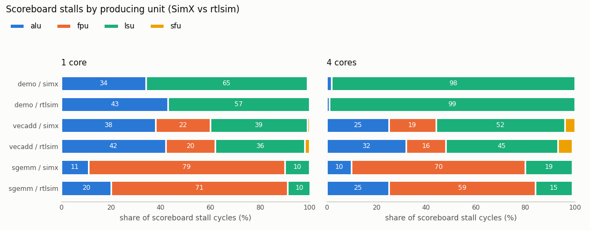

# Assignment 1: Scoreboard Stall Attribution

> Targets Vortex release [v3.0](https://github.com/vortexgpgpu/vortex/releases/tag/v3.0).

## Background

Every Vortex core counts how many cycles its issue stage spends blocked on the
scoreboard. Run any kernel with `--perf=1` and look at the `stalls:` line:

```
PERF: stalls: fetch=0%, ibuf=0%, scrb=36%, opds=3%, alu=0%, lsu=0%, sfu=0%, fpu=0%
```

`scrb=36%` says that in more than a third of all cycles the next instruction of
every ready warp was waiting for a register still owned by an earlier,
in-flight instruction. It does not say *what* it was waiting for. A load that
missed in the data cache, a 4-cycle `fmadd` chain and a slow `div` in the SFU
call for different fixes: more warps, a prefetch, a shorter FPU pipeline,
a different instruction schedule. In this assignment you add the missing answer.

**What you build.** Every scoreboard-stall cycle is charged to the functional
unit (ALU, FPU, LSU or SFU) that *produces* the register the stalled
instruction is waiting on. The rule, applied once per cycle per issue slice:

1. Among the warps of the slice that are blocked on the scoreboard this cycle,
   take the lowest-index one.
2. Of its operands, checked in the order `rd, rs1, rs2, rs3`, take the first
   one that is busy.
3. Charge the cycle to the unit of the instruction that owns that register.
   If no register is busy (e.g. only an `fcsr` field is), charge the ALU.

So the four per-unit counts always add up to the existing total
`VX_CSR_MPM_STALL_SCRB`; they *partition* it.

**Where the counters live.** Performance counters are machine performance
monitoring (MPM) CSRs, grouped in classes (`--perf=1` selects class 1 = CORE).
The host reads them over the DCR bus with a **5-bit index** from
`VX_CSR_MPM_BASE = 0xB00` (see the address math in
[`VX_dcr_data.sv`](https://github.com/vortexgpgpu/vortex/blob/v3.0/hw/rtl/core/VX_dcr_data.sv#L40)
and the range check in
[`vx_device_mpm_query()`](https://github.com/vortexgpgpu/vortex/blob/v3.0/sw/runtime/common/perf.cpp#L196)),
so a class has at most 32 counters: `0xB00`–`0xB1F` (low halves) and
`0xB80`–`0xB9F` (high halves). In the CORE class only **three** slots are
free: `0xB18` and `0xB19` (commented out as `reserved: VX_CSR_MPM_MEM_READS/WRITES`
in [`VX_types.toml`](https://github.com/vortexgpgpu/vortex/blob/v3.0/VX_types.toml#L656))
and `0xB1F`. Four units, three slots: you store FPU, LSU and SFU and derive
ALU as the remainder `STALL_SCRB - (fpu + lsu + sfu)`.

**Output format.** The runtime prints one new line after `stalls:`, per core
(only when there is more than one core) and in total. Percentages are of the
scoreboard total, not of cycles:

```
PERF: scoreboard stalls=291525 (alu=11%, fpu=79%, lsu=10%, sfu=0%)
```

## Setup

Clone the v3.0 release and build it out of tree. If you fetched the `v3.0`
tag before 2026-10-07, refresh it first with `git fetch --tags --force`.

```bash
git clone --branch v3.0 --recursive https://github.com/vortexgpgpu/vortex.git
cd vortex
mkdir build32 && cd build32
../configure --xlen=32 --tooldir=$HOME/tools
./ci/toolchain_install.sh --all     # prebuilt toolchain, first time only
make -s
```

All commands below run from `build32/`. After any edit to a `*.toml` file or a
Makefile, run `../configure` again (same arguments) and then `make -s`;
`configure` is what regenerates `build32/sw/VX_types.h` and
`build32/hw/VX_types.vh` from the toml.

Check the baseline before you change anything:

```bash
./ci/blackbox.sh --driver=simx --cores=1 --app=sgemm --perf=1
```

No handout patch is needed for this assignment.

## Part A: SimX

### How SimX already tracks the producer

Read these first; the SimX scoreboard already knows the answer, you only have
to consume it.

- [`sim/simx/scoreboard.cpp`](https://github.com/vortexgpgpu/vortex/blob/v3.0/sim/simx/scoreboard.cpp#L61):
  `in_use(trace)` is true when any destination or source register of `trace`
  (or an `fcsr` field) is reserved. `get_uses(trace)`
  ([L82](https://github.com/vortexgpgpu/vortex/blob/v3.0/sim/simx/scoreboard.cpp#L82))
  returns one `reg_use_t` per busy register, destination first, then
  `rs1..rs3`. Each entry carries the owner's `fu_type`
  ([`scoreboard.h`](https://github.com/vortexgpgpu/vortex/blob/v3.0/sim/simx/scoreboard.h#L27)).
- [`Core::issue()`](https://github.com/vortexgpgpu/vortex/blob/v3.0/sim/simx/core.cpp#L555)
  loops over issue slices (`iw`) and, inside, over the slice's warps (`w`, lowest
  index first). When `scoreboard_->in_use(uop_trace)` is true it already calls
  `get_uses()` for the debug trace and sets `any_scrb_blocked = true`
  ([L618](https://github.com/vortexgpgpu/vortex/blob/v3.0/sim/simx/core.cpp#L618)).
  At the end of the slice loop
  ([L723](https://github.com/vortexgpgpu/vortex/blob/v3.0/sim/simx/core.cpp#L723))
  it increments `perf_stats_.scrb_stalls` once.

### Step 1: Reserve the CSR addresses

In `VX_types.toml`, section `[csr_mpm_core]`, replace the four
`# reserved: VX_CSR_MPM_MEM_READS/WRITES` comment lines with your three counters:

```toml
# PERF: scoreboard stall attribution (producer unit of the blocking operand)
# The ALU share is not stored: it is STALL_SCRB minus the counters below.
VX_CSR_MPM_SCRB_FPU     = 0xB18 # scoreboard stalls waiting on an FPU result
VX_CSR_MPM_SCRB_FPU_H   = 0xB98
VX_CSR_MPM_SCRB_LSU     = 0xB19 # scoreboard stalls waiting on an LSU result
VX_CSR_MPM_SCRB_LSU_H   = 0xB99
VX_CSR_MPM_SCRB_SFU     = 0xB1F # scoreboard stalls waiting on an SFU result
VX_CSR_MPM_SCRB_SFU_H   = 0xB9F
```

Regenerate the headers and check them:

```bash
../configure --xlen=32 --tooldir=$HOME/tools
grep SCRB_ sw/VX_types.h hw/VX_types.vh
```

### Step 2: Add the counters to `Core::PerfStats`

In [`sim/simx/core.h`](https://github.com/vortexgpgpu/vortex/blob/v3.0/sim/simx/core.h#L50),
next to `scrb_stalls`:

```c++
    uint64_t scrb_stalls = 0;
    uint64_t scrb_fpu = 0;
    uint64_t scrb_lsu = 0;
    uint64_t scrb_sfu = 0;
```

### Step 3: Attribute the stall in `Core::issue()`

This is the core of the assignment. In `sim/simx/core.cpp`, inside the slice
loop `for (uint32_t iw = 0; ...)`:

1. Next to `bool any_scrb_blocked = false;` declare the unit the current cycle
   is charged to, defaulting to the ALU:

   ```c++
   FUType scrb_fu_type = FUType::ALU;
   ```

2. In the `if (scoreboard_->in_use(uop_trace))` branch, replace
   `any_scrb_blocked = true;` so that only the **first** blocked warp of the
   slice sets the unit, and it takes the `fu_type` of the first entry of
   `uses`. Guard against an empty `uses` vector: `in_use()` can be true when
   only an `fcsr` field is busy, and `get_uses()` then returns nothing.

3. Extend the `// track scoreboard stalls` block at the end of the slice loop so
   that, besides `++perf_stats_.scrb_stalls`, it increments `scrb_fpu`,
   `scrb_lsu` or `scrb_sfu` according to `scrb_fu_type`. ALU (and TCU, when the
   tensor core is enabled) increment nothing: they are the remainder.

### Step 4: Expose the CSRs

In [`CsrUnit::get_csr()`](https://github.com/vortexgpgpu/vortex/blob/v3.0/sim/simx/csr_unit.cpp#L136),
`case VX_DCR_MPM_CLASS_CORE`, after the `VX_CSR_MPM_STALL_SCRB` line:

```c++
        CSR_READ_64(VX_CSR_MPM_SCRB_FPU, core_perf.scrb_fpu);
        CSR_READ_64(VX_CSR_MPM_SCRB_LSU, core_perf.scrb_lsu);
        CSR_READ_64(VX_CSR_MPM_SCRB_SFU, core_perf.scrb_sfu);
```

### Step 5: Print the attribution in the runtime

All in [`sw/runtime/common/perf.cpp`](https://github.com/vortexgpgpu/vortex/blob/v3.0/sw/runtime/common/perf.cpp):

1. `struct CoreCounters` ([L124](https://github.com/vortexgpgpu/vortex/blob/v3.0/sw/runtime/common/perf.cpp#L124)):
   add `scrb_fpu`, `scrb_lsu`, `scrb_sfu` (all `uint64_t`, `= 0`) after `stall_scrb`.
2. After `print_metric_list()` add a printer. It computes the ALU remainder and
   prints through the existing helpers (`perf_print_core()` adds the `core<N>:`
   prefix, `perf_print()` does not):

   ```c++
   static void print_scrb_attribution(FILE *stream, int core_id, const CoreCounters &c) {
     const uint64_t claimed = c.scrb_fpu + c.scrb_lsu + c.scrb_sfu;
     const uint64_t scrb_alu = (c.stall_scrb > claimed) ? (c.stall_scrb - claimed) : 0;
     const char *fmt = "scoreboard stalls=%" PRIu64 " (alu=%d%%, fpu=%d%%, lsu=%d%%, sfu=%d%%)";
     // TODO: compute the four percentages of c.stall_scrb with calc_percent()
     //       and print with perf_print_core() if core_id >= 0, else perf_print().
   }
   ```

3. In `case VX_DCR_MPM_CLASS_CORE` of `vx_device_dump_perf()`, query the three
   counters right after `VX_CSR_MPM_STALL_SCRB`
   ([L313](https://github.com/vortexgpgpu/vortex/blob/v3.0/sw/runtime/common/perf.cpp#L313)):

   ```c++
   CHECK_ERR(vx_device_mpm_query(hdevice, mpm_class, VX_CSR_MPM_SCRB_FPU, core_id, &c.scrb_fpu), { return err; });
   ```

   (and the same for LSU and SFU).
4. Call `print_scrb_attribution(stream, core_id, c);` right after the per-core
   `print_metric_list(stream, "stalls", core_id, stall_metrics);`
   ([L365](https://github.com/vortexgpgpu/vortex/blob/v3.0/sw/runtime/common/perf.cpp#L365)).
5. Accumulate the totals next to `tot.stall_scrb += c.stall_scrb;`
   ([L402](https://github.com/vortexgpgpu/vortex/blob/v3.0/sw/runtime/common/perf.cpp#L402)),
   and call `print_scrb_attribution(stream, -1, tot);` after the global
   `print_metric_list(stream, "stalls", -1, global_stalls);`
   ([L450](https://github.com/vortexgpgpu/vortex/blob/v3.0/sw/runtime/common/perf.cpp#L450)).

### Step 6: Build and test

```bash
../configure --xlen=32 --tooldir=$HOME/tools
make -s
./ci/blackbox.sh --driver=simx --cores=1 --app=demo   --perf=1
./ci/blackbox.sh --driver=simx --cores=1 --app=vecadd --perf=1
./ci/blackbox.sh --driver=simx --cores=1 --app=sgemm  --perf=1
./ci/blackbox.sh --driver=simx --cores=4 --app=sgemm  --perf=1   # per-core lines + total
```

`--perf=1` adds `-DPERF_ENABLE`, and a new `--cores` value is a new
configuration, so the first run of each combination rebuilds the SimX driver
(a minute or two). Check that:

- every run prints `PASSED!`;
- the four percentages add up to 100 (±1 for rounding);
- `scoreboard stalls=` is the existing `STALL_SCRB` total: on 1 core it is
  about `scrb%` × `cycles` (the `scrb=` field of the `stalls:` line, at issue
  width 1);
- `demo` (integer) has no FPU share, `sgemm` is FPU-dominated.

## Part B: RTL extension

Part B implements the same counters, rule and output in the RTL. Steps 1
(toml), 4–5 (runtime) of Part A are shared: do not repeat them. Your SimX build
from Part A is the reference.

### What differs in hardware

SimX keeps a pointer to the producing instruction for every busy register. The
RTL scoreboard
([`hw/rtl/core/VX_scoreboard.sv`](https://github.com/vortexgpgpu/vortex/blob/v3.0/hw/rtl/core/VX_scoreboard.sv))
keeps **one bit per register** and nothing else:

| Signal | Line | Meaning |
|---|---|---|
| `g_scoreboard[w]` | [L100](https://github.com/vortexgpgpu/vortex/blob/v3.0/hw/rtl/core/VX_scoreboard.sv#L100) | one generate iteration per warp of the issue slice |
| `inuse_regs` | [L101](https://github.com/vortexgpgpu/vortex/blob/v3.0/hw/rtl/core/VX_scoreboard.sv#L101) | busy bit per architectural register (int + float) |
| `stg_opds`, `stg_opd_mask[i]` | [L111](https://github.com/vortexgpgpu/vortex/blob/v3.0/hw/rtl/core/VX_scoreboard.sv#L111), [L125](https://github.com/vortexgpgpu/vortex/blob/v3.0/hw/rtl/core/VX_scoreboard.sv#L125) | the staged instruction's `{rs3, rs2, rs1, rd}` and a one-hot register mask per operand |
| `inuse_regs_n \|= stg_opd_mask[0]` | [L149](https://github.com/vortexgpgpu/vortex/blob/v3.0/hw/rtl/core/VX_scoreboard.sv#L149) | reserve `rd` when the staged instruction fires with `wb` |
| `operands_ready[w]` | [L232](https://github.com/vortexgpgpu/vortex/blob/v3.0/hw/rtl/core/VX_scoreboard.sv#L232) | registered readiness; folds data hazards *and* FU-queue congestion |
| `perf_stall_per_cycle` | [L74](https://github.com/vortexgpgpu/vortex/blob/v3.0/hw/rtl/core/VX_scoreboard.sv#L74) | `\|(stg_valid_in & ~operands_ready)`, counted into `perf_stalls` |

So you need a new per-warp array that remembers, for each reserved register,
the `ex_type` of the instruction that reserved it (`EX_ALU`, `EX_LSU`, `EX_SFU`,
`EX_FPU` in
[`VX_gpu_pkg.sv`](https://github.com/vortexgpgpu/vortex/blob/v3.0/hw/rtl/VX_gpu_pkg.sv#L238)).

### Step B1: Per-unit counters in the perf struct

In `hw/rtl/VX_gpu_pkg.sv`, `issue_perf_t`
([L1309](https://github.com/vortexgpgpu/vortex/blob/v3.0/hw/rtl/VX_gpu_pkg.sv#L1309)),
next to `scb_stalls`:

```verilog
        logic [NUM_EX_UNITS-1:0][PERF_CTR_BITS-1:0] scb_stall_units;
```

### Step B2: Record the producer and charge the stall (`VX_scoreboard.sv`)

1. Add an output under the existing `ifdef PERF_ENABLE` in the port list:

   ```verilog
       output reg [NUM_EX_UNITS-1:0][PERF_CTR_BITS-1:0] perf_stall_units,
   ```

2. Inside `g_scoreboard`, after `assign operands_ready[w] = operands_ready_r;`,
   add a `PERF_ENABLE` block that

   - declares `reg [NUM_REGS-1:0][EX_BITS-1:0] inuse_units;` and writes
     `inuse_units[staging_if[w].data.rd] <= staging_if[w].data.ex_type` on the
     same condition that reserves `rd` (`staging_fire && staging_if[w].data.wb`).
     No reset is needed: an entry is only read while its register is busy, and
     it was written when the register was reserved;
   - computes, combinationally, the unit of the first busy operand in
     `rd, rs1, rs2, rs3` order. A loop that walks the operands from `NUM_OPDS-1`
     down to `0` and overwrites the result whenever
     `|(inuse_regs & stg_opd_mask[i])` is set ends with the lowest busy index.
     Default to `EX_ALU`;
   - exports it as `stall_units[w]` (a `wire [PER_ISSUE_WARPS-1:0][EX_BITS-1:0]`
     declared at slice level).

   Use `inuse_regs`, **not** `wb_inuse_regs`. `operands_ready_r` is one cycle
   behind, so in the writeback cycle the warp is still counted as stalled while
   `wb_inuse_regs` already shows the register free; with the released view the
   last stall cycle of every dependency would fall to the ALU.

3. At slice level, replace `perf_stall_per_cycle` by a mask
   `stg_valid_in & ~operands_ready` and its OR, select the lowest-index stalled
   warp with a
   [`VX_priority_encoder`](https://github.com/vortexgpgpu/vortex/blob/v3.0/hw/rtl/libs/VX_priority_encoder.sv)
   (`data_in` = the mask, use `index_out`), and add one counter per unit:

   ```verilog
   for (genvar e = 0; e < NUM_EX_UNITS; ++e) begin : g_perf_stall_units
       always @(posedge clk) begin
           if (reset) begin
               perf_stall_units[e] <= '0;
           end else begin
               perf_stall_units[e] <= perf_stall_units[e]
                   + PERF_CTR_BITS'(perf_stall_per_cycle && perf_stall_unit == EX_BITS'(e));
           end
       end
   end
   ```

### Step B3: Plumb the counters up

- [`VX_issue_slice.sv`](https://github.com/vortexgpgpu/vortex/blob/v3.0/hw/rtl/core/VX_issue_slice.sv#L61),
  scoreboard instance: connect `.perf_stall_units (issue_perf.scb_stall_units)`.
- [`VX_issue.sv`](https://github.com/vortexgpgpu/vortex/blob/v3.0/hw/rtl/core/VX_issue.sv#L40),
  inside the existing `g_issue_perf_units_uses` loop, sum across issue slices
  like the neighbouring counters:

  ```verilog
  `PERF_COUNTER_ADD (issue_perf, per_issue_perf, scb_stall_units[i], PERF_CTR_BITS, `VX_CFG_ISSUE_WIDTH, (`VX_CFG_ISSUE_WIDTH > 2))
  ```

- `VX_core.sv` needs nothing: `pipeline_perf.issue` is wired as a whole struct.

### Step B4: CSR read

In [`VX_csr_data.sv`](https://github.com/vortexgpgpu/vortex/blob/v3.0/hw/rtl/core/VX_csr_data.sv#L413),
`VX_DCR_MPM_CLASS_CORE` case, next to `STALL_SCRB`:

```verilog
`CSR_READ_64(`VX_CSR_MPM_SCRB_LSU, dcr_data_w, pipeline_perf.issue.scb_stall_units[EX_LSU]);
`CSR_READ_64(`VX_CSR_MPM_SCRB_SFU, dcr_data_w, pipeline_perf.issue.scb_stall_units[EX_SFU]);
```

Put the FPU read inside the existing `` `ifdef VX_CFG_EXT_F_ENABLE `` block next
to `STALL_FPU` ([L421](https://github.com/vortexgpgpu/vortex/blob/v3.0/hw/rtl/core/VX_csr_data.sv#L421)):
`EX_FPU` is defined as `EX_SFU + VX_CFG_EXT_F_ENABLED`, so without F it
aliases the SFU.

### Step B5: Build and cross-check

Run the four commands of Part A Step 6 with `--driver=rtlsim`. Build cost: every
distinct configuration (`--perf=1`, each `--cores` value) is a full Verilator
build, 10–15 min on an idle 4-core machine and longer on a shared one. You can
build ahead while you read:

```bash
CONFIGS="-DVX_CFG_NUM_CORES=4 -DPERF_ENABLE" make -C tests/regression/demo runtime-rtlsim
```

Cross-check against Part A:

- `instrs=` must match SimX **exactly** for every app and core count;
- the top unit must agree: LSU for `demo`, FPU for `sgemm` (in `vecadd` the
  ALU and LSU shares are within a few points of each other and may swap);
- totals agree within ~15% on 1 core; the RTL ALU share is 4–15 points higher
  in every run except 4-core `demo`, where both are 1–2% (see Question 5).

## Expected results

Default app sizes, default v3.0 configuration (4 warps × 4 threads, issue
width 1, no L2), `--perf=1`. All runs pass. `stalls` is the
`scoreboard stalls=` total (summed over cores), `cycles` and `instrs` are the
`PERF: instrs=..., cycles=...` line, and `scrb%` is the existing
`stalls: scrb=` field (scoreboard stall cycles as a share of all cycles).
Default sizes: `demo -n64` processes 64 ints per hardware thread, so its
problem grows with the core count (4 cores do 4× the 1-core work:
9,776 = 4 × 2,444 instructions); `vecadd -n64` (64 floats) and `sgemm`
(64×64) are fixed-size, so their instruction counts barely change.

| app | cores | SimX stalls | SimX alu/fpu/lsu/sfu % | rtlsim stalls | rtlsim alu/fpu/lsu/sfu % | SimX / rtlsim cycles | instrs (both) |
|---|---:|---:|---|---:|---|---|---:|
| demo   | 1 | 2,158   | 34 / 0 / 65 / 0  | 1,833   | 43 / 0 / 57 / 0  | 6,529 / 6,511     | 2,444   |
| vecadd | 1 | 422     | 38 / 22 / 39 / 1 | 463     | 42 / 20 / 36 / 2 | 1,270 / 1,216     | 400     |
| sgemm  | 1 | 291,525 | 11 / 79 / 10 / 0 | 297,573 | 20 / 71 / 10 / 0 | 802,800 / 797,014 | 336,912 |
| demo   | 4 | 105,531 | 2 / 0 / 98 / 0   | 193,966 | 1 / 0 / 99 / 0   | 31,878 / 49,048   | 9,776   |
| vecadd | 4 | 496     | 25 / 19 / 52 / 4 | 568     | 32 / 16 / 45 / 6 | 498 / 448         | 448     |
| sgemm  | 4 | 331,651 | 10 / 70 / 19 / 0 | 368,374 | 25 / 59 / 15 / 0 | 206,224 / 204,728 | 336,960 |

`scrb%` (SimX / rtlsim): demo 33 / 28, vecadd 33 / 38, sgemm 36 / 37 on 1 core;
demo 83 / 99, vecadd 25 / 33, sgemm 40 / 45 on 4 cores. On 4 cores the
per-core lines of `demo` and `sgemm` are within 1–2 points of the totals
(`vecadd`, with only 113–150 stalls per core, varies by up to 4 points),
e.g. SimX `sgemm`:

```
PERF: core0: scoreboard stalls=86483 (alu=11%, fpu=70%, lsu=19%, sfu=0%)
PERF: core1: scoreboard stalls=81013 (alu=10%, fpu=70%, lsu=20%, sfu=0%)
...
PERF: scoreboard stalls=331651 (alu=10%, fpu=70%, lsu=19%, sfu=0%)
```



The table is also in [`expected/a1/scoreboard_attribution.csv`](expected/a1/scoreboard_attribution.csv).
The 4-core `demo` cycle gap (31,878 vs 49,048) is a memory-system difference
between the two v3.0 models that exists without your change; the attribution
(98–99% LSU) is the same on both.

Reproduce (from `build32/`):

```bash
for app in demo vecadd sgemm; do
  for c in 1 4; do
    ./ci/blackbox.sh --driver=simx   --cores=$c --app=$app --perf=1 | tee simx_${app}_c$c.log
    ./ci/blackbox.sh --driver=rtlsim --cores=$c --app=$app --perf=1 | tee rtlsim_${app}_c$c.log
  done
done
grep -H "scoreboard stalls\|PERF: instrs" *_c?.log
```

## Questions

1. `demo` (`TYPE=int`, a loop over 64 elements per thread) and `vecadd`
   (`TYPE=float`, one element per thread, no loop) both compute
   `dst = src0 + src1` as load, load, add, store. Explain the ALU share of
   `demo` and the FPU share that appears in `vecadd` from that instruction
   sequence: which instruction waits on which producer?
2. `sgemm` is FPU-dominated on one core, but its LSU share nearly doubles on
   four cores (10% → 19% in SimX). What changed in the memory system? The FPU
   share drops from 79% to 70% although the total FPU work is unchanged
   (same `instrs`): compute the FPU-attributed stall cycles in both runs
   (share × total) and explain what actually grew.
3. On four cores `demo` spends 83–99% of its cycles stalled, nearly all on the
   LSU. Would adding warps help? Would a data-cache prefetch (Assignment 2)
   help? Argue from the numbers.
4. Why do SimX and rtlsim cycles differ (e.g. sgemm 802,800 vs 797,014) when
   the instruction counts are identical?
5. The RTL ALU share is higher than SimX in every run except 4-core `demo`
   (where both are 1–2%), e.g. sgemm 20% vs 11% on 1 core.
   Look at how `operands_ready` is computed in `VX_scoreboard.sv` and at the
   `fu_full_seen_` path in SimX `Core::issue()`: which stall cycles does the RTL
   count that SimX does not, and where does your rule put them?
6. You charge a cycle to the lowest-index stalled warp only. Propose a rule that
   is fairer to other warps. What would it cost in counters, and why does the
   5-bit MPM index make that hard?
7. With `VX_CFG_EXT_TCU_ENABLE`, where do stalls waiting on the tensor core land
   in your output? What would you need to report them separately?
