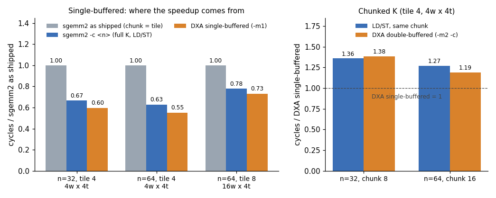

# Assignment 10: Async Tile Staging with DXA and Async Barriers

> Targets Vortex release [v3.0](https://github.com/vortexgpgpu/vortex/releases/tag/v3.0).

## Background

A tiled matrix multiply spends a large share of its instructions *moving*
data: every thread computes addresses, loads a few elements of A and B from
global memory and stores them into local (shared) memory, then the whole
thread block synchronizes before anyone may read the tiles. Hopper-class GPUs
take this work off the threads with a copy engine (NVIDIA's Tensor Memory
Accelerator): one thread describes a whole 2-D tile, the engine copies it
asynchronously, and a *transaction barrier* tells the block when the bytes
have landed.

Vortex v3.0 has the same mechanism, the **DXA** unit
([design notes](https://github.com/vortexgpgpu/vortex/blob/v3.0/docs/designs/dxa_async_copy_multicast.md)).
It is an ISA extension, enabled with `CONFIGS="-DVX_CFG_EXT_DXA_ENABLE"`
([`VX_config.toml` L39](https://github.com/vortexgpgpu/vortex/blob/v3.0/VX_config.toml#L39)).
Three pieces work together:

1. **Descriptor (host).** The host programs up to 16 descriptor slots over the
   DCR bus. A 2-D descriptor holds a base address, the matrix extent
   `size0 × size1` in elements, the byte stride of dimension 1, the element
   size and the **box** `tile0 × tile1` that one copy moves:
   [`vortex::dxa::program_2d()`](https://github.com/vortexgpgpu/vortex/blob/v3.0/sw/runtime/include/dxa.h#L128).
   Dimension 0 is the contiguous one. The box lands in local memory densely
   packed, row-major: `tile1` rows of `tile0` elements.
2. **Copy (kernel).**
   [`vx_dxa_issue_2d_wg(desc_slot, barrier_id, smem_addr, coord0, coord1)`](https://github.com/vortexgpgpu/vortex/blob/v3.0/sw/kernel/include/vx_dxa.h#L85)
   starts copying the box whose top-left element is at `(coord0, coord1)`
   (element coordinates, dimension 0 first) to `smem_addr`, and returns
   immediately. It is a warp instruction: it packs its operands across the
   first four lanes of the warp, so the whole warp executes it, once.
   When the last byte is written, the DXA signals one *transaction* on
   `barrier_id`.
3. **Async barrier (kernel).**
   [`vortex::barrier`](https://github.com/vortexgpgpu/vortex/blob/v3.0/sw/kernel/include/vx_barrier.h#L21)
   `bar(i)` names barrier `i` of the calling thread block; `bar.id()` is the
   value the DXA wants. `bar.expect_tx(n)`
   ([L50](https://github.com/vortexgpgpu/vortex/blob/v3.0/sw/kernel/include/vx_barrier.h#L50))
   tells the barrier to also wait for `n` transactions; it must be called
   before the copies are issued. `bar.arrive_and_wait()`
   ([L42](https://github.com/vortexgpgpu/vortex/blob/v3.0/sw/kernel/include/vx_barrier.h#L42))
   returns once every warp of the block has arrived **and** all expected
   transactions have completed.

**What you build.** The LD/ST-tiled `sgemm2` kernel
([`tests/regression/sgemm2/kernel.cpp`](https://github.com/vortexgpgpu/vortex/blob/v3.0/tests/regression/sgemm2/kernel.cpp#L29))
converted to DXA copies: first single-buffered (the whole K extent staged in
one shot), then, as a stretch, double-buffered (stage K chunk `i+1` while
computing on chunk `i`).

**A reference solution ships with v3.0**:
[`tests/regression/sgemm2_dxa`](https://github.com/vortexgpgpu/vortex/blob/v3.0/tests/regression/sgemm2_dxa/kernel.cpp).
Do not open its `kernel.cpp` until you have a passing kernel of your own; then
use it to compare designs and numbers. The handout test you work in uses the
same host program and argument layout, so its numbers are directly comparable.

## Setup

Clone the v3.0 release and build it out of tree. If you fetched the `v3.0`
tag before 2026-10-07, refresh it first with `git fetch --tags --force`.

```bash
git clone --branch v3.0 --recursive https://github.com/vortexgpgpu/vortex.git
cd vortex
git apply <path-to-this-repo>/Exercises/patches/a10_sgemm2_async.patch
mkdir build32 && cd build32
../configure --xlen=32 --tooldir=$HOME/tools
./ci/toolchain_install.sh --all     # prebuilt toolchain, first time only
make -s
```

The patch [`a10_sgemm2_async.patch`](patches/a10_sgemm2_async.patch) adds
`tests/regression/sgemm2_async/`:

| File | Content |
|---|---|
| `main.cpp` | host, ready for DXA: checks the ISA flag, sizes `chunk_k` and local memory, programs descriptor 0 (A) and 1 (B), launches, verifies. Option `-m1` single-buffered (`chunk_k` = n, full K), `-m2` double-buffered (`-c` sets `chunk_k`; without `-c` the host picks the largest chunk that fits, which at these sizes is full K) |
| `common.h` | `kernel_arg_t`: `size`, `tile_size`, `chunk_k`, `mode`, buffer addresses |
| `kernel.cpp` | **your starting point**: the `sgemm2` LD/ST kernel, unchanged. It already works with this host |
| `Makefile` | adds `-DVX_CFG_EXT_DXA_ENABLE` to `CONFIGS` if missing |

All commands below run from `build32/`. Export the DXA flag once, so that
`sgemm2`, `sgemm2_async` and `sgemm2_dxa` share one SimX driver build (a
different `CONFIGS` string means a driver rebuild, one to two minutes):

```bash
export CONFIGS="-DVX_CFG_EXT_DXA_ENABLE"
```

## Part A: SimX

### Step 1: Baselines

Run the shipped LD/ST kernel at its default chunk (`chunk_k` = tile size, so
one barrier pair per 4 values of k), the same kernel staging the full K extent
at once (`-c32`), and your starting point:

```bash
./ci/blackbox.sh --driver=simx --cores=1 --warps=4 --threads=4 --app=sgemm2 --args="-n32 -t4" --perf=1
./ci/blackbox.sh --driver=simx --cores=1 --warps=4 --threads=4 --app=sgemm2 --args="-n32 -t4 -c32" --perf=1
./ci/blackbox.sh --driver=simx --cores=1 --warps=4 --threads=4 --app=sgemm2_async --args="-n32 -t4 -m1" --perf=1
```

```
PERF: instrs=162576, cycles=461550, IPC=0.352
PERF: instrs=115984, cycles=308079, IPC=0.376
PERF: instrs=115984, cycles=308079, IPC=0.376
```

All three pass. The second and third lines are the same kernel with the same
`chunk_k`: this is the **fair baseline** for DXA. Staging all of K at once
already removed a third of the cycles, with no new hardware. Keep both
baselines; Expected results reports DXA against each.

The default shape is 4 warps × 4 threads = 16 hardware threads per core, and
a `-t4` block is 4 × 4 = 16 threads, one block per core at a time.

### Step 2: Read the host side

Open `tests/regression/sgemm2_async/main.cpp` and find the two
`vortex::dxa::program_2d()` calls. Work out, on paper, for block
`(blockIdx.x, blockIdx.y)` with `row_base = blockIdx.x * tile_size` and
`col_base = blockIdx.y * tile_size`:

- **A** (slot 0): dimension 0 = k (columns of A), dimension 1 = rows; box =
  `chunk_k × tile_size`. Which `(coord0, coord1)` copies rows
  `row_base … row_base + tile_size − 1`, columns `k … k + chunk_k − 1`? In what
  layout does it land: is it the `local_A[l_row * chunk_k + kk]` layout the
  kernel reads?
- **B** (slot 1): dimension 0 = columns, dimension 1 = k; box =
  `tile_size × chunk_k`. Same two questions for `local_B[kk * tile_size + l_col]`.

### Step 3: Single-buffered DXA kernel (`-m1`)

Edit `tests/regression/sgemm2_async/kernel.cpp`. With `-m1` the host sets
`chunk_k = size`, so the K loop runs once. Replace the two cooperative load
loops and the first `__syncthreads()`:

1. Include `<vx_dxa.h>` and `<vx_barrier.h>`.
2. Compute the block's `row_base` and `col_base` (above) from `blockIdx` and
   `tile_size`, not from the thread's own global row and column.
3. Create one block barrier, `vortex::barrier bar(0);`.
4. Exactly **one warp** of the block, the one with `get_sub_group_id() == 0`
   ([`vx_spawn.h` L50](https://github.com/vortexgpgpu/vortex/blob/v3.0/sw/kernel/include/vx_spawn.h#L50)),
   declares two pending transactions with `expect_tx`, then issues the A copy
   and the B copy, both signalling `bar.id()`. All threads of that warp execute
   these calls (they are warp instructions); no other warp does.
5. Every warp calls `bar.arrive_and_wait()`, then runs the unchanged
   multiply-accumulate loop over local memory.
6. Keep a second block-wide synchronization (on `bar`) after the compute loop,
   before the store. Question 3 asks why.

Then run:

```bash
make -s
./ci/blackbox.sh --driver=simx --cores=1 --warps=4 --threads=4 --app=sgemm2_async --args="-n32 -t4 -m1" --perf=1
```

You should see `PASSED!` and about 20% fewer instructions than the fair
baseline (Expected results). Common failures:

- **hangs** (the barrier never completes): the `expect_tx` count does not
  match the number of copies, or a warp waits on a barrier that the issuing
  warp never reaches;
- **wrong values in some tiles**: `(coord0, coord1)` swapped, or `col_base`
  computed from `threadIdx`;
- **4× too many transactions**: every warp issued the copies (check with
  `--perf=16`, the DXA counter class: `transfers` must be 2 per block, 128 for
  `-n32 -t4`).

```bash
./ci/blackbox.sh --driver=simx --cores=1 --warps=4 --threads=4 --app=sgemm2_async --args="-n32 -t4 -m1" --perf=16
```

```
PERF: dxa: transfers=128, gmem_reads=2560, gmem_dedup=0 (rate=0%), lmem_writes=2560, avg_gmem_lat=175.7, noslot_stalls=11143
```

Now compare with the reference: run `sgemm2_dxa` with the same arguments.
Its host prints the `PERF:` summary twice (it also calls
`vx_device_dump_perf()` itself); the numbers are the same. If your
instruction count differs, open its `kernel.cpp` and find out why.

### Step 4: Bigger matrix, bigger tile

```bash
./ci/blackbox.sh --driver=simx --cores=1 --warps=4 --threads=4 --app=sgemm2_async --args="-n64 -t4 -m1" --perf=1
./ci/blackbox.sh --driver=simx --cores=1 --warps=4 --threads=4 --app=sgemm2_async --args="-n64 -t8 -m1" --perf=1
```

The second command fails before launching:

```
Error: block needs 16 warps but core has 4; reduce tile_size or increase warps/threads
```

A `-t8` block is 8 × 8 = 64 threads and all of them must be resident on one
core at once (they share local memory and barriers). Give the core 64
hardware threads, 16 warps × 4 threads, and run the three variants again
(new shape: one driver rebuild):

```bash
for spec in "sgemm2|-n64 -t8" "sgemm2|-n64 -t8 -c64" "sgemm2_async|-n64 -t8 -m1"; do
  app=${spec%%|*}; args=${spec#*|}
  ./ci/blackbox.sh --driver=simx --cores=1 --warps=16 --threads=4 --app=$app --args="$args" --perf=1 \
    | grep -E "^PERF: instrs|PASSED|FAILED"
done
```

### Step 5 (stretch): Double buffering (`-m2`)

With `-m2` the host allocates **two** stages in local memory, each
`(tile_size × chunk_k) + (chunk_k × tile_size)` elements, A first, and honours
`-c`. Extend your kernel with a `mode == 2` path:

- two barriers, one per stage (`vortex::barrier(0)`, `vortex::barrier(1)`);
- prologue: the issuing warp stages chunk 0 into stage 0;
- loop over chunks: issue chunk `i+1` into the *other* stage (if there is
  one), wait on the current stage's barrier, compute, synchronize on the
  current stage's barrier again (so the stage may be overwritten two
  iterations later), swap stages.

Run it at a chunk small enough that there is something to overlap, and compare
with the LD/ST kernel at the same chunk and with your single-buffered kernel:

```bash
./ci/blackbox.sh --driver=simx --cores=1 --warps=4 --threads=4 --app=sgemm2_async --args="-n32 -t4 -m2 -c8" --perf=1
./ci/blackbox.sh --driver=simx --cores=1 --warps=4 --threads=4 --app=sgemm2 --args="-n32 -t4 -c8" --perf=1
./ci/blackbox.sh --driver=simx --cores=1 --warps=4 --threads=4 --app=sgemm2_async --args="-n64 -t4 -m2 -c16" --perf=1
./ci/blackbox.sh --driver=simx --cores=1 --warps=4 --threads=4 --app=sgemm2 --args="-n64 -t4 -c16" --perf=1
```

Double buffering does not beat full-K single buffering at these sizes
(Expected results). Question 5 asks you to explain when it would.

## Expected results

SimX, 1 core, `CONFIGS="-DVX_CFG_EXT_DXA_ENABLE"`, `--perf=1`, default v3.0
configuration otherwise. All runs pass. "DXA single" is the reference kernel
`sgemm2_dxa -m1`. The reference `kernel.cpp` copied into `sgemm2_async` gives
exactly these numbers (the hosts are the same); a kernel of your own may differ
by a few instructions per block, depending on how it computes indices and
pointers. The DXA counters (`--perf=16`) must match exactly: `transfers` is
2 per block per K chunk, and `gmem_reads` counts the 64-byte lines that the A
and B boxes touch (128 / 2,560 for `-n32 -t4 -m1`; 512 / 20,480 for
`-n64 -t4 -m1`; 128 / 6,144 for `-n64 -t8 -m1`).

**Single-buffered.** Δ shipped = DXA vs `sgemm2` as shipped; Δ fair = DXA vs
`sgemm2 -c <n>` (same full-K staging, LD/ST).

| shape | args | `sgemm2` as shipped<br>instrs / cycles | `sgemm2 -c <n>` (fair)<br>instrs / cycles | DXA single (`-m1`)<br>instrs / cycles | Δ shipped<br>instrs / cycles | Δ fair<br>instrs / cycles |
|---|---|---|---|---|---|---|
| 4w × 4t  | `-n32 -t4` | 162,576 / 461,550     | 115,984 / 308,079   | 92,432 / 275,272    | −43.1% / −40.4% | −20.3% / −10.6% |
| 4w × 4t  | `-n64 -t4` | 1,223,696 / 3,525,390 | 824,336 / 2,215,348 | 664,592 / 1,944,279 | −45.7% / −44.8% | −19.4% / −12.2% |
| 16w × 4t | `-n64 -t8` | 879,680 / 1,760,429   | 693,312 / 1,369,929 | 662,336 / 1,286,912 | −24.7% / −26.9% | −4.5% / −6.1% |

**Double-buffered (stretch).** Same shape (4w × 4t, tile 4).

| args | LD/ST, same chunk<br>instrs / cycles | DXA `-m2`<br>instrs / cycles | DXA `-m1` cycles |
|---|---|---|---:|
| `-n32 -c8`  | 135,952 / 374,075   | 127,568 / 380,903   | 275,272 |
| `-n64 -c16` | 904,208 / 2,470,316 | 805,136 / 2,317,023 | 1,944,279 |
| `-n32` (no `-c`: full K, one chunk)  | — | 101,648 / 281,692 | 275,272 |
| `-n64` (no `-c`: full K, one chunk)  | — | 701,456 / 1,962,417 | 1,944,279 |
| `-n64 -t8`, 16w × 4t (no `-c`: full K, one chunk) | — | 699,200 / 1,324,628 | 1,286,912 |



Left: single-buffered, normalized to `sgemm2` as shipped; most of the gain
comes from staging all of K at once, DXA adds 6–12% on top. Right:
double-buffered at a small chunk, normalized to DXA single-buffered. Raw
numbers: [`expected/a10/dxa_results.csv`](expected/a10/dxa_results.csv).

Reproduce: the commands of Steps 1, 3, 4 and 5 (replace `sgemm2_async` by
`sgemm2_dxa` for the reference column). Each SimX run takes a few seconds;
the first run of each shape rebuilds the driver.

## Questions

1. **Where does the speedup come from?** Against the shipped `sgemm2`, DXA
   saves 43% of the instructions and 40% of the cycles at `-n32 -t4`. Split
   that into the part that comes from the staging schedule (shipped →
   `-c <n>`) and the part that comes from the copy engine (`-c <n>` → DXA).
   Which instructions disappear in each step? Use the `PERF: inst_mix` line of
   `--perf=1`, and the kernel disassembly
   (`make -C tests/regression/sgemm2_async kernel.dump`).
2. **Why one warp?** What would happen if every warp of the block called
   `expect_tx(2)` and issued both copies? Predict the `transfers` counter and
   the result, then try it.
3. **Why the second barrier** after the compute loop in single-buffered mode?
   Think about which warps of the *next* block on this core can start while
   slow warps of this block still read the tiles, and where the next block's
   tiles land.
4. **Wasted bandwidth.** For `-n32 -t4` the DXA made 128 transfers and
   2,560 global reads of 64-byte lines. Count the useful bytes of one A box
   (4 rows × 32 floats) and one B box (32 rows × 4 floats). What fraction of
   each line fetched for B is used, and how would you change the tiling (or
   the descriptor) to fix it?
5. **When does double buffering pay?** Local memory is 16 KB per core here
   and full-K staging needs `2 × tile × n × 4` bytes per block. Up to which `n`
   does full K fit at tile 4, and at tile 8? Why is `-m2 -c8` slower than `-m1`
   even though it overlaps copy and compute, and what would have to change
   (matrix size, memory latency, compute per chunk) for it to win?
6. **Fewer cycles, but how much less work?** At tile 8 on 16 warps, DXA gains
   only 6% over the fair baseline, against 11–12% at tile 4. What changed in
   the ratio between copy work and compute work per block?
