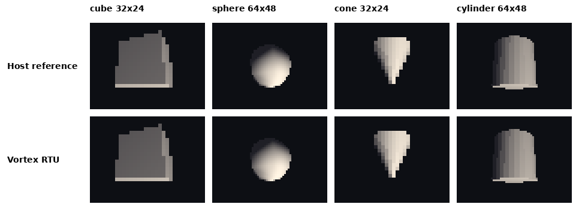
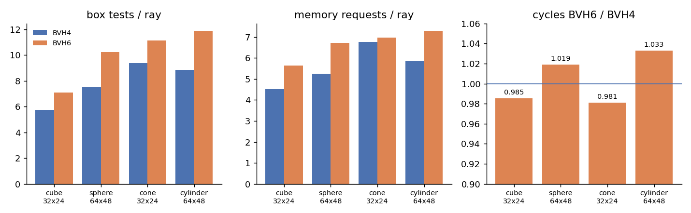
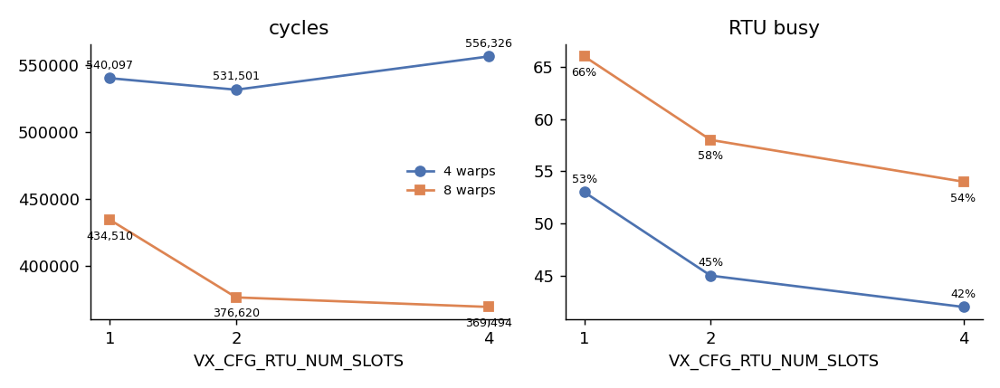

# Assignment 11: Ray-Tracing Unit Performance Analysis

> Targets Vortex `master` at commit [`50cb17454`](https://github.com/vortexgpgpu/vortex/commit/50cb17454),
> the first version with the RTU performance counters.

## Background

Vortex has a hardware **Ray-Tracing Unit (RTU)** shared by the cores of a socket. A warp
hands it a batch of rays with one trace instruction (`vx_rt_wtrace`); the RTU walks a **bounding
volume hierarchy (BVH)** for each ray, intersecting it with boxes (internal nodes) and triangles
(leaves), and returns one hit or miss record per ray. Its design is described in
[`docs/designs/ray_tracing_architecture.md`](https://github.com/vortexgpgpu/vortex/blob/50cb17454/docs/designs/ray_tracing_architecture.md);
its §8.1 defines the performance counters.

Two design parameters shape its performance:

- **BVH width** (`VX_CFG_RTU_BVH_WIDTH`, 4 by default). A node of a *W*-wide BVH has up to *W*
  children. Wider nodes make a shallower tree (fewer nodes per ray) but cost *W* box tests per
  visited node and bigger nodes to fetch (a BVH6 node spans two cache lines).
- **Slots** (`VX_CFG_RTU_NUM_SLOTS`, one per core by default). A slot holds one in-flight trace
  instruction: its rays, their walk state and their results. More slots let the RTU overlap more
  traces, if there are warps to issue them.

In this assignment you measure both with the RTU's performance counters and explain the results.
There is no hardware to write: the questions are the assignment.

## Setup

The RTU counters (`--perf=15`) are on `master` from commit `50cb17454`. Check it out
and build it out of tree, then apply the test app from the Vortex root:

```bash
git clone --recursive https://github.com/vortexgpgpu/vortex.git && cd vortex
git checkout 50cb17454 && git submodule update --init --recursive
git apply $TUTORIAL/Exercises/patches/a11_rt_raycast_sweep.patch
mkdir build32 && cd build32
../configure --xlen=32 --tooldir=$HOME/tools
make -s
```

`$TUTORIAL` is your checkout of this tutorial repository. The toolchain is the same
as for v3.0 (`TOOLCHAIN_REV=v3.0.1`); if you have not installed it yet, run
`./ci/toolchain_install.sh --all` from `build32/` before `make -s`. All commands below
run from `build32/`.

`tests/raytracing/rt_raycast_sweep` renders a mesh with one primary ray per pixel and checks the
image against a host-side ray tracer, pixel by pixel. It builds the BVH with the runtime's
library builder for whatever `VX_CFG_RTU_BVH_WIDTH` it is compiled with, so the **app and the
simulator must be built with the same `CONFIGS`**:

```bash
export ASSETS=$(realpath ../tests/regression/raycast/assets)   # cube, sphere, cone, cylinder .obj
CFG="-DVX_CFG_EXT_RTU_ENABLE -DVX_CFG_RTU_BVH_WIDTH=4"
make -C tests/raytracing/rt_raycast_sweep clean
CONFIGS="$CFG" make -C tests/raytracing/rt_raycast_sweep
CONFIGS="$CFG" ./ci/blackbox.sh --driver=simx --app=rt_raycast_sweep --perf=15 \
    --args="-m $ASSETS/sphere.obj -w 64 -h 48"
```

The first run of each new configuration rebuilds the SimX driver (1–3 minutes); later runs take
seconds. Run one simulation at a time per build directory.

## Reading the counters

```
PERF: rtu: rays=3072, hits=428 (rate=14%), box_tests=23210 (7.6/ray), tri_tests=1880 (0.6/ray),
      callbacks=0, busy=288818 (util=53%); rtcache: reqs=16155 (5.3/ray), miss=105 (hit=99%)
PERF: instrs=143965, cycles=540097, IPC=0.267
```

| Counter | Meaning |
|---|---|
| `rays` | rays traced: the active lanes of the trace instructions |
| `hits` | rays whose final result is a hit (misses = `rays` − `hits`) |
| `box_tests` | ray/box intersection tests (BVH node children) |
| `tri_tests` | ray/triangle intersection tests |
| `callbacks` | any-hit and intersection candidates returned to the shader; 0 here, the meshes are opaque |
| `busy` | cycles with at least one ray in the RTU (% of total cycles) |
| `rtcache` | memory requests of the RTU (its private cache) and their misses |

These are the quantities any BVH ray-tracing unit has, whatever its internal design:
work (`rays`, `box_tests`, `tri_tests`), outcome (`hits`), programmability cost
(`callbacks`), utilization (`busy`) and memory demand (`rtcache`). Per-ray ratios
compare scenes and configurations of different sizes.

## Part A: Analysis (SimX)

### Step 1: Render the four meshes

Run the cube (32×24), sphere (64×48), cone (32×24) and cylinder (64×48) with BVH width 4,
using the Setup commands with `--args="-m $ASSETS/<mesh>.obj -w <width> -h <height>"`. Each
run must print `PASSED!` (every pixel matches the host reference). The image is written to
`tests/raytracing/rt_raycast_sweep/output.ppm`.



### Step 2: BVH width

Rebuild app and simulator with `-DVX_CFG_RTU_BVH_WIDTH=6` and repeat Step 1. For each mesh and
width record: hit %, box tests/ray, triangle tests/ray, memory requests/ray, rtcache hit %,
busy and cycles. Compare with the table below and answer Questions 1–3.

### Step 3: Slots and warps

With width 4 and the sphere at 64×48, vary the number of slots and the number of warps per core:

```bash
for W in 4 8; do for S in 1 2 4; do
  C="-DVX_CFG_EXT_RTU_ENABLE -DVX_CFG_RTU_BVH_WIDTH=4 -DVX_CFG_NUM_WARPS=$W -DVX_CFG_RTU_NUM_SLOTS=$S"
  make -C tests/raytracing/rt_raycast_sweep clean
  CONFIGS="$C" make -C tests/raytracing/rt_raycast_sweep
  CONFIGS="$C" ./ci/blackbox.sh --driver=simx --app=rt_raycast_sweep --warps=$W --perf=15 \
      --args="-m $ASSETS/sphere.obj -w 64 -h 48" > rt_w${W}_s${S}.log 2>&1
done; done
```

Plot cycles and `busy` against slots for both warp counts, and answer Questions 4–6.
`$TUTORIAL/Exercises/tools/plot_perf.py` plots the cycles from the logs.

## Expected results

SimX, 1 core × 4 warps × 4 threads unless stated; every run `PASSED!` (bit-exact image).

**BVH width** (counters per ray):

| Mesh (triangles) | W | Res. | Hit % | Box tests | Tri tests | Mem requests | rtcache hit | RTU busy | Cycles | Instrs |
|---|---|---|---|---|---|---|---|---|---:|---:|
| cube (12) | 4 | 32×24 | 27 | 5.76 | 0.55 | 4.51 | 99 % | 43 % | 145,437 | 39,200 |
| cube (12) | 6 | 32×24 | 27 | 7.11 | 0.55 | 5.64 | 99 % | 42 % | 143,280 | 39,200 |
| sphere (60) | 4 | 64×48 | 14 | 7.56 | 0.61 | 5.26 | 99 % | 53 % | 540,097 | 143,965 |
| sphere (60) | 6 | 64×48 | 14 | 10.24 | 0.59 | 6.71 | 99 % | 55 % | 550,246 | 143,965 |
| cone (33) | 4 | 32×24 | 11 | 9.37 | 1.72 | 6.78 | 98 % | 65 % | 181,440 | 36,303 |
| cone (33) | 6 | 32×24 | 11 | 11.13 | 1.77 | 6.98 | 98 % | 63 % | 177,997 | 36,303 |
| cylinder (34) | 4 | 64×48 | 21 | 8.85 | 0.61 | 5.85 | 96 % | 54 % | 578,169 | 148,601 |
| cylinder (34) | 6 | 64×48 | 21 | 11.86 | 0.72 | 7.28 | 99 % | 57 % | 597,158 | 148,601 |



**Slots × warps** (sphere, 64×48, width 4; `rays`, `hits`, `box_tests` and `tri_tests`
are identical across these runs):

| Warps | Slots | Cycles | vs 1 slot | RTU busy | |
|---|---|---:|---:|---:|---:|
| 4 | 1 (default) | 540,097 | — | 288,818 | 53 % |
| 4 | 2 | 531,501 | −1.6 % | 238,215 | 45 % |
| 4 | 4 | 556,326 | +3.0 % | 231,513 | 42 % |
| 8 | 1 (default) | 434,510 | — | 288,782 | 66 % |
| 8 | 2 | 376,620 | −13.3 % | 218,507 | 58 % |
| 8 | 4 | 369,494 | −15.0 % | 200,028 | 54 % |



## Questions

1. BVH6 does 19–36 % more box tests and up to 28 % more memory requests per ray than
   BVH4, and cycles stay within −2 %…+3.3 %. Why does the wider tree not pay off for
   these meshes? (How deep is a BVH4 over 12–60 triangles?) What kind of scene would
   favour BVH6?
2. `tri_tests` stays below 2 per ray for every mesh. What does that say about how well
   the BVH culls triangles, and why is the cone the worst case?
3. The rtcache hit rate is 96–99 %. Is the RTU limited by memory bandwidth? The RTU is
   busy only 42–65 % of the cycles: where does the rest of the time go?
4. With 4 warps, more slots do not help (−1.6 %, then +3.0 %), but with 8 warps two
   slots save 13 %. Explain both results from how many traces the warps can have in
   flight at once.
5. The box and triangle tests are identical in every slot and warp configuration. What
   do extra slots actually change, and why can `busy` *fall* while the run gets faster?
6. With 1 slot, 8 warps take 19.5 % fewer cycles than 4 warps (434,510 vs 540,097), with
   identical RTU work and the same `busy` (288,782 vs 288,818 cycles). Where does that gain come from?
7. `tests/raytracing/rt_raycast` builds its own CW-BVH4 on the host; on the cube it does
   7.29 box tests per ray, against 5.76 with the library builder used by
   `rt_raycast_sweep`. What makes one tree better than the other?
