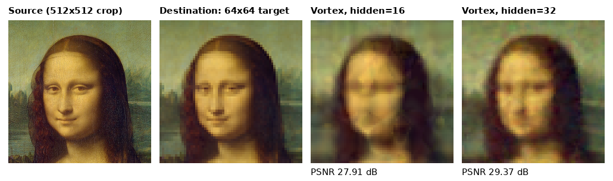
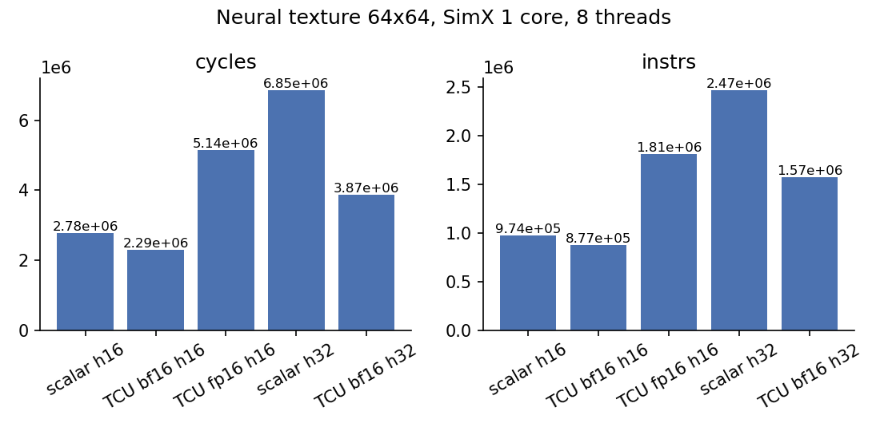

# Assignment 12: Neural Texture on the Tensor Core

> Targets Vortex release [v3.0](https://github.com/vortexgpgpu/vortex/releases/tag/v3.0).

## Background

A *neural texture* replaces a stored image with a tiny neural network that, given texture
coordinates `(u, v)`, returns the color at that point. Real GPUs use this to compress material
textures. Decoding a texel becomes a sequence of small matrix multiplications, which is exactly
what a tensor core accelerates.

In this assignment the texture is the Mona Lisa. A 64×64 RGB image (12,288 bytes) is
replaced by a 3-layer MLP:

```
(u, v) ─► 16 Fourier features ─► Linear 16→H + ReLU ─► Linear H→H + ReLU ─► Linear H→3 ─► RGB
```

| Hidden width H | Parameters | Weights (16-bit) | Compression vs RGB8 |
|---|---|---|---|
| 16 | 595 | 1,190 B | 10.3× |
| 32 | 1,699 | 3,398 B | 3.6× |

The **features** are `2u−1, 2v−1` plus `sin`/`cos` of `u` and `v` at several frequencies
(`nt_make_features` in `neural_tex_math.h`). They let a small network represent detail it could
not learn from raw coordinates.

**Mapping onto the tensor core.** One warp decodes `TILE_M` consecutive pixels at a time. The
pixels are the **M** dimension of the matrix multiplication, the layer input width is **K**, and
the layer output width is **N**:

```
H[TILE_M × N] = ReLU( X[TILE_M × K] · W[K × N] + b[N] )
```

Each layer is a loop over `tileN`-wide column blocks of the output and `tileK`-deep slices of
the input, using the WMMA-style API in
[`vx_tensor.h`](https://github.com/vortexgpgpu/vortex/blob/v3.0/sw/kernel/include/vx_tensor.h#L160)
(`wmma_context`, `load_matrix_sync`, `mma_sync`, `store_matrix_sync`). Activations and weights are
**bf16**, accumulation is **fp32**. Two tricks keep the kernel short:

- **Bias via the accumulator.** Load the bias into the accumulator fragment *before* the first
  `mma_sync`, with `ldm = 0`: a leading dimension of zero makes every one of the `TILE_M` rows read
  the same bias row.
- **Local-memory staging.** The accumulator tile is stored to local memory (fp32), then every
  lane applies ReLU and converts its share of the elements back to 16-bit for the next layer's
  `A` operand.

[`tests/regression/sgemm_tcu`](https://github.com/vortexgpgpu/vortex/blob/v3.0/tests/regression/sgemm_tcu)
shows the same API on a plain matrix multiplication.

## Setup

From the root of your Vortex v3.0 checkout (built in `build32/` as in the earlier
assignments):

```bash
export VORTEX_HOME=$PWD                  # the Vortex root, used by the commands below
git apply $TUTORIAL/Exercises/patches/a12_neural_tex.patch
cd build32 && ../configure --xlen=32 --tooldir=$HOME/tools   # picks up the new test directory
```

All other commands run from `build32/` unless they `cd` elsewhere.

`$TUTORIAL` is your checkout of this tutorial repository. The patch adds
`tests/regression/neural_tex`:

| File | Provided | You write |
|---|---|---|
| `train_mlp.py` | trainer (numpy), writes the weight headers and reference images | — |
| `assets/monalisa.png` | the source image (public domain) | — |
| `neural_tex_weights.h`, `neural_tex_weights_h32.h` | trained weights for H = 16 and 32 | — |
| `neural_tex_math.h`, `neural_tex_fp16.h` | features, 16-bit packing | — |
| `main.cpp` | host: upload weights, launch, check against a CPU model, PSNR, image out | `lmem_size` |
| `kernel.cpp` | features, output packing, the scalar baseline (`SCALAR=1`) | `layer_tcu`, local-memory layout |

All runs below use 8 threads per warp, so the bf16 tile is M×N×K = 8×8×16:

```bash
export CONFIGS="-DVX_CFG_NUM_THREADS=8 -DVX_CFG_EXT_TCU_ENABLE"
```

> `SCALAR` and `WEIGHTS` select variants of the test. Pass them as **environment variables** (as
> below), not as `make` arguments: `blackbox.sh` rebuilds the app when `--perf` is on, and only
> the environment survives that rebuild.

## Part A: The tensor-core decoder (SimX)

### Step 1: Run the scalar baseline

The scalar path evaluates the same quantized network with plain fp32 FMAs, one pixel per thread:

```bash
SCALAR=1 make -C tests/regression/neural_tex
SCALAR=1 ./ci/blackbox.sh --driver=simx --app=neural_tex --threads=8 --perf=1 --args="-w 64 -h 64"
```

It prints the device-vs-CPU check, the PSNR against the original image, and `PERF:` counters, and
writes `tests/regression/neural_tex/neural_tex_out.ppm` and `neural_tex_ref.ppm`. Keep the
`PERF:` output: it is your baseline.

### Step 2: Run the handout tensor-core path

```bash
make -C tests/regression/neural_tex clean
make -C tests/regression/neural_tex
./ci/blackbox.sh --driver=simx --app=neural_tex --threads=8 --perf=1 --args="-w 64 -h 64"
```

It builds and runs, and fails (`FAILED!`, PSNR ≈ 6 dB): `layer_tcu` does nothing yet and the kernel
has no local memory.

### Step 3: Lay out local memory

In `kernel_main` (`kernel.cpp`), carve four buffers out of `__local_mem()`, one block per warp:

| Buffer | Type | Size | Holds |
|---|---|---|---|
| `bufX` | 16-bit | `TILE_M × NT_L0_K` | input features (A of layer 0) |
| `bufH` | 16-bit | `TILE_M × NT_L0_N` | layer 0 output (A of layer 1) |
| `bufH2` | 16-bit | `TILE_M × NT_L1_N` | layer 1 output (A of layer 2) |
| `stage` | fp32 | `TILE_M × max(N)` | accumulator tile, reused by every layer |

Then set `li.lmem_size` in `main.cpp` to the total. For H = 16 and `TILE_M` = 8 it is 1,280 bytes;
the host prints `lmem/block=…` at launch.

### Step 4: Write `layer_tcu`

Implement `layer_tcu<K, N, RELU>(in, wt, bias, stage, out)` following the comment in the
handout and the mapping in the Background:

1. For each column block `j` (step `ctx::tileN`): load the bias into the accumulator fragment with
   `ldm = 0`; for each `k` (step `ctx::tileK`), load the `A` fragment from `in` (row-major, `ldm =
   K`) and the `B` fragment from `wt` and call `mma_sync`; store the tile to `stage + j` (`ldm = N`).
   `wt` holds **Bᵀ** (`[N][K]`, row-major), which is a column-major `B`: use
   `load_matrix_sync<vt::col_major>`.
2. `vx_fence()`: the store must be visible before the lanes read `stage`.
3. If `out` is not null, apply ReLU (when `RELU`) and convert to 16-bit with `nt_pack()`. Spread the
   `TILE_M × N` elements over the lanes (`vx_thread_id()`, stride `VX_CFG_NUM_THREADS`), then
   `vx_fence()` again before the next layer reads `out`.

### Step 5: Verify

```bash
make -C tests/regression/neural_tex clean && make -C tests/regression/neural_tex
./ci/blackbox.sh --driver=simx --app=neural_tex --threads=8 --perf=1 --args="-w 64 -h 64"
```

The device output must match the CPU model of the same quantized network exactly
(`max |diff| = 0/255`) and reach the PSNR in the table below. Render the reference and your output
side by side:

```bash
cd tests/regression/neural_tex
python3 $VORTEX_HOME/tests/regression/neural_tex/train_mlp.py --compare neural_tex_ref.ppm neural_tex_out.ppm side.png
```

### Step 6: Widen the network

Run the H = 32 network with both paths and compare quality and speed:

```bash
make -C tests/regression/neural_tex clean
WEIGHTS=neural_tex_weights_h32.h make -C tests/regression/neural_tex
WEIGHTS=neural_tex_weights_h32.h ./ci/blackbox.sh --driver=simx --app=neural_tex --threads=8 --perf=1 --args="-w 64 -h 64"
# and the same with SCALAR=1 WEIGHTS=neural_tex_weights_h32.h
```

### Step 7 (optional): fp16 activations

`-DNEURAL_TEX_FP16` switches the activations from bf16 to fp16 (H = 16, tensor-core path).
Rebuild, run, and explain the result (Question 3):

```bash
export CONFIGS="-DVX_CFG_NUM_THREADS=8 -DVX_CFG_EXT_TCU_ENABLE -DNEURAL_TEX_FP16"
make -C tests/regression/neural_tex clean && make -C tests/regression/neural_tex
./ci/blackbox.sh --driver=simx --app=neural_tex --threads=8 --perf=1 --args="-w 64 -h 64"
export CONFIGS="-DVX_CFG_NUM_THREADS=8 -DVX_CFG_EXT_TCU_ENABLE"   # back to bf16
```

### Retraining (optional)

The weight headers are generated by `train_mlp.py` (numpy and Pillow; about 10–20 s of CPU):

```bash
cd $VORTEX_HOME/tests/regression/neural_tex
OMP_NUM_THREADS=1 python3 train_mlp.py --hidden 16 --out neural_tex_weights.h
OMP_NUM_THREADS=1 python3 train_mlp.py --hidden 32 --out neural_tex_weights_h32.h
```

`--image` takes any picture (`--hidden` must be a multiple of 16, the tile padding). Re-run
`make` after retraining: the headers are compiled into both the kernel and the host.

## Expected results



From left to right: the source image (512×512 crop), the 64×64 destination the network is trained
to reproduce, and the image decoded **on Vortex** with H = 16 and H = 32. At H = 16 the network
only hints at a face; at H = 32 the face appears.

SimX, 1 core × 4 warps × 8 threads, 64×64 pixels:

| Path | H | Instructions | Cycles | IPC | PSNR | Device vs CPU | Cycles vs scalar |
|---|---|---:|---:|---:|---:|---|---|
| scalar fp32 | 16 | 974,455 | 2,776,760 | 0.351 | 27.91 dB | 0/255 | 1.00× |
| **TCU bf16** | 16 | 877,144 | 2,288,708 | 0.383 | 27.91 dB | 0/255 | **1.21× faster** |
| TCU fp16 | 16 | 1,810,769 | 5,143,914 | 0.352 | 27.92 dB | 1/255 | 1.85× slower |
| scalar fp32 | 32 | 2,466,020 | 6,854,773 | 0.360 | 29.38 dB | 0/255 | 1.00× |
| **TCU bf16** | 32 | 1,569,857 | 3,874,914 | 0.405 | 29.37 dB | 0/255 | **1.77× faster** |



Plot your own runs with `python3 $TUTORIAL/Exercises/tools/plot_perf.py label=run.log … -o out.png`.

## Going further

- Give the network more Fourier octaves instead of more hidden units: `NFREQ`/`features()` in
  `train_mlp.py` and `NT_NFEAT`/`nt_make_features()` in `neural_tex_math.h` must change together,
  and the feature count must stay a multiple of `tileK`. Which buys more PSNR per cycle?
- Decode the texture where it is used: in Assignment 11's ray-casting scene, evaluate the network
  at each hit point's `(u, v)` on a sphere instead of reading a stored texture.

## Questions

1. The tensor core removes almost all of the matmul instructions, yet at H = 16 the kernel is only
   1.21× faster than scalar. Use `--perf=1`'s instruction mix to find where the remaining time
   goes (features, local-memory round trip, packing). Why does the speedup grow to 1.77× at H = 32?
2. Why does loading the bias with `ldm = 0` work, and what would it cost to add the bias with the
   lanes after `store_matrix_sync` instead?
3. fp16 activations give the same quality (27.92 vs 27.91 dB; pixels differ from bf16 by at
   most 2/255) but are 1.85× *slower* than scalar. Look at `nt_pack()` in
   `neural_tex_math.h` for both formats: what does each conversion cost on a core without a
   hardware fp32→fp16 instruction?
4. Doubling H from 16 to 32 costs 1.69× the cycles on the tensor core and 2.47× on the scalar path.
   Explain the difference from how each path scales with the layer width.
5. The network stores 1,190 bytes instead of 12,288. At what image size, network size and decode
   cost would a neural texture beat a block-compressed texture (e.g. 4 bits per texel) on memory
   traffic and on quality?

---

*Image: Leonardo da Vinci, Mona Lisa (c. 1503–1519), public domain; reproduction from Wikimedia
Commons ("Mona Lisa, by Leonardo da Vinci, from C2RMF retouched.jpg").*
