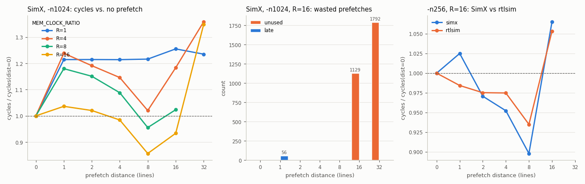

# Assignment 2: Software Prefetching

> Targets Vortex release [v3.0](https://github.com/vortexgpgpu/vortex/releases/tag/v3.0).

## Background

A GPU hides memory latency by switching warps: while one warp waits for a
load, another computes. When there are too few warps, or every warp is waiting
on memory, the core idles. A **software prefetch** lets the program ask for a
cache line *before* it needs it, so the line is already in the L1 data cache
when the real load arrives.

A prefetch only pays off when three things hold, and you will build the
counters that measure each:

| counter | event | what goes wrong when it is high |
|---|---|---|
| `prefetch_reqs` | a prefetch misses in the dcache and issues a **new** fill to memory (not a hit, not chained onto a fill already in flight) | nothing: this is the useful work |
| `prefetch_unused` | a line installed by a prefetch is **evicted by a later fill before any demand access hit it** | prefetched too early or into a conflicting set: wasted bandwidth |
| `prefetch_late` | a **demand** miss finds an in-flight fill for its line whose chain was **started by a prefetch** | prefetched too late: the load still waits |

Lines still resident when the kernel ends count as neither used nor unused.

**The instruction.** `vx_prefetch(addr)` is an R-type instruction in the
RISC-V custom-0 opcode space (`0x0B`), `funct7 = 5`, `funct3 = 0`,
`rd = x0`, `rs1 = addr`, `rs2 = x0`. In v3.0, custom-0 `funct7` 0–4 are taken
(warp control, vote/shuffle, TCU, DXA, packed loads); 5 is free in both
SimX and RTL.

**What a prefetch is.** A prefetch is executed as an ordinary **word load
to `x0` whose response is dropped**. It goes through the LSU, the coalescer and
the cache exactly like a load, takes an LSU outstanding-request slot and an MSHR
entry, and its response is discarded at writeback because it has no
destination register. The alternative, a true fire-and-forget request with no
response, would need response suppression in the cache and special cases in
the LSU and the coalescer, which allocate an entry on every read and free it on
the response (a request that never answers leaks an entry and eventually
deadlocks). The cost of the simple design: a prefetch pins an LSU slot and an
MSHR entry for the whole miss latency, and it is one more instruction to issue.
Question 2 asks you to measure which of these costs actually matters.

**How the flag travels.** The cache must know that a request is a prefetch.
v3.0 already has a sideband that every memory request carries end to end: SimX
`MemFlags` (in `LsuReq`, `MemReq` and the cache's `bank_req_t`), RTL
`mem_bus_attr_t` (the `attr` field of the memory bus). You add one bit to it;
the local-memory switch, the coalescer and the memory adapters already copy it.

**Where the counters live.** Each cache level is its own MPM class. The data
cache is class 4 (`--perf=4`); its counters occupy `0xB03`–`0xB09`, so
`0xB0A`–`0xB0C` are free for yours. The runtime prints one new line under the
existing `dcache:` line:

```
PERF: core0: dcache prefetch: reqs=1984, unused=0, late=0
```

## Setup

Clone the v3.0 release and build it out of tree. If you fetched the `v3.0`
tag before 2026-10-07, refresh it first with `git fetch --tags --force`.

```bash
git clone --branch v3.0 --recursive https://github.com/vortexgpgpu/vortex.git
cd vortex
mkdir build32 && cd build32
../configure --xlen=32 --tooldir=$HOME/tools
./ci/toolchain_install.sh --all     # prebuilt toolchain, first time only
make -s
```

Apply the test handout from the Vortex root. It adds `tests/regression/prefetch`
and registers it in `tests/regression/Makefile`:

```bash
cd vortex
git apply ~/vortex_tutorials/Exercises/patches/a2_prefetch_test.patch
```

The test streams two source arrays into a destination, `dst = src0 + src1`.
Each warp owns whole cache lines: line `l` of warp `w` is global line
`l * num_warps + w`, and before consuming line `l` the warp prefetches its line
`l + dist` on both sources (one `vx_prefetch` per line and source). Options:
`-n <words per thread>` (default 64) and `-d <prefetch distance in lines>`
(default 1, 0 disables prefetching). The layout matters. If each thread owned a
private 1 KB chunk (the `fence` test layout), the 16 streams, 1 KB apart, would
map to only 4 of the dcache's 64 sets (16 KB, 4 ways, 64-byte lines), so the
prefetched lines of all streams would compete for the same 16 ways. If all warps shared one line per iteration
(the `vecadd` layout), each line would get one prefetch per warp, four in all,
and three of them would be redundant. One line per warp per iteration is what
a GPU programmer writes, and it exposes all three counters.

The test does not compile until you add `vx_prefetch` (Part A, Step A1).
All commands below run from `build32/`; re-run `../configure` (same arguments)
after editing a `*.toml` file, a Makefile, or adding a test directory.

## Part A: SimX

### Step A1: The intrinsic

In [`sw/kernel/include/vx_intrinsics.h`](https://github.com/vortexgpgpu/vortex/blob/v3.0/sw/kernel/include/vx_intrinsics.h#L372),
after `vx_fence()`:

```c
// Software prefetch: pull the cache line holding addr into the L1 dcache.
// Issued as a word load whose result is discarded, so addr must be word-aligned.
inline void vx_prefetch(const void* addr) {
    __asm__ volatile (".insn r %0, 0, 5, x0, %1, x0" :: "i"(RISCV_CUSTOM0), "r"(addr) : "memory");
}
```

### Step A2: Decode the instruction

1. [`sim/simx/types.h`](https://github.com/vortexgpgpu/vortex/blob/v3.0/sim/simx/types.h#L377):
   add `PREFETCH` to `enum class LsuType` and a `case LsuType::PREFETCH`
   to its `operator<<`.
2. [`sim/simx/decode.cpp`](https://github.com/vortexgpgpu/vortex/blob/v3.0/sim/simx/decode.cpp#L307):
   in `op_string()`, LSU lambda, add `case LsuType::PREFETCH: return {"PREFETCH", ""};`
   after `FENCE`.
3. Same file, `case Opcode::EXT1:` ([L826](https://github.com/vortexgpgpu/vortex/blob/v3.0/sim/simx/decode.cpp#L826)),
   `switch (funct7)`: after `case 4` (packed loads,
   [L963](https://github.com/vortexgpgpu/vortex/blob/v3.0/sim/simx/decode.cpp#L963)) add

   ```c++
       case 5: { // Software prefetch: a word load whose result is discarded
         instr->set_fu_type(FUType::LSU);
         switch (funct3) {
         case 0: // PREFETCH rs1
           instr->set_op_type(LsuType::PREFETCH);
           instr->set_src_reg(0, rs1, RegType::Integer);
           instr->set_args(IntrLsuArgs{/*width=LW*/ 2, /*stride*/ 0, /*offset*/ 0});
           break;
         default:
           std::abort();
         }
       } break;
   ```

   There is no `set_dest_reg()`: an instruction without a destination gets
   `trace->wb == false`, which is what makes the commit stage drop its result.

### Step A3: Execute it in the LSU

The LSU ([`sim/simx/lsu_unit.cpp`](https://github.com/vortexgpgpu/vortex/blob/v3.0/sim/simx/lsu_unit.cpp))
sends every access as a real `LsuReq` over its memory channel; there is no
shortcut that reads memory directly. Three edits:

1. `ingest_inputs()` ([L331](https://github.com/vortexgpgpu/vortex/blob/v3.0/sim/simx/lsu_unit.cpp#L331)):
   a prefetch reserves an outstanding-request slot like a load, so include
   `LsuType::PREFETCH` in `is_read`.
2. `process_request_step()` ([L345](https://github.com/vortexgpgpu/vortex/blob/v3.0/sim/simx/lsu_unit.cpp#L345)):
   next to `is_fence` / `is_write` derive `is_prefetch`; the request op stays
   `MemOp::LD`. (Step A5 adds one more line here to mark the request.)
3. Same function, where the pending entry is allocated
   ([L556](https://github.com/vortexgpgpu/vortex/blob/v3.0/sim/simx/lsu_unit.cpp#L556)):
   the last field of the entry is `is_load`. Pass `!is_prefetch` instead of
   `true`. `process_response_step()` then retires the instruction without
   formatting register data.

### Step A4: Functional check

```bash
../configure --xlen=32 --tooldir=$HOME/tools   # picks up the new test directory
make -s
./ci/blackbox.sh --driver=simx --cores=1 --app=prefetch --debug=2 --args="-n64 -d2"
grep -c PREFETCH run.log
grep PASSED run.log
```

With `--debug`, all output goes to `run.log`: the test must pass and the
trace must show `PREFETCH` instructions. With
`--debug=3` you will later also see the cache side (`core-req ... flags=0x10`,
`mshr-enqueue: ... prefetch=1`).

### Step A5: Mark prefetch requests

1. `sim/simx/types.h`, `struct MemFlags`
   ([L439](https://github.com/vortexgpgpu/vortex/blob/v3.0/sim/simx/types.h#L439)):
   add `uint32_t prefetch : 1;` as bit 4, right after `amo_unsigned`
   (renumber the comments of the DXA fields that follow).
2. `lsu_unit.cpp`, `process_request_step()`: next to the `amo_unsigned`
   assignment ([L498](https://github.com/vortexgpgpu/vortex/blob/v3.0/sim/simx/lsu_unit.cpp#L498)),
   set `lsu_req.flags.prefetch = is_prefetch;`.

That is all the plumbing: the local-memory switch, the coalescer and the
LSU memory adapter copy `flags` into the `MemReq`, and the cache copies it
into its `bank_req_t`.

### Step A6: Count the events in the cache

All in [`sim/simx/mem/cache.h`](https://github.com/vortexgpgpu/vortex/blob/v3.0/sim/simx/mem/cache.h#L48)
and [`sim/simx/mem/cache.cpp`](https://github.com/vortexgpgpu/vortex/blob/v3.0/sim/simx/mem/cache.cpp).
Three facts about the v3.0 cache model to know first:

- Lines are sectored; the victim way is chosen when the **fill** arrives, in
  `processFill()`, not at miss time.
- Misses to the same line form an **MSHR chain**: the first miss (the chain
  root) issues the fill, later ones are enqueued behind it and replayed when the
  fill returns.
- A request that finds a fill already pending is coalesced **at admission**
  in `processInputs()` and never reaches `processRequests()`. A late prefetch
  can therefore be detected in two places.

1. `Cache::PerfStats` (cache.h): add `prefetch_reqs`, `prefetch_unused`,
   `prefetch_late` (`uint64_t`, `= 0`) and the three `+=` lines in `operator+=`.
2. `struct line_t` ([L153](https://github.com/vortexgpgpu/vortex/blob/v3.0/sim/simx/mem/cache.cpp#L153)):
   add `bool was_prefetched;` (installed by a prefetch fill) and
   `bool was_used;` (a demand access hit it since); clear both in `reset()`.
3. `class MSHR` ([L439](https://github.com/vortexgpgpu/vortex/blob/v3.0/sim/simx/mem/cache.cpp#L439)),
   next to `has_pending_fill()`: two scans over `entries_`, each matching
   `set_id`, `addr_tag` and `sector_id`:
   - `has_pending_prefetch(set_id, addr_tag, sector_id)`: some entry is still
     `bank_req_t::Core` and has `bank_req.flags.prefetch` set;
   - `has_demand_waiter(set_id, addr_tag, sector_id)`: some entry is not
     `bank_req_t::None` and is **not** a prefetch.
4. `processInputs()`, where a fill response is turned into a `bank_req_t::Fill`
   ([L819](https://github.com/vortexgpgpu/vortex/blob/v3.0/sim/simx/mem/cache.cpp#L819)):
   copy the chain root's flags, `bank_req.flags = root_peek.bank_req.flags;`,
   so `processFill()` knows the fill was requested by a prefetch.

Now the five counting sites. Write them yourself from these rules:

| where | rule |
|---|---|
| `processRequests()`, `case bank_req_t::Core`, MSHR-backed miss, inside `if (!fill_pending) { MemReq fill; ... }` ([L1628](https://github.com/vortexgpgpu/vortex/blob/v3.0/sim/simx/mem/cache.cpp#L1628)) | if the request is a prefetch, `++prefetch_reqs`. Also set `fill.flags.prefetch` so a next-level cache could count it |
| same branch, before `mshr_.enqueue(...)` | if `fill_pending`, the request is **not** a prefetch, and `has_pending_prefetch(...)`: `++prefetch_late` |
| `processInputs()`, admission coalescing, `if (fill_pending \|\| must_order)` ([L925](https://github.com/vortexgpgpu/vortex/blob/v3.0/sim/simx/mem/cache.cpp#L925)) | same late rule, using `core_req.flags` and the `adm_*` set/tag/sector |
| `processFill()`, just before `victim_line.reset()` ([L1068](https://github.com/vortexgpgpu/vortex/blob/v3.0/sim/simx/mem/cache.cpp#L1068)) | if the victim is valid, was prefetched and was never used: `++prefetch_unused`. After the reset, install the new line with `was_prefetched = bank_req.flags.prefetch` and `was_used = was_prefetched && has_demand_waiter(...)`: a late prefetch still delivers its line to the demand access waiting in the chain |
| `processRequests()`, the hit paths of `case bank_req_t::Replay` ([L1375](https://github.com/vortexgpgpu/vortex/blob/v3.0/sim/simx/mem/cache.cpp#L1375)) and `case bank_req_t::Core` ([L1477](https://github.com/vortexgpgpu/vortex/blob/v3.0/sim/simx/mem/cache.cpp#L1477)) | a hit by a **non-prefetch** request sets `was_used` on the hit line. A prefetch hitting an earlier prefetch must not count as a use |

### Step A7: Expose the counters

1. `VX_types.toml`, section `[csr_mpm_dcache]`, after
   `VX_CSR_MPM_DCACHE_MSHR_ST_H` ([L697](https://github.com/vortexgpgpu/vortex/blob/v3.0/VX_types.toml#L697)):

   ```toml
   VX_CSR_MPM_DCACHE_PF_REQS = 0xB0A  # prefetch fills issued to memory
   VX_CSR_MPM_DCACHE_PF_REQS_H = 0xB8A
   VX_CSR_MPM_DCACHE_PF_UNUSED = 0xB0B  # prefetched lines evicted unused
   VX_CSR_MPM_DCACHE_PF_UNUSED_H = 0xB8B
   VX_CSR_MPM_DCACHE_PF_LATE = 0xB0C  # demand misses on an in-flight prefetch
   VX_CSR_MPM_DCACHE_PF_LATE_H = 0xB8C
   ```

2. [`sim/simx/csr_unit.cpp`](https://github.com/vortexgpgpu/vortex/blob/v3.0/sim/simx/csr_unit.cpp#L178),
   `case VX_DCR_MPM_CLASS_DCACHE`, after `MSHR_ST`:

   ```c++
           CSR_READ_64(VX_CSR_MPM_DCACHE_PF_REQS, socket_perf.dcache.prefetch_reqs);
           CSR_READ_64(VX_CSR_MPM_DCACHE_PF_UNUSED, socket_perf.dcache.prefetch_unused);
           CSR_READ_64(VX_CSR_MPM_DCACHE_PF_LATE, socket_perf.dcache.prefetch_late);
   ```

3. [`sw/runtime/common/perf.cpp`](https://github.com/vortexgpgpu/vortex/blob/v3.0/sw/runtime/common/perf.cpp#L494),
   `case VX_DCR_MPM_CLASS_DCACHE`, after the `perf_print_core(... "dcache: reqs=...")`
   call: query the three CSRs for `rep_core` with `vx_device_mpm_query()` (as the
   lines above it do) and print

   ```c++
   perf_print_core(stream, rep_core, "dcache prefetch: reqs=%" PRIu64 ", unused=%" PRIu64 ", late=%" PRIu64,
                   pf_reqs, pf_unused, pf_late);
   ```

Rebuild and run the functional check with counters:

```bash
../configure --xlen=32 --tooldir=$HOME/tools
make -s
./ci/blackbox.sh --driver=simx --cores=1 --app=prefetch --perf=4 --args="-n64 -d2"
```

Expect `dcache prefetch: reqs=112, unused=0, late=0`
(112 = 4 warps × 2 sources × (16 − 2) lines).

### Step A8: Make memory slow enough to matter

Run the default DRAM model with and without prefetching:

```bash
./ci/blackbox.sh --driver=simx --cores=1 --app=prefetch --perf=4 --args="-n1024 -d0"
./ci/blackbox.sh --driver=simx --cores=1 --app=prefetch --perf=4 --args="-n1024 -d8"
```

Prefetching makes it **slower** (70,004 → 85,160 cycles). With the default
DRAM model a dcache fill comes back in about 20 core cycles, far less than the
time a warp spends on one line (Question 1), so there is no latency to hide and the prefetches only add instructions. Real GPU DRAM is
hundreds of core cycles away. `MEM_CLOCK_RATIO=R` ticks the DRAM model once
every `R` core cycles (same knob in SimX and rtlsim). The unloaded fill round
trip (dcache `fill-req` to `fill-rsp` in a `--debug=3` trace) becomes about 55
cycles at R=4 and 300 at R=16; under load, queueing in the slow DRAM model
makes it several times longer (median ≈ 900 cycles at R=16 even for `-n16`):

```bash
CONFIGS="-DMEM_CLOCK_RATIO=16" ./ci/blackbox.sh --driver=simx --cores=1 --app=prefetch --perf=4 --args="-n1024 -d0"
CONFIGS="-DMEM_CLOCK_RATIO=16" ./ci/blackbox.sh --driver=simx --cores=1 --app=prefetch --perf=4 --args="-n1024 -d8"
```

Now distance 8 is 14% faster (630,805 → 540,276 cycles).

### Step A9: Sweep the prefetch distance

```bash
for d in 0 1 2 4 8 16 32; do
  CONFIGS="-DMEM_CLOCK_RATIO=16" ./ci/blackbox.sh --driver=simx --cores=1 --app=prefetch \
      --perf=4 --args="-n1024 -d$d" > pf_simx_d$d.log 2>&1
  echo "d=$d $(grep -m1 -o 'cycles=[0-9]*' pf_simx_d$d.log) $(grep -m1 'dcache prefetch' pf_simx_d$d.log)"
done
python3 ~/vortex_tutorials/Exercises/tools/plot_perf.py \
    d0=pf_simx_d0.log d1=pf_simx_d1.log d2=pf_simx_d2.log d4=pf_simx_d4.log \
    d8=pf_simx_d8.log d16=pf_simx_d16.log d32=pf_simx_d32.log \
    --metric cycles --normalize d0 -o pf_sweep.png
```

Explain the three regimes before you look at the expected results: where is
`late` non-zero, where does `unused` jump, and why?

## Part B: RTL extension

Part B implements the same instruction, flag and counters in the RTL. The
toml CSRs and the runtime print from Step A7 are shared; the test, the
output format and the commands are those of Part A. Your SimX build is the
reference.

### File and signal map

| Part A (SimX) | Part B (RTL) | what you do |
|---|---|---|
| `LsuType::PREFETCH`, decode `case 5` | [`VX_decode.sv`](https://github.com/vortexgpgpu/vortex/blob/v3.0/hw/rtl/core/VX_decode.sv#L580) `INST_EXT1`, new `7'h05` case | write |
| `is_load = !is_prefetch` | nothing: decode an `INST_LSU_LW` with no `USED_IREG(rd)`, so `wb = 0` and commit drops the data, the path store results already take | write (decode) |
| `MemFlags::prefetch` | `lsu_args_t.is_prefetch` (decode → LSU) and `mem_bus_attr_t.is_prefetch` (LSU → cache) in [`VX_gpu_pkg.sv`](https://github.com/vortexgpgpu/vortex/blob/v3.0/hw/rtl/VX_gpu_pkg.sv#L208) | write |
| `lsu_req.flags.prefetch = ...` | [`VX_lsu_slice.sv`](https://github.com/vortexgpgpu/vortex/blob/v3.0/hw/rtl/core/VX_lsu_slice.sv#L95) `g_mem_req_attr` | write |
| `line_t::was_prefetched/was_used`, MSHR scans | per line/way `pf_line_r`, `used_line_r`; per MSHR entry `pf_own_r`, `pf_root_r`, `pf_joined_r` in `VX_cache_bank.sv` | **handed out** |
| three counting rules | three one-cycle event wires in `VX_cache_bank.sv` | **write** |
| `Cache::PerfStats`, `csr_unit.cpp` | `cache_perf_t`, `VX_cache.sv` (pop-count + accumulate), `VX_cache_define.vh`, `VX_cache_wrap.sv`, `VX_csr_data.sv` | **handed out** |

### Step B1: Decode and carry the flag

1. `hw/rtl/VX_gpu_pkg.sv`:
   - `lsu_args_t` ([L910](https://github.com/vortexgpgpu/vortex/blob/v3.0/hw/rtl/VX_gpu_pkg.sv#L910)):
     its `__padding` field is exactly **one** bit wide. Replace it with
     `logic is_prefetch;`. Do not add a field: `lsu_args_t` must stay
     `INST_ARGS_BITS` wide (a `PACKAGE_ASSERT` checks it).
   - `mem_bus_attr_t` ([L208](https://github.com/vortexgpgpu/vortex/blob/v3.0/hw/rtl/VX_gpu_pkg.sv#L208)):
     add `logic is_prefetch;` as the **first** (most significant) field, above
     `amo`, and define `localparam MEM_ATTR_PREFETCH_OFFS = MEM_ATTR_AMO_OFFS + AMO_REQ_BITS;`
     next to `MEM_ATTR_AMO_OFFS` ([L220](https://github.com/vortexgpgpu/vortex/blob/v3.0/hw/rtl/VX_gpu_pkg.sv#L220)).
     Never insert below `amo`: the cache bank reads the AMO sideband by offset.
2. `hw/rtl/core/VX_decode.sv`:
   - in the defaults at the top of the `always @(*)` block (next to
     `is_wstall = 0;`, [L202](https://github.com/vortexgpgpu/vortex/blob/v3.0/hw/rtl/core/VX_decode.sv#L202)):
     `op_args.lsu.is_prefetch = 1'b0;`. `op_args` defaults to `'x`; without this
     line ordinary loads randomly become prefetches in simulation;
   - in `INST_EXT1: case (funct7)`, after `7'h04` (packed loads,
     [L732](https://github.com/vortexgpgpu/vortex/blob/v3.0/hw/rtl/core/VX_decode.sv#L732)),
     add `7'h05` / `funct3 == 3'h0`: `ex_type = EX_LSU`,
     `op_type = INST_OP_BITS'(INST_LSU_LW)`, `is_store`, `is_float`, `pack`,
     `offset` all zero, `is_prefetch = 1`, and `` `USED_IREG (rs1) `` only.
3. `hw/rtl/core/VX_lsu_slice.sv`, generate loop `g_mem_req_attr`, next to
   `is_flush` ([L100](https://github.com/vortexgpgpu/vortex/blob/v3.0/hw/rtl/core/VX_lsu_slice.sv#L100)):

   ```verilog
   assign mem_req_attr_struct[i].is_prefetch = execute_if.data.op_args.lsu.is_prefetch;
   ```

   That is the whole LSU change. Because `mem_bus_attr_t` sizes every bus,
   arbiter and queue on the way, the bit reaches the cache bank with no further
   edits. No tag bits are spent.
4. Optional: in [`hw/rtl/VX_trace_pkg.sv`](https://github.com/vortexgpgpu/vortex/blob/v3.0/hw/rtl/VX_trace_pkg.sv#L173),
   `EX_LSU` branch, print `PREFETCH` when `op_args.lsu.is_prefetch` so
   `--debug` traces name the instruction.

Functional check (Part A Step A4 with `--driver=rtlsim`; combine `--debug=2`
and `--perf=4` so this is one Verilator build, not two):

```bash
./ci/blackbox.sh --driver=rtlsim --cores=1 --app=prefetch --debug=2 --perf=4 --args="-n64 -d2"
```

Output goes to `run.log`. The decode trace shows `ex=LSU, ..., wb=0`
(`op=PREFETCH` with the optional trace edit) and the LSU `Rd Req` lines carry
the prefetch bit in `attr`. `instrs=` must equal SimX (2,260); the counters
still read 0 until Step B3.

### Step B2: Apply the bank bookkeeping handout

```bash
cd vortex
git apply ~/vortex_tutorials/Exercises/patches/a2_rtl_bank_bookkeeping.patch
```

It adds the three `cache_perf_t` fields, the per-bank event ports, their
pop-count and accumulation in `VX_cache.sv`, `PERF_CACHE_ADD`, the bypass
tie-offs in `VX_cache_wrap.sv`, the three `CSR_READ_64` lines in
`VX_csr_data.sv`, and in `VX_cache_bank.sv` the bookkeeping state:

- `pf_line_r[line][way]`: the way was installed by a prefetch fill;
  `used_line_r[line][way]`: a demand lookup hit it since. Both are set by the
  fill (`pf_install_st0`), cleared by init/flush, and `used` is set on demand
  hits.
- Per MSHR entry: `pf_own_r` (the entry is a prefetch), `pf_root_r` (the root of
  its chain), `pf_joined_r` (a demand request joined the chain). The fill
  returns with the root's id (`mem_rsp_id`) and installs the line with
  `pf_fill_st0 = pf_own_r[root]` and `used_fill_st0 = pf_joined_r[root]`.
  Chain members after the root are completed by the fill-forward port and never
  pass the tag stage again, so this per-chain state is what lets a late but
  consumed prefetch count as used (SimX gets the same answer from
  `has_demand_waiter()`).
- `pf_st0`, `pf_st1`, `pf_stc`: the prefetch bit of the request in stage S0,
  S1 and commit; `mshr_keep_st1`: an S1 request is kept in the MSHR (a miss);
  `pf_prev_root_st1`: root of the chain the S1 request links behind.

The patch leaves three constants, marked `TODO`, at the end of the
`PERF_ENABLE` block of `VX_cache_bank.sv`. With them the design builds and
the counters read 0.

### Step B3: Write the three event wires

Each is one line built from existing bank signals and the bookkeeping above;
each must be qualified with `~pipe_stall` (or with a signal that already is).

| wire | rule (Part A Step A6) | signals to use |
|---|---|---|
| `pf_fill_req_stc` | a prefetch read at the commit stage that misses and is the chain root, i.e. issues the fill | `do_read_stc`, `stC.lk.is_hit`, `stC.lk.mshr_pending`, `pf_stc` |
| `pf_victim_st0` | a fill installs over a way whose line was prefetched and not used | `pf_install_st0`, `lk_st0.is_refill` (a refill of the same line evicts nothing), `pf_line_r`, `used_line_r`, `line_idx_st0`, `fill_way_oh_st0` |
| `pf_late_st1` | a demand request kept in the MSHR behind a chain whose root is a prefetch | `mshr_keep_st1`, `st1.lk.mshr_pending`, `pf_st1`, `pf_own_r`, `pf_prev_root_st1` |

### Step B4: Build and cross-check

The Verilator build for a new configuration takes 6–15 minutes; the counter
runs below share one build (`--perf=4` + `MEM_CLOCK_RATIO=16`). Keep `-n` at
256 or below on rtlsim.

```bash
for d in 0 1 2 4 8 16; do
  CONFIGS="-DMEM_CLOCK_RATIO=16" ./ci/blackbox.sh --driver=rtlsim --cores=1 --app=prefetch \
      --perf=4 --args="-n256 -d$d" > pf_rtlsim_d$d.log 2>&1
  CONFIGS="-DMEM_CLOCK_RATIO=16" ./ci/blackbox.sh --driver=simx --cores=1 --app=prefetch \
      --perf=4 --args="-n256 -d$d" > pf_simx_n256_d$d.log 2>&1
done
grep -H "PERF: instrs\|dcache prefetch" pf_rtlsim_d*.log pf_simx_n256_d*.log
```

Cross-check against Part A:

- `instrs=` and `reqs=` must match SimX **exactly** at every distance
  (`reqs = 2 × 4 × (64 − dist)` at `-n256`);
- `unused` must show the same knee at `dist = 16` (a few percent apart is
  expected, see Questions);
- the fastest distance must be the same on both.

## Expected results

Configuration: 1 core, 4 warps × 4 threads, 16 KB 4-way dcache with 2 banks,
8-entry LSU outstanding pool, `--perf=4`. Every run prints `PASSED!`.

**SimX, `-n1024`, `MEM_CLOCK_RATIO=16`** (unloaded fill ≈ 300 cycles; 256 lines
per warp per source):

| dist | cycles | vs. dist 0 | instrs | prefetch reqs | unused | late |
|---:|---:|---:|---:|---:|---:|---:|
| 0  | 630,805 | 1.00 | 27,836 | 0    | 0     | 0  |
| 1  | 653,733 | 1.04 | 33,960 | 2,040 | 0    | 56 |
| 2  | 643,699 | 1.02 | 33,940 | 2,032 | 0    | 0  |
| 4  | 620,900 | 0.98 | 33,900 | 2,016 | 0    | 0  |
| 8  | **540,276** | **0.86** | 33,820 | 1,984 | 0 | 0 |
| 16 | 588,865 | 0.93 | 33,660 | 1,920 | 1,129 | 0  |
| 32 | 850,853 | 1.35 | 33,340 | 1,792 | 1,792 | 0  |

**rtlsim vs SimX, `-n256`, `MEM_CLOCK_RATIO=16`:**

| dist | SimX cycles | rtlsim cycles | instrs (both) | reqs (both) | SimX unused | rtlsim unused | late (both) |
|---:|---:|---:|---:|---:|---:|---:|---:|
| 0  | 116,357 | 129,665 | 7,100 | 0   | 0   | 0   | 0 |
| 1  | 119,267 | 127,633 | 8,616 | 504 | 0   | 0   | 0 |
| 2  | 112,948 | 126,449 | 8,596 | 496 | 0   | 0   | 0 |
| 4  | 110,804 | 126,401 | 8,556 | 480 | 0   | 0   | 0 |
| 8  | **104,484** | **121,233** | 8,476 | 448 | 0 | 0 | 0 |
| 16 | 123,948 | 136,577 | 8,316 | 384 | 195 | 206 | 0 |

**Functional check, `-n64 -d2`, default DRAM:** SimX 2,260 instrs / 5,903
cycles, rtlsim 2,260 instrs / 6,863 cycles, both `reqs=112, unused=0, late=0`.



The left panel repeats the SimX `-n1024` sweep at `MEM_CLOCK_RATIO` 1, 4, 8
and 16; all numbers are in [`expected/a2/prefetch_sweep.csv`](expected/a2/prefetch_sweep.csv).
What to read from them:

- `reqs = 2 × 4 warps × (256 − dist)`: every prefetch is a unique fill; the
  kernel skips prefetches past the end of the stream.
- `late` appears only at `dist = 1`, and only once the DRAM is slow (R ≥ 4:
  4, 34 and 56 late misses at R = 4, 8, 16): a one-line-ahead prefetch is
  issued one line-time before its use, and the slowest fills under load take
  longer than that. It stays small because the four warps interleave.
- `unused` jumps at `dist ≥ 16`: 4 warps × 16 lines ahead is 64 lines =
  4 KB, exactly the dcache set window (16 KB / 4 ways). The prefetched line maps
  to the set the warp is using right now, and with three streams plus the
  prefetches competing for four ways, FIFO replacement evicts it before use.
  This is a conflict-miss effect.
- Prefetch instructions add 22% instructions (33,960 vs 27,836 at
  `dist = 1`). At R=1 that is pure overhead; at R=16, `dist = 8` wins by 14%,
  while `dist = 1..2` is *slower* than no prefetch although `dist = 2` is not
  late. The LSU slots are not the cause: with a 4× larger LSU pool
  (`CONFIGS="-DMEM_CLOCK_RATIO=16 -DVX_CFG_LSU_PENDING_SIZE=32"`, rows with
  `lsu_pending_size = 32` in the CSV) `dist = 0` is unchanged (630,805) and
  `dist = 1 / 2 / 8` get slightly *slower* (663,443 / 655,075 / 549,085).
  Question 2 asks you to find what the short-distance prefetches cost.
- rtlsim is 11% slower than SimX at `dist = 0`, before any prefetch exists;
  with prefetching the gap is 7–16%. The trend is the same on both: `dist = 8`
  is best (−6.5% rtlsim, −10% SimX), `dist = 16` thrashes.

Reproduce: the loops of Part A Step A9 (SimX, `-n1024`) and Part B Step B4
(both drivers, `-n256`).

## Questions

1. Why does prefetching slow the kernel down at the default `MEM_CLOCK_RATIO=1`?
   Estimate the time one warp spends on one cache line and compare it with the
   DRAM latency.
2. At R=16, `dist = 1` and `dist = 2` are slower than no prefetch even though
   `late` is 0 at `dist = 2`. Which resources does a prefetch occupy, and for
   how long? Rerun `dist = 0, 2, 8` with
   `CONFIGS="-DMEM_CLOCK_RATIO=16 -DVX_CFG_LSU_PENDING_SIZE=32"`: is the
   8-entry LSU pool the bottleneck? Compare the `dcache:` line (`miss_r`,
   `bank_st`) across distances and argue where a prefetch that is not late
   still costs time. How would a fire-and-forget prefetch change this, and
   what would it cost in the LSU, the coalescer and the cache?
3. Derive the `dist = 16` knee from the cache geometry. Predict where it moves
   with `CONFIGS="-DVX_CFG_DCACHE_SIZE=4096"`, then measure.
4. `late` is detected both in `processInputs()` and in `processRequests()`.
   What goes wrong if you only count it in one of them?
5. A late prefetch is installed with `was_used` already set. Why is that
   correct, and which RTL state (`pf_joined_r`) plays the role of
   `has_demand_waiter()`?
6. Why do SimX and rtlsim cycles differ (11% at `dist = 0`) when the
   instruction counts are identical? And why can `unused` differ by a few
   percent (195 vs 206) while `reqs` matches exactly?
7. The flag rides `mem_bus_attr_t`, not the request tag. What does the cache
   bank do with the tag, and why would a tag bit be the wrong place for an
   operation selector?
