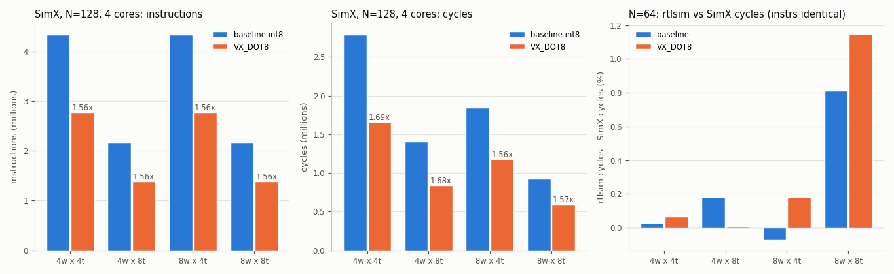
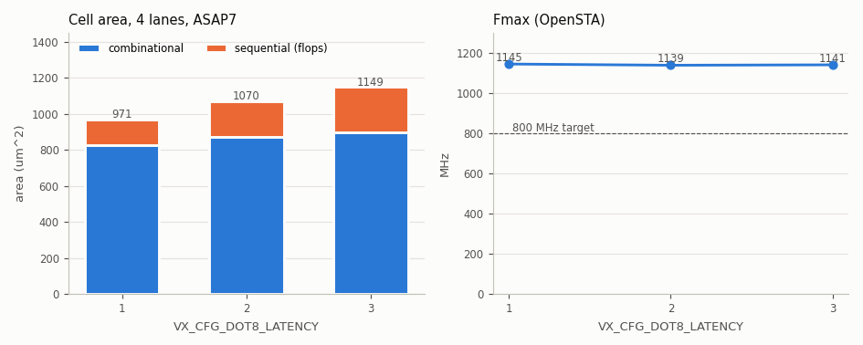

# Assignment 3: VX_DOT8, an int8 Dot-Product Instruction

> Targets Vortex release [v3.0](https://github.com/vortexgpgpu/vortex/releases/tag/v3.0).

## Background

Quantized neural networks run on 8-bit integers. Every GPU vendor ships an
instruction that multiplies four int8 pairs and adds the products in one go
(NVIDIA `dp4a`, AMD `v_dot4_i32_i8`), so one instruction does the work of four
multiply-adds. In this assignment you add such an instruction, `VX_DOT8`, to
Vortex: to the ISA, to the SimX simulator (Part A), to the RTL (Part B), and,
optionally, you synthesize your unit for an ASIC library (Part C).

**Semantics.** Each source register holds four signed 8-bit values; the
result is their signed 32-bit dot product:

```
rs1 = {A3, A2, A1, A0}     (A0 in bits 7:0)
rs2 = {B3, B2, B1, B0}
rd  = A0*B0 + A1*B1 + A2*B2 + A3*B3      (int32)
```

**Encoding.** R-type, in the RISC-V custom-0 opcode space:

```
| funct7  | rs2    | rs1    | funct3 | rd     | opcode  |
| 0000110 | 5 bits | 5 bits | 000    | 5 bits | 0001011 |
```

`opcode = 0x0B` (custom-0), `funct3 = 0`, **`funct7 = 6`**. In v3.0, custom-0
`funct7` 0–4 are taken (warp control, vote/shuffle, TCU, DXA, packed loads) and
5 is used by the prefetch of Assignment 2; an unknown `funct7` makes SimX abort.

**Latency.** The unit has a configurable pipeline depth,
`VX_CFG_DOT8_LATENCY` (default 2), defined once in `VX_config.toml` so SimX and
the RTL read the same value.

**The benchmark.** `C = A × B` for N×N int8 matrices with int32 results, one
output element per thread. The baseline kernel does one multiply-add per
element; the DOT8 kernel loads four consecutive bytes of the A row with one
32-bit load, gathers four bytes of the B column, and does one `vx_dot8`.

## Setup

Clone the v3.0 release and build it out of tree. If you fetched the `v3.0`
tag before 2026-10-07, refresh it first with `git fetch --tags --force`.

```bash
git clone --branch v3.0 --recursive https://github.com/vortexgpgpu/vortex.git
cd vortex
mkdir build32 && cd build32
../configure --xlen=32 --tooldir=$HOME/tools
./ci/toolchain_install.sh --all     # prebuilt toolchain (incl. Yosys/OpenSTA), first time only
make -s
```

Apply the test handout from the Vortex root:

```bash
cd vortex
git apply ~/vortex_tutorials/Exercises/patches/a3_dot8_test.patch
```

It adds `tests/regression/dot8`: the host program (int8 inputs, exact int32
check, `-n <size>` with `size % 4 == 0`, `-b` to launch the baseline kernel
instead of the DOT8 kernel), the complete baseline kernel `kernel_base`, and a
`kernel_main` whose loop you write. Both kernels live in the same `.vxbin`; the
host picks one by name. The DOT8 kernel reports `FAILED!` until you finish
Part A.

All commands below run from `build32/`. Re-run `../configure` (same arguments)
after editing a `*.toml` file, a Makefile, or adding a test directory.

## Part A: SimX

### Step A1: The intrinsic

In [`sw/kernel/include/vx_intrinsics.h`](https://github.com/vortexgpgpu/vortex/blob/v3.0/sw/kernel/include/vx_intrinsics.h#L372),
after `vx_fence()`:

```c
// DOT8: rd = a.b0*b.b0 + a.b1*b.b1 + a.b2*b.b2 + a.b3*b.b3 (int8 lanes, int32 result)
inline __attribute__((const)) int vx_dot8(int a, int b) {
    int ret;
    __asm__ volatile (".insn r %1, 0, 6, %0, %2, %3" : "=r"(ret) : "i"(RISCV_CUSTOM0), "r"(a), "r"(b));
    return ret;
}
```

### Step A2: The kernel

Complete `kernel_main` in `tests/regression/dot8/kernel.cpp` following its
`TODO`. Two details:

- Build `packedB` from `(uint32_t)(uint8_t)B[...] << (8*k)`. Without the casts,
  a negative byte sign-extends over the other three lanes, and shifting an
  `int` into bit 31 is undefined behaviour (the kernel builds with `-Werror`).
- The A row is contiguous and 4-byte aligned for `size % 4 == 0`, so one
  `*reinterpret_cast<const uint32_t*>(A + row * size + e)` packs A.

After building (Step A4), check the encoding in the disassembly
(`tests/regression/dot8/kernel.dump`). `objdump` does not know the
instruction and prints `<unknown>`; check that the word has bits 6:0 = `0x0B`,
bits 14:12 (`funct3`) = 0 and bits 31:25 (`funct7`) = 6. For example
`0dcf8e0b` is `vx_dot8 x28, x31, x28` (rd = bits 11:7, rs1 = bits 19:15,
rs2 = bits 24:20); your registers may differ.

### Step A3: The simulator

1. `VX_config.toml`, section `[alu]` ([L83](https://github.com/vortexgpgpu/vortex/blob/v3.0/VX_config.toml#L83)):

   ```toml
   # Pipeline depth of the VX_DOT8 int8 dot-product unit (SimX and RTL).
   VX_CFG_DOT8_LATENCY = 2
   ```

2. [`sim/simx/types.h`](https://github.com/vortexgpgpu/vortex/blob/v3.0/sim/simx/types.h#L215):
   add `DOT8` to `enum class AluType` and a `case AluType::DOT8` to its
   `operator<<` ([L251](https://github.com/vortexgpgpu/vortex/blob/v3.0/sim/simx/types.h#L251)).
   Both `operator<<` and `op_string()` abort on unknown values, so a missing
   case only crashes when you trace with `--debug`.
3. [`sim/simx/decode.cpp`](https://github.com/vortexgpgpu/vortex/blob/v3.0/sim/simx/decode.cpp#L116):
   add `case AluType::DOT8: return {"DOT8", ""};` to `op_string()`. In
   `Decoder::decode()`, `case Opcode::EXT1:` →
   `switch (funct7)` ([L826](https://github.com/vortexgpgpu/vortex/blob/v3.0/sim/simx/decode.cpp#L826)),
   add `case 6:` with `funct3 == 0`. The instruction object is created as an
   ALU instruction already, so you only set
   - the op type: `instr->set_op_type(AluType::DOT8);`
   - the arguments: `instr->set_args(IntrAluArgs{0, 0, 0});` (`execute()`
     reads `IntrAluArgs` for every ALU op and throws without it);
   - the registers: `set_dest_reg(rd, RegType::Integer)`,
     `set_src_reg(0, rs1, ...)`, `set_src_reg(1, rs2, ...)`.
4. [`sim/simx/alu_unit.cpp`](https://github.com/vortexgpgpu/vortex/blob/v3.0/sim/simx/alu_unit.cpp)
   holds both the functional model and the timing of the ALU:
   - **Function.** In `AluUnit::execute()` ([L98](https://github.com/vortexgpgpu/vortex/blob/v3.0/sim/simx/alu_unit.cpp#L98)),
     `switch` on the `AluType`, add `case AluType::DOT8:` next to `CZERO`
     ([L247](https://github.com/vortexgpgpu/vortex/blob/v3.0/sim/simx/alu_unit.cpp#L247)).
     For every thread `t` from `thread_start` with `tmask.test(t)` set, unpack
     the four bytes of `rs1_data[t].u32` and `rs2_data[t].u32` as `int8_t`,
     accumulate the products in an `int32_t`, and write
     `rd_data[t].i = sext((uint64_t)(uint32_t)sum, 32);`. Use `trace->tmask`
     (the local `tmask`), not the warp's live mask: the warp may have diverged
     since this instruction issued. For debugging, print each lane with
     `DP(3, "*** DOT8[" << t << "]: a=0x" << std::hex << a << ", b=0x" << b << ", c=0x" << (uint32_t)sum << std::dec);`
     (with `a`, `b` the packed source words).
   - **Timing.** `AluUnit::latency_of()` ([L38](https://github.com/vortexgpgpu/vortex/blob/v3.0/sim/simx/alu_unit.cpp#L38))
     returns the cycles an op spends beyond the single-cycle integer ALU (MUL/DIV
     return `kMulDivLatency`). Return `VX_CFG_DOT8_LATENCY` for `DOT8`.
   - **Queue depth.** The constructor ([L31](https://github.com/vortexgpgpu/vortex/blob/v3.0/sim/simx/alu_unit.cpp#L31))
     sizes the output channel from the deepest path:
     `kMulDivLatency + (kGather ? 1 : 0) + 2`, with `kMulDivLatency = 3`. In
     that expression replace `kMulDivLatency` by
     `std::max<uint32_t>(kMulDivLatency, VX_CFG_DOT8_LATENCY)`
     (`#include <algorithm>`), or a latency above 3 overflows the channel.

### Step A4: Build and test

```bash
../configure --xlen=32 --tooldir=$HOME/tools   # toml + new test directory
make -s
./ci/blackbox.sh --driver=simx --cores=4 --warps=4 --threads=4 --app=dot8 --args="-n128"
./ci/blackbox.sh --driver=simx --cores=4 --warps=4 --threads=4 --app=dot8 --args="-n128 -b"
```

Both must print `PASSED!`. The host returns the error count as its exit code,
which wraps at 256, so always read the `PASSED!`/`FAILED!` line rather than the
exit status. Use `--debug=3` on a small size (`-n8`) to see the
`*** DOT8[t]: a=..., b=..., c=...` lines of the `DP(3, ...)` trace you added
in Step A3. With `--debug`, the output goes to `run.log`.

Then sweep the four shapes, (warps, threads) ∈ {(4,4), (4,8), (8,4), (8,8)},
for both kernels and record `PERF: instrs=..., cycles=...`. Each new shape
rebuilds the SimX driver (10–40 s); each run at `-n128` takes 15–35 s.

```bash
for wt in "4 4" "4 8" "8 4" "8 8"; do
  set -- $wt
  for k in "" "-b"; do
    ./ci/blackbox.sh --driver=simx --cores=4 --warps=$1 --threads=$2 --app=dot8 \
        --args="-n128 $k" > dot8_simx_w$1_t$2${k:+_base}.log 2>&1
    echo "w=$1 t=$2 ${k:-dot8} $(grep -m1 'PERF: instrs' dot8_simx_w$1_t$2${k:+_base}.log)"
  done
done
```

`-n256` has about 8× the instructions of `-n128` and takes several minutes
per run (it was not measured for the tables below); use it only if you have
time.

## Part B: RTL extension

Part B implements the same instruction in the RTL. The intrinsic, kernel,
config knob and commands are those of Part A; your SimX model is the
reference.

### File and signal map

| Part A (SimX) | Part B (RTL) |
|---|---|
| `AluType::DOT8` | `INST_ALU_DOT8` in [`VX_gpu_pkg.sv`](https://github.com/vortexgpgpu/vortex/blob/v3.0/hw/rtl/VX_gpu_pkg.sv#L312): take the free 4-bit code of the commented-out `INST_ALU_UNUSED = 4'b0001` |
| `op_string()` | `INST_ALU_DOT8: TRACE("DOT8")` in [`VX_trace_pkg.sv`](https://github.com/vortexgpgpu/vortex/blob/v3.0/hw/rtl/VX_trace_pkg.sv#L101), next to `INST_ALU_CZNE` |
| decode `case 6` | `7'h06` in `INST_EXT1: case (funct7)` of [`VX_decode.sv`](https://github.com/vortexgpgpu/vortex/blob/v3.0/hw/rtl/core/VX_decode.sv#L580) |
| `AluUnit::execute()` + `latency_of()` | new sub-unit `hw/rtl/core/VX_alu_dot8.sv` |
| ALU dispatch on `AluType` | a third processing element in [`VX_alu_unit.sv`](https://github.com/vortexgpgpu/vortex/blob/v3.0/hw/rtl/core/VX_alu_unit.sv#L34) |
| `VX_CFG_DOT8_LATENCY` | same macro, generated into `build32/hw/VX_config.vh` |

### Step B1: Decode

In `VX_decode.sv`, inside `INST_EXT1: case (funct7)`, after the `7'h04` case,
add `7'h06` with `funct3 == 3'h0`: `ex_type = EX_ALU`,
`op_type = INST_OP_BITS'(INST_ALU_DOT8)`, `op_args.alu = '0` and then
`op_args.alu.xtype = ALU_TYPE_ARITH`, and `` `USED_IREG `` for `rd`, `rs1`, `rs2`.
`op_args` is a packed union that defaults to `'x`: zero the whole `alu` member
first, or `use_imm`/`use_PC` float.

### Step B2: The DOT8 sub-unit

Create `hw/rtl/core/VX_alu_dot8.sv` (files in `hw/rtl/core` are picked up
automatically). It has the interface of the other ALU sub-units and uses
[`VX_pe_serializer`](https://github.com/vortexgpgpu/vortex/blob/v3.0/hw/rtl/libs/VX_pe_serializer.sv)
for the valid/ready handshake, the lane-to-PE mapping and the pipelining of the
instruction header (see its use in
[`VX_fpu_dsp.sv`](https://github.com/vortexgpgpu/vortex/blob/v3.0/hw/rtl/fpu/VX_fpu_dsp.sv#L148)):

```verilog
`include "VX_define.vh"

module VX_alu_dot8 import VX_gpu_pkg::*; #(
    parameter `STRING INSTANCE_ID = "",
    parameter NUM_LANES = 1
) (
    input wire          clk,
    input wire          reset,
    VX_execute_if.slave execute_if,   // data_t = alu_execute_t
    VX_result_if.master result_if     // data_t = alu_result_t
);
    `UNUSED_SPARAM (INSTANCE_ID)
    `UNUSED_VAR (execute_if.data.op_type)
    `UNUSED_VAR (execute_if.data.op_args)
    `UNUSED_VAR (execute_if.data.rs3_data)

    localparam TAG_WIDTH    = $bits(alu_header_t);
    localparam LATENCY_DOT8 = `VX_CFG_DOT8_LATENCY;
    localparam NUM_PES      = NUM_LANES;

    wire pe_enable;
    wire [NUM_LANES-1:0][2*`VX_CFG_XLEN-1:0] data_in;
    wire [NUM_PES-1:0][2*`VX_CFG_XLEN-1:0] pe_data_in;
    wire [NUM_PES-1:0][`VX_CFG_XLEN-1:0] pe_data_out;

    // data_in[i] = {rs2_data[i], rs1_data[i]}

    VX_pe_serializer #(
        .NUM_LANES      (NUM_LANES),
        .NUM_PES        (NUM_PES),
        .LATENCY        (LATENCY_DOT8),
        .DATA_IN_WIDTH  (2 * `VX_CFG_XLEN),
        .DATA_OUT_WIDTH (`VX_CFG_XLEN),
        .TAG_WIDTH      (TAG_WIDTH),
        .PE_REG         (1),
        .OUT_BUF        (0)
    ) pe_serializer (
        .clk         (clk),
        .reset       (reset),
        .valid_in    (execute_if.valid),
        .mask_in     (execute_if.data.header.tmask),
        .data_in     (data_in),
        .shared_in   (1'b0),
        .tag_in      (execute_if.data.header),
        .ready_in    (execute_if.ready),
        .pe_enable   (pe_enable),
        `UNUSED_PIN  (pe_mask_out),
        .pe_data_out (pe_data_in),
        `UNUSED_PIN  (pe_shared_out),
        .pe_data_in  (pe_data_out),
        .valid_out   (result_if.valid),
        `UNUSED_PIN  (mask_out),
        .data_out    (result_if.data.data),
        .tag_out     (result_if.data.header),
        .ready_out   (result_if.ready)
    );

    for (genvar i = 0; i < NUM_PES; ++i) begin : g_PEs
        // TODO: split pe_data_in[i] into a (rs1) and b (rs2), compute
        //       c = sum of the four signed int8 products (32-bit),
        //       delay it by LATENCY_DOT8 stages with
        //       `BUFFER_EX(result, c, pe_enable, 0, LATENCY_DOT8);
        //       and drive pe_data_out[i] (sign-extended to XLEN).
    end
endmodule
```

Things to know:

- The whole instruction header (`alu_header_t`: uuid, warp, thread mask, PC,
  `rd`, ...) is the serializer's tag; the result interface carries
  `{header, data}`. These types come from the `DECL_EXECUTE_T` macro in
  `VX_define.vh`; do not redeclare them.
- Products must be signed: `$signed(a[7:0]) * $signed(b[7:0])`.
- `OUT_BUF` stays 0 so the unit is exactly `PE_REG + LATENCY` = 1 +
  `VX_CFG_DOT8_LATENCY` register stages, i.e. `VX_CFG_DOT8_LATENCY` stages
  more than the integer ALU's single stage, which is what SimX's
  `latency_of() = VX_CFG_DOT8_LATENCY` models. An extra output buffer would
  break cycle parity.

### Step B3: Hook it into the ALU

`VX_alu_unit.sv` is a `VX_pe_switch` over its processing elements (integer
ALU, mul/div) with a `pe_select` mux on `op_args.alu.xtype`:

1. `PE_COUNT = 1 + VX_CFG_EXT_M_ENABLED + 1` and
   `localparam PE_IDX_DOT8 = PE_IDX_MDV + 1;`
   ([L34](https://github.com/vortexgpgpu/vortex/blob/v3.0/hw/rtl/core/VX_alu_unit.sv#L34)).
2. In the `pe_select` block ([L70](https://github.com/vortexgpgpu/vortex/blob/v3.0/hw/rtl/core/VX_alu_unit.sv#L70)),
   select `PE_IDX_DOT8` when `xtype == ALU_TYPE_ARITH` and
   `op_type == INST_OP_BITS'(INST_ALU_DOT8)`. The integer ALU never sees DOT8.
3. After the mul/div instance ([L111](https://github.com/vortexgpgpu/vortex/blob/v3.0/hw/rtl/core/VX_alu_unit.sv#L111)),
   instantiate `VX_alu_dot8` on `pe_execute_if[PE_IDX_DOT8]` /
   `pe_result_if[PE_IDX_DOT8]`, with
   `.INSTANCE_ID (`` `SFORMATF(("%s-dot8%0d", INSTANCE_ID, block_idx)) ``)` and
   `.NUM_LANES (NUM_LANES)`.

### Step B4: Build and cross-check

```bash
../configure --xlen=32 --tooldir=$HOME/tools
make -s
./ci/blackbox.sh --driver=rtlsim --cores=4 --warps=4 --threads=4 --app=demo          # sanity
./ci/blackbox.sh --driver=rtlsim --cores=4 --warps=4 --threads=4 --app=dot8 --args="-n64"
./ci/blackbox.sh --driver=rtlsim --cores=4 --warps=4 --threads=4 --app=dot8 --args="-n64 -b"
```

Every (warps, threads) shape is a new Verilator build, 3.5–7 minutes on a
lightly loaded machine; each `-n64` run then takes 7–14 s. Use `-n64` on
rtlsim (the `-n128` baseline exceeds two minutes). Run the same sizes on SimX
and compare:

- `instrs=` must match SimX **exactly** for both kernels and every shape;
- `cycles=` should agree within about 1%.

## Part C (optional): ASIC synthesis of your DOT8 unit

v3.0 ships an open-source ASIC flow in `hw/syn/yosys` (sv2v → Yosys/ABC →
OpenSTA, ASAP7 7.5-track RVT library, 800 MHz default target) with a per-DUT
dispatcher, `hw/syn/yosys/dut`. A module with interface ports cannot be a
synthesis top, so every DUT has a thin wrapper with plain ports
(`hw/unittest/*/VX_*_top.sv`). Apply the wrapper for your unit and its catalog
entry (4 lanes, 4 warps):

```bash
cd vortex
git apply ~/vortex_tutorials/Exercises/patches/a3_synth_wrapper.patch
cd build32 && ../configure --xlen=32 --tooldir=$HOME/tools
```

Synthesize at three latencies. Use a new `PREFIX` for every parameter change:
the flow caches its generated sources per `PREFIX` and does not regenerate
them. The first run installs the ASAP7 library files (about a minute, needs
network); each run then takes about 2 minutes.

```bash
make -C hw/syn/yosys/dut dot8                                                   # latency 2
make -C hw/syn/yosys/dut dot8 PREFIX=dot8_l1 CONFIGS=-DVX_CFG_DOT8_LATENCY=1
make -C hw/syn/yosys/dut dot8 PREFIX=dot8_l3 CONFIGS=-DVX_CFG_DOT8_LATENCY=3
cat hw/syn/yosys/dot8*_VX_alu_dot8_top/synth_summary.csv
less hw/syn/yosys/dot8_VX_alu_dot8_top/reports/stat_lib.rpt    # per-cell area
less hw/syn/yosys/dot8_VX_alu_dot8_top/reports/setup.rpt       # critical path
```

Then make the latency count: restructure the PE as two stages (four products
registered in stage 1, the adder tree in stage 2, the remaining
`LATENCY_DOT8 - 2` stages as a plain delay) and re-synthesize. SimX does not
change: the latency is the same.

## Expected results

**SimX, N=128, 4 cores, `VX_CFG_DOT8_LATENCY=2`:**

| warps × threads | baseline instrs | DOT8 instrs | instr ratio | baseline cycles | DOT8 cycles | speedup |
|---|---:|---:|---:|---:|---:|---:|
| 4 × 4 | 4,341,824 | 2,781,248 | 1.56× | 2,793,392 | 1,655,931 | **1.69×** |
| 4 × 8 | 2,170,944 | 1,390,656 | 1.56× | 1,406,099 | 836,358   | **1.68×** |
| 8 × 4 | 4,341,888 | 2,781,312 | 1.56× | 1,843,162 | 1,179,654 | **1.56×** |
| 8 × 8 | 2,171,008 | 1,390,720 | 1.56× | 926,782   | 591,636   | **1.57×** |

**SimX vs rtlsim, N=64, 4 cores** (instructions identical on both drivers):

| warps × threads | kernel | instrs | SimX cycles | rtlsim cycles | delta |
|---|---|---:|---:|---:|---:|
| 4 × 4 | baseline | 561,216 | 353,125 | 353,218 | +0.03% |
| 4 × 4 | DOT8     | 367,680 | 218,470 | 218,612 | +0.06% |
| 4 × 8 | baseline | 280,640 | 177,967 | 178,290 | +0.18% |
| 4 × 8 | DOT8     | 183,872 | 109,781 | 109,792 | +0.01% |
| 8 × 4 | baseline | 561,280 | 238,981 | 238,809 | −0.07% |
| 8 × 4 | DOT8     | 367,744 | 156,123 | 156,410 | +0.18% |
| 8 × 8 | baseline | 280,704 | 121,353 | 122,341 | +0.81% |
| 8 × 8 | DOT8     | 183,936 | 79,187  | 80,097  | +1.15% |



**Part C, Yosys + OpenSTA, `VX_alu_dot8_top`, 4 lanes, ASAP7 RVT, 800 MHz target:**

| `VX_CFG_DOT8_LATENCY` | cells | flops | cell area (µm²) | sequential area (µm²) | WNS (ns) | Fmax (MHz) | power (mW, vectorless) |
|---:|---:|---:|---:|---:|---:|---:|---:|
| 1 | 9,282  | 496 | 971.0  | 144.6 | +0.377 | 1145 | 19.4 |
| 2 | 9,889  | 680 | 1070.4 | 198.3 | +0.372 | 1139 | 19.8 |
| 3 | 10,501 | 864 | 1148.7 | 251.9 | +0.374 | 1141 | 18.7 |



Each extra stage adds 184 flops (4 lanes × 32-bit result, plus the instruction
header tag and valid bit) and 78–99 µm² of cell area (about 54 µm² of it
sequential), and **Fmax does not move** (1139–1145 MHz): the critical path
(0.84 ns data arrival) is the whole combinational dot product, 8-bit
multiplier into the adder tree into the result register, because `BUFFER_EX`
only delays the result. About 80% of the cell area is combinational
(872 of 1070 µm² at latency 2), essentially the four 8×8 multipliers and the
adder tree per lane.

Data: [`expected/a3/dot8_results.csv`](expected/a3/dot8_results.csv),
[`expected/a3/dot8_synthesis.csv`](expected/a3/dot8_synthesis.csv).
Reproduce: the sweep loop of Step A4 (SimX, `-n128`), the same loop with
`--driver=rtlsim` and `-n64` for both drivers (Part B), and the three `make`
commands of Part C.

## Questions

1. DOT8 does four multiply-adds per instruction, yet the kernel retires only
   1.56× fewer instructions. Count the instructions of the inner loop in both
   kernels from `kernel.dump`. Where do the DOT8 kernel's instructions go?
2. Transpose B on the host so that one 32-bit load fetches four B bytes. How
   many instructions does the inner loop need now, and what speedup do you
   expect? Measure it.
3. Why is the cycle speedup higher than the instruction ratio at 4 warps
   (1.69× vs 1.56×) but equal to it at 8 warps?
4. Why do SimX and rtlsim cycles differ when the instructions are identical,
   and why is the gap larger at 8 warps × 8 threads?
5. `VX_CFG_DOT8_LATENCY` goes from 1 to 3 and Fmax stays at ~1140 MHz. Why?
   What does your two-stage version (Part C) do to the critical path, the flop
   count and the area?
6. Compare the area of one DOT8 lane with the integer ALU lane. At how many
   lanes would you rather time-multiplex fewer DOT8 PEs over the lanes
   (`PE_RATIO > 1` in `VX_pe_serializer`), and what does that cost in cycles?
