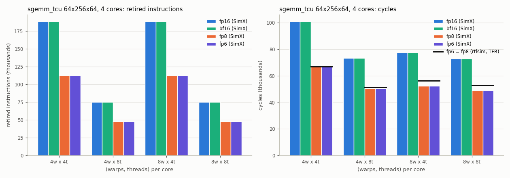

# Assignment 4: FP6 (e2m3) Tensor Format

> Targets Vortex release [v3.0](https://github.com/vortexgpgpu/vortex/releases/tag/v3.0).

## Background

Low-precision formats are how tensor cores buy throughput: fewer bits per
element means more elements per register, per load and per multiplier. The
Vortex v3.0 tensor core (TCU) already supports fp32 accumulation over tf32,
fp16, bf16, fp8 (e4m3) and bf8 (e5m2) inputs. In this assignment you add a
6-bit format from the OCP Microscaling (MX) specification, **fp6 e2m3**, first
to SimX (Part A), then to the RTL tensor core (Part B).

**The format.** 1 sign bit, 2 exponent bits, 3 mantissa bits, exponent bias 1,
and **no Inf or NaN encodings**: the all-ones exponent is an ordinary binade.

| exponent field | value |
|---|---|
| 0 | subnormal: `(-1)^s × 0.m × 2^0` = `m/8` |
| 1, 2, 3 | normal: `(-1)^s × 1.m × 2^(e−1)` |

All 64 codes are finite; the magnitudes are the multiples of 1/8 up to 7.5
(0, 0.125, …, 0.875, 1.0, 1.125, …, 1.875, 2.0, 2.25, …, 3.75, 4.0, 4.5, …, 7.5).
Every product of two fp6 values is exact in fp32.

**Storage.** Vortex stores fp6 **one element per byte** (bits [5:0], bits [7:6]
zero), exactly like fp8. Tensor fragments, loads and stores are sized from the
element container, so they need no change, and the fp8 datapath's byte lanes
can be reused.

**Format id.** Each format has a numeric id shared by software, SimX and RTL.
Ids are bit-coded: bit 0 marks the "bfloat" variant of a pair (bf16 = 3,
bf8 = 5), bit 3 marks block-scaled MX formats, bit 4 integer formats. fp6 takes
id **6**: free, and even, so the RTL treats it as an fp-style (not bfloat)
format.

**Why e2m3 and not e3m2.** e2m3 has three mantissa bits, like e4m3, so the
fp8 multiplier's 4×4 mantissa product `{hidden, m[2:0]}` is reused unchanged;
only the field positions, the bias and the special-value rule differ.

**The benchmark.** `tests/regression/sgemm_tcu` multiplies M×K by K×N
matrices on the tensor core. The element types are compile-time macros:
`-DITYPE=fp6 -DOTYPE=fp32`.

## Setup

Clone the v3.0 release and build it out of tree. If you fetched the `v3.0`
tag before 2026-10-07, refresh it first with `git fetch --tags --force`.

```bash
git clone --branch v3.0 --recursive https://github.com/vortexgpgpu/vortex.git
cd vortex
git apply ~/vortex_tutorials/Exercises/patches/a4_tree_fixes.patch
mkdir build32 && cd build32
../configure --xlen=32 --tooldir=$HOME/tools
./ci/toolchain_install.sh --all     # prebuilt toolchain, first time only
make -s
```

`a4_tree_fixes.patch` fixes two latent problems in v3.0 that no existing format
triggers but a 6-bit format does; neither changes the behaviour of any
existing format:

- `hw/rtl/tcu/tfr/VX_tcu_tfr_mul_f8.sv`: the exponent-bias constants were
  8 bits wide. They are now `EXP_W` bits wide (see Question 4).
- `hw/unittest/tcu_fedp/fedp.h` and `fedp.py`, the C++ and Python reference
  models of the tensor-core dot product: they unpacked lanes at a stride of
  `1 + exp_bits + sig_bits` bits. They now unpack byte-multiple containers, so
  a 6-bit element is read from its byte.

All commands below run from `build32/`. Re-run `../configure` (same arguments)
after editing a `*.toml` file or a Makefile.

## Part A: SimX

### Step A1: Declare the format

In [`sw/common/tensor_cfg.h`](https://github.com/vortexgpgpu/vortex/blob/v3.0/sw/common/tensor_cfg.h#L60),
next to `struct tf32`, add `struct fp6` with `using dtype = uint8_t;`,
`id = 6`, `bits = 8` and `name = "fp6"`, and add its case to `fmt_string()`
([L145](https://github.com/vortexgpgpu/vortex/blob/v3.0/sw/common/tensor_cfg.h#L145)).
`bits` is the **container** width: `wmma_config_t` derives elements per register
from `sizeof(dtype)`, and the RTL helper `tcu_fmt_width` only knows byte
multiples.

### Step A2: Converters

`sw/common/softfloat_ext.{h,cpp}` holds the bit-level conversions,
`sw/common/rvfloats.{h,cpp}` wraps them in the `rv_*` API used everywhere.
Follow the fp4 (e2m1) pair, which has the same shape:

1. [`softfloat_ext.h`](https://github.com/vortexgpgpu/vortex/blob/v3.0/sw/common/softfloat_ext.h#L44):
   `typedef struct { uint8_t v; } float6_t;  // e2m3 (OCP MX, no Inf/NaN)` and the
   declarations `float6_t f32_to_f6e2m3(float32_t);` and
   `float32_t f6e2m3_to_f32(float6_t);`.
2. `softfloat_ext.cpp`, `f6e2m3_to_f32()`: decode sign, exponent, mantissa from
   `a.v & 0x3f` with the table in Background. `std::ldexp` makes it four lines.
3. `softfloat_ext.cpp`, `f32_to_f6e2m3()`: round to nearest even (honour
   `softfloat_roundingMode`), saturate above 7.5 and raise `overflow|inexact`,
   map fp32 Inf/NaN to ±7.5 (there is nothing else to map them to). Do **not**
   call the generic `cvt_f32_to_custom(v, 2, 3, ...)`: it reserves the all-ones
   exponent for Inf/NaN and therefore saturates at 3.75. Hint: in binade `k ≥ 0`
   (and in the subnormal range, `k = 0`) the grid step is `2^(k−3)`; round
   `n = |v| / step` with guard and sticky bits, and carry `n == 16` into the next
   binade.

   <details><summary>Reference implementation, if you are short on time</summary>

   ```c++
   float6_t f32_to_f6e2m3(float32_t a) {
     enum { RNE=0, RTZ=1, RDN=2, RUP=3, RMM=4 };
     const uint32_t bits = a.v;
     const uint32_t sign = bits >> 31;
     const uint32_t exp_ieee = (bits >> 23) & 0xffu;
     const uint32_t sig_ieee = bits & 0x7fffffu;
     const uint32_t frm = softfloat_roundingMode;
     uint32_t mag;

     if (exp_ieee == 0xffu) {
       // No Inf/NaN encoding: saturate to the largest magnitude (7.5).
       softfloat_exceptionFlags |= sig_ieee ? softfloat_flag_invalid : softfloat_flag_overflow;
       mag = 0x1f;
     } else if ((bits & 0x7fffffffu) == 0) {
       mag = 0;
     } else {
       int e_unb = exp_ieee ? (int(exp_ieee) - 127) : -126;
       uint32_t sig = exp_ieee ? ((1u << 23) | sig_ieee) : sig_ieee; // value = sig * 2^(e_unb-23)
       int k = (e_unb > 0) ? e_unb : 0;
       int sh = 23 + (k - 3) - e_unb;                                   // >= 20
       uint64_t n = (sh < 64) ? (uint64_t(sig) >> sh) : 0;
       uint64_t rem = (sh < 64) ? (uint64_t(sig) & ((1ull << sh) - 1)) : uint64_t(sig);
       bool guard  = (sh < 64) && ((rem >> (sh - 1)) & 1);
       bool sticky = (sh < 64) ? ((rem & ((1ull << (sh - 1)) - 1)) != 0) : (sig != 0);
       bool inexact = (rem != 0);
       bool inc;
       switch (frm) {
       default:
       case RNE: inc = guard && (sticky || (n & 1)); break;
       case RTZ: inc = false; break;
       case RDN: inc = sign && inexact; break;
       case RUP: inc = !sign && inexact; break;
       case RMM: inc = guard; break;
       }
       n += inc;
       if (n == 16) { n = 8; k += 1; }   // carried into the next binade
       if (k > 2) {
         softfloat_exceptionFlags |= softfloat_flag_overflow | softfloat_flag_inexact;
         mag = 0x1f;
       } else {
         mag = (n < 8) ? uint32_t(n) : ((uint32_t(k) + 1) << 3) | uint32_t(n - 8);
         if (inexact) {
           softfloat_exceptionFlags |= softfloat_flag_inexact;
           if (mag != 0 && mag < 8) softfloat_exceptionFlags |= softfloat_flag_underflow;
         }
       }
     }
     float6_t res;
     res.v = uint8_t((sign << 5) | mag);
     return res;
   }
   ```
   </details>

4. `softfloat_ext.cpp`, `cvt_custom_to_f32()`
   ([L696](https://github.com/vortexgpgpu/vortex/blob/v3.0/sw/common/softfloat_ext.cpp#L696)):
   this generic decoder treats the all-ones exponent as Inf/NaN for every format
   except e4m3. Exclude e2m3 as well (`exp_bits == 2 && sig_bits == 3`). Your
   fp6 path in SimX does not call it, but the tensor-core unit test of Part B
   uses it as its reference decoder.
5. [`rvfloats.h`](https://github.com/vortexgpgpu/vortex/blob/v3.0/sw/common/rvfloats.h#L130)
   / [`rvfloats.cpp`](https://github.com/vortexgpgpu/vortex/blob/v3.0/sw/common/rvfloats.cpp#L695):
   `uint32_t rv_e2m3tof_s(uint8_t a, uint32_t frm, uint32_t* fflags)` and
   `uint8_t rv_ftoe2m3_s(uint32_t a, uint32_t frm, uint32_t* fflags)`, copies of
   the `rv_e2m1tof_s` / `rv_ftoe2m1_s` wrappers.

### Step A3: The tensor-core model

All in [`sim/simx/tcu/tcu_unit.cpp`](https://github.com/vortexgpgpu/vortex/blob/v3.0/sim/simx/tcu/tcu_unit.cpp):

1. **Multiply-add.** Next to the fp8 specialisations
   ([L127](https://github.com/vortexgpgpu/vortex/blob/v3.0/sim/simx/tcu/tcu_unit.cpp#L127)),
   add `FMA<vt::fp6, vt::fp32>` (convert both inputs with `rv_e2m3tof_s`,
   multiply, add the fp32 accumulator) and `FMA<vt::fp6, vt::fp6>` (same, and
   re-round the result with `rv_ftoe2m3_s`).
2. **Dispatch.** `select_FEDP_N()` ([L267](https://github.com/vortexgpgpu/vortex/blob/v3.0/sim/simx/tcu/tcu_unit.cpp#L267))
   picks the fused-dot-product kernel per (input, output) format: add
   `case vt::fp6::id` under `OT == fp32`, and an `fp6 → fp6` case. An unknown
   format returns `nullptr`, and the simulator then crashes inside the tensor
   unit; that is the symptom of a missing case.
3. **Element width.** `elem_bits()` ([L1292](https://github.com/vortexgpgpu/vortex/blob/v3.0/sim/simx/tcu/tcu_unit.cpp#L1292)):
   add `vt::fp6::id` to the 8-bit group.

### Step A4: The host test

In [`tests/regression/sgemm_tcu/main.cpp`](https://github.com/vortexgpgpu/vortex/blob/v3.0/tests/regression/sgemm_tcu/main.cpp),
copy the fp8 pieces:

- `Comparator<vt::fp6>` ([fp8 at L248](https://github.com/vortexgpgpu/vortex/blob/v3.0/tests/regression/sgemm_tcu/main.cpp#L248)):
  `generate()` returns `rv_ftoe2m3_s()` of a random float in [0, 1];
  `compare()` is bit-exact;
- add `vt::fp6` to the `low_prec_input` list in `Comparator<vt::fp32>::compare`
  ([L311](https://github.com/vortexgpgpu/vortex/blob/v3.0/tests/regression/sgemm_tcu/main.cpp#L311));
- `muladd_t<vt::fp6, vt::fp32>` and `muladd_t<vt::fp6, vt::fp6>`
  ([fp8 at L403](https://github.com/vortexgpgpu/vortex/blob/v3.0/tests/regression/sgemm_tcu/main.cpp#L403)),
  the host reference.

### Step A5: Build and run

The element types and the TCU are compile-time options, so the app and the
driver must be built with the same `CONFIGS`:

```bash
make -s
make -C tests/regression/sgemm_tcu clean
CONFIGS="-DVX_CFG_NUM_THREADS=8 -DVX_CFG_EXT_TCU_ENABLE -DITYPE=fp6 -DOTYPE=fp32" make -C tests/regression/sgemm_tcu
CONFIGS="-DVX_CFG_NUM_THREADS=8 -DVX_CFG_EXT_TCU_ENABLE -DITYPE=fp6 -DOTYPE=fp32" ./ci/blackbox.sh --driver=simx --app=sgemm_tcu
```

Expected tail (1 core, 4 warps, 8 threads, 64×64×64):

```
input data type: fp6 (id=6)
[iter 0] match (0 errors)
PERF: instrs=11984, cycles=23661, IPC=0.506
PASSED!
```

SimX ignores the `VX_CFG_TCU_*_ENABLE` format knobs; only the RTL uses them.

### Step A6: Compare the formats

Run fp16, bf16, fp8 and fp6 (fp32 accumulate) at 4 cores on an
M = 64, N = 256, K = 64 problem (`--args="-n256"`; `-m` and `-k` stay at their
default 64; the run prints `matrix B: 64x256`) for (warps, threads) ∈
{(4,4), (4,8), (8,4), (8,8)}. Every `CONFIGS` change rebuilds the SimX driver (3–10 minutes on
a loaded machine), so the full 16-point sweep is a background job; run a few
points and take the rest from Expected results.

```bash
for fmt in fp16 bf16 fp8 fp6; do
  for wt in "4 4" "4 8" "8 4" "8 8"; do
    set -- $wt
    extra=""; [ $fmt = fp8 ] && extra="-DVX_CFG_TCU_FP8_ENABLE"
    C="-DVX_CFG_NUM_CORES=4 -DVX_CFG_NUM_WARPS=$1 -DVX_CFG_NUM_THREADS=$2 -DVX_CFG_EXT_TCU_ENABLE $extra -DITYPE=$fmt -DOTYPE=fp32"
    make -C tests/regression/sgemm_tcu clean > /dev/null
    CONFIGS="$C" make -C tests/regression/sgemm_tcu > /dev/null
    CONFIGS="$C" ./ci/blackbox.sh --driver=simx --app=sgemm_tcu --args="-n256" > tcu_simx_${fmt}_w$1_t$2.log 2>&1
    echo "$fmt w=$1 t=$2 $(grep -m1 'PERF: instrs' tcu_simx_${fmt}_w$1_t$2.log)"
  done
done
```

## Part B: RTL extension

Part B adds fp6 to the **TFR** backend, the in-house pipelined tensor-core
datapath and the default (`VX_CFG_TCU_TYPE = "TFR"`). Format, test, run
commands and expected output are those of Part A; your SimX build is the
reference.

### Step B1: Apply the starter patch

```bash
cd vortex
git apply ~/vortex_tutorials/Exercises/patches/a4_fp6_rtl_starter.patch
cd build32 && ../configure --xlen=32 --tooldir=$HOME/tools
```

It contains the plumbing, so you can focus on the datapath:

| file | what the patch adds |
|---|---|
| `VX_config.toml` | `VX_CFG_TCU_FP6_ENABLE = false` in `[tcu]`; enable it with `-DVX_CFG_TCU_FP6_ENABLE`. Re-run `../configure`: the `-D` only works once the knob exists |
| `hw/rtl/tcu/VX_tcu_pkg.sv` | `TCU_FP6_ID = 6` and its case in `exp_bits` (2), `sig_bits` (3), `sign_pos` (5), `tcu_fmt_width` (8), `trace_fmt` |
| `hw/rtl/tcu/tfr/VX_tcu_tfr_shared_mul.sv`, `VX_tcu_tfr_mul_join.sv` | the fp8 multiplier bank and its ports exist when FP8 **or** FP6 is enabled (`TFR_MUL_F8_ENABLE`, `TFR_JOIN_F8_ENABLE`, the pattern TF32 uses to share the fp16 bank) |
| `hw/dpi/dpi_float.cpp`, `hw/rtl/tcu/dpi/VX_tcu_fedp_dpi.sv` | fp6 in the DPI reference backend (format code 8) |
| `hw/rtl/tcu/VX_tcu_dsm.sv` | fp6 in the sparse zero detector (only with `VX_CFG_TCU_DSM_ENABLE`) |
| `hw/unittest/tcu_fedp/{main.cpp,fedp.h,fedp.py}`, `hw/unittest/Makefile` | fp6 in the tensor-core unit test: format 6 = (2, 3), no special encodings, generator covers the top binade, fp6 cases in `run-tcu` |

You write the multiplier (Step B2) and the three format case entries
(Step B3). Until Step B3 is in, a build with `-DVX_CFG_TCU_FP6_ENABLE` stops
at Verilator lint (`UNUSEDSIGNAL` on `mul_f8_sig`, `mul_f8_zero`, `exp_f8`,
`exc_f8`): the starter instantiates the fp8 bank for fp6, but nothing reads
its outputs yet. With Step B3 and without Step B2, the unit test fails: the
fp8 bank decodes fp6 elements as e4m3.

### Step B2: The fp8 multiplier bank, third variant

[`hw/rtl/tcu/tfr/VX_tcu_tfr_mul_f8.sv`](https://github.com/vortexgpgpu/vortex/blob/v3.0/hw/rtl/tcu/tfr/VX_tcu_tfr_mul_f8.sv)
multiplies byte elements pairwise. Per lane it decodes two elements per 16-bit
half-word, as e4m3 when `is_bfloat == 0` and as e5m2 when `is_bfloat == 1`.
Add fp6 as a third variant, all under `` `ifdef VX_CFG_TCU_FP6_ENABLE ``:

1. **Constants** (after the BF8 ones, [L69](https://github.com/vortexgpgpu/vortex/blob/v3.0/hw/rtl/tcu/tfr/VX_tcu_tfr_mul_f8.sv#L69)):
   `E_FP6`, `S_FP6` and `B_FP6` from `VX_tcu_pkg::exp_bits/sign_pos(TCU_FP6_ID)`
   like their fp8 siblings, and `BIAS_CONST_FP6 = BIAS_BASE − 2·B_FP6`, `EXP_W`
   bits wide.
2. **Select** in `g_lane`: `wire is_fp6 = (fmt_f == 4'(TCU_FP6_ID));`
   (constant 0 when FP6 is disabled).
3. **Field extraction** in the `always_comb` ([L90](https://github.com/vortexgpgpu/vortex/blob/v3.0/hw/rtl/tcu/tfr/VX_tcu_tfr_mul_f8.sv#L90)):
   a branch before `if (is_bfloat)` that takes exponent `raw_x[S_FP6-1 -: E_FP6]`
   zero-extended to 5 bits, mantissa `raw_x[2:0]` and sign `raw_x[S_FP6]` for
   both operands.
4. **No NaN.** The e4m3 rule `(raw_ea == 5'h0F) && (raw_ma == 3'b111)`
   ([L145](https://github.com/vortexgpgpu/vortex/blob/v3.0/hw/rtl/tcu/tfr/VX_tcu_tfr_mul_f8.sv#L145))
   must not fire for fp6. (It cannot with a zero-extended 2-bit exponent, but
   make the intent explicit with `~is_fp6`.)
5. **Bias.** `bias_sel` ([L195](https://github.com/vortexgpgpu/vortex/blob/v3.0/hw/rtl/tcu/tfr/VX_tcu_tfr_mul_f8.sv#L195))
   selects `BIAS_CONST_FP6` when `is_fp6`.

The mantissa multiplier, the classifier and the exponent adder are untouched.

### Step B3: Route the format

Add `TCU_FP6_ID` to three case lists, each under
`` `ifdef VX_CFG_TCU_FP6_ENABLE `` and each a copy of the fp8 entry:

- [`VX_tcu_tfr_lane_mask.sv`](https://github.com/vortexgpgpu/vortex/blob/v3.0/hw/rtl/tcu/tfr/VX_tcu_tfr_lane_mask.sv#L63):
  `TCU_FP6_ID: lane_mask = mask_8;`
- [`VX_tcu_tfr_shared_mul.sv`](https://github.com/vortexgpgpu/vortex/blob/v3.0/hw/rtl/tcu/tfr/VX_tcu_tfr_shared_mul.sv#L326),
  post-seam `case (fmt_s_r)`: `sig_sel = mul_f8_sig; sig_zero = mul_f8_zero;`
- [`VX_tcu_tfr_mul_join.sv`](https://github.com/vortexgpgpu/vortex/blob/v3.0/hw/rtl/tcu/tfr/VX_tcu_tfr_mul_join.sv#L68),
  `case (fmt_s)`: `exp_sel = exp_f8; exc_sel = exc_f8;`

### Step B4: Unit test first

`hw/unittest/tcu_fedp` is a standalone Verilator testbench of one fused
dot-product unit against a C++ model. Its build takes about 30 s and a run
about 5 s, against 6–12 minutes for a full-chip build, so iterate here:

```bash
CFG="-DSIMULATION -DSV_DPI -DVX_CFG_EXT_TCU_ENABLE -DVX_CFG_TCU_TYPE_TFR -DUSE_FEDP -DVX_CFG_TCU_FP6_ENABLE"
make -C hw/unittest/tcu_fedp clean
make -C hw/unittest/tcu_fedp NUM_REGS=2 CONFIGS="$CFG"
make -C hw/unittest/tcu_fedp run NUM_REGS=2 CONFIGS="$CFG" OPTS="--fmt=6 --W=25 --tests=20000"
#   -> 20000 test(s) PASSED!
```

To debug one failing vector, replay it by id (add `-DDBG_TRACE_TCU` to `CFG`
for per-stage traces):

```bash
make -C hw/unittest/tcu_fedp run NUM_REGS=2 CONFIGS="$CFG" OPTS="--fmt=6 --W=25 --features=normals --test=7"
```

Then check that the existing formats still pass with fp6 enabled
(`--fmt=4` and `--fmt=5` with `-DVX_CFG_TCU_FP8_ENABLE` added to `CFG`), or run
the whole suite with `make -C hw/unittest run-tcu`. The DPI backend runs with
`-DVX_CFG_TCU_TYPE_DPI` instead of `-DVX_CFG_TCU_TYPE_TFR -DUSE_FEDP`,
`NUM_REGS=1` and `OPTS="--fmt=6 --no-fused"`. If you pipe the output through
`grep -m1`, exit code 141 is SIGPIPE, not a failure: look for `PASSED!`.

### Step B5: Full-chip rtlsim and cross-check

Part A Step A5 with `--driver=rtlsim` and the FP6 knob (6–12 minutes of
Verilator build the first time):

```bash
make -C tests/regression/sgemm_tcu clean
CONFIGS="-DVX_CFG_NUM_THREADS=8 -DVX_CFG_EXT_TCU_ENABLE -DVX_CFG_TCU_FP6_ENABLE -DITYPE=fp6 -DOTYPE=fp32" make -C tests/regression/sgemm_tcu
CONFIGS="-DVX_CFG_NUM_THREADS=8 -DVX_CFG_EXT_TCU_ENABLE -DVX_CFG_TCU_FP6_ENABLE -DITYPE=fp6 -DOTYPE=fp32" ./ci/blackbox.sh --driver=rtlsim --app=sgemm_tcu
```

- `instrs=` must match SimX **exactly** (11,984);
- cycles agree within about 7% (25,195 rtlsim vs 23,661 SimX, +6.5%);
- run the same with `-DITYPE=fp8 -DVX_CFG_TCU_FP8_ENABLE`: fp6 and fp8 must be
  cycle-identical, so any SimX/RTL gap is not caused by your format.

Add `-DVX_CFG_TCU_TYPE_DPI` to run the DPI backend instead of TFR.
The BHF backend (HardFloat) is left as a stretch goal: HardFloat has no
2-bit-exponent mode without Inf/NaN, so the clean design is an e2m3 → e4m3
re-encoder (every e2m3 value is an e4m3 value) in front of the existing
`VX_tcu_bhf_fp8mul`.

## Expected results

**SimX, `sgemm_tcu` M = 64, N = 256, K = 64 (`-n256`), fp32 accumulate, 4 cores,
TFR model** (every run `PASSED!`), instructions / cycles:

| format | 4w × 4t | 4w × 8t | 8w × 4t | 8w × 8t |
|---|---|---|---|---|
| fp16 | 188,992 / 101,098 | 75,328 / 73,402 | 189,056 / 77,528 | 75,392 / 73,010 |
| bf16 | 188,992 / 101,098 | 75,328 / 73,402 | 189,056 / 77,528 | 75,392 / 73,010 |
| fp8  | 112,704 / 66,962  | 47,936 / 50,538 | 112,768 / 52,337 | 48,000 / 49,092 |
| fp6  | 112,704 / 66,962  | 47,936 / 50,538 | 112,768 / 52,337 | 48,000 / 49,092 |

fp6 costs exactly what fp8 costs, and bf16 what fp16 costs: the tensor core's
work is set by the element **container** width (four 8-bit or two 16-bit
elements per 32-bit word), not by the arithmetic. The 8-bit formats retire
0.60× (4 threads) to 0.64× (8 threads) the instructions of fp16 and take
0.66–0.69× the cycles, not 0.5×: the rest is per-tile load/store overhead that
does not shrink.

**rtlsim (TFR RTL) vs SimX, same problem and configuration** (fp6 and fp8 give
identical numbers on both drivers):

| (warps, threads) | instrs (both) | rtlsim cycles | SimX cycles | delta |
|---|---:|---:|---:|---:|
| 4 × 4 | 112,704 | 66,833 | 66,962 | −0.2% |
| 4 × 8 | 47,936  | 51,456 | 50,538 | +1.8% |
| 8 × 4 | 112,768 | 56,287 | 52,337 | +7.5% |
| 8 × 8 | 48,000  | 52,975 | 49,092 | +7.9% |

**Correctness runs, 1 core, 4 warps, M = N = K = 64** (Part A Step A5 / Part B
Step B5; the DPI row was run with 4 threads):

| driver | backend | format | threads | instrs | cycles |
|---|---|---|---:|---:|---:|
| SimX   | TFR model | fp6 / fp8 | 8 | 11,984 | 23,661 |
| rtlsim | TFR       | fp6 / fp8 | 8 | 11,984 | 25,195 |
| rtlsim | DPI       | fp6 / fp8 | 4 | 28,176 | 53,185 |

**Unit test** (`tcu_fedp`, TFR, `--W=25 --tests=20000`): tf32, fp16, bf16, fp8,
bf8 and fp6 all `20000 test(s) PASSED!` with fp6 enabled; DPI `--fmt=6
--no-fused` also passes.



Data: [`expected/a4/sgemm_tcu_formats.csv`](expected/a4/sgemm_tcu_formats.csv).
Reproduce: the loop of Part A Step A6 (SimX); for rtlsim, the same loop with
`--driver=rtlsim`, `-DVX_CFG_TCU_FP6_ENABLE` (or `FP8`) and the fp6/fp8 formats
only, plus the commands of Steps A5 and B5.

## Questions

1. Why must `fp6::bits` be 8 and not 6? What would break in the fragment
   layout and in `tcu_fmt_width` with a 6-bit container, and what would a
   denser packing (four fp6 in 3 bytes) cost in the load path?
2. fp6 and fp8 have identical instruction and cycle counts. What would have to
   change in the tensor core for fp6 to be faster than fp8?
3. Why is the 4×4 mantissa multiplier the same for e4m3 and e2m3? What would
   e3m2 need instead?
4. `BIAS_CONST = BIAS_BASE − 2·bias`, with `BIAS_BASE = 231 + WA` (WA = 30..32).
   Compute it for e4m3 (bias 7), e5m2 (bias 15) and e2m3 (bias 1). Why did the
   tree fix widen the constant from 8 to `EXP_W` bits, and what did an fp6
   product look like before it?
5. The classifier is instantiated with a 5-bit exponent and fp6's 2-bit exponent
   is zero-extended into it. What do `is_inf` / `is_nan` return for an all-ones
   fp6 exponent, and why is that exactly the OCP e2m3 semantics?
6. What would go wrong if fp6 had taken id 7?
7. Why do SimX and rtlsim cycles differ (−0.2% at 4 warps × 4 threads, +7.9% at
   8 warps × 8 threads) when the instruction counts match exactly? Use the fp8 numbers to
   argue whether the gap is a property of your fp6 datapath.
8. The two reference models unpacked lanes at a stride of `1 + exp + man` bits.
   Why did no existing format expose the bug, and what did the first fp6
   unit-test failure look like?
