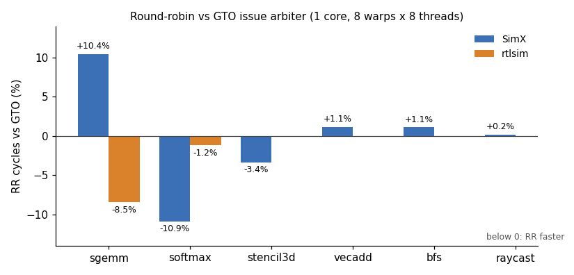

# Assignment 5: Warp Issue Policy: GTO vs Round-Robin

> Targets Vortex release [v3.0](https://github.com/vortexgpgpu/vortex/releases/tag/v3.0).

## Background

Every cycle, each issue slice of a Vortex core picks **one** warp among those
whose next instruction is ready (operands available, functional-unit queue not
full) and sends it to the operand collectors. Which warp it picks is the
*issue policy*. It decides nothing about correctness and nothing about the
instruction count, yet it can move run time by 10% in either direction:

- **Greedy-Then-Oldest (GTO)** keeps issuing from the same warp for as long as
  it stays ready, and only when it stalls switches to the warp that has waited
  longest. One warp runs ahead, its data stays hot in the cache, and the other
  warps are kept in reserve to hide its stalls.
- **Round-Robin (RR)** rotates to the next ready warp after every issue. All
  warps advance together: good for latency hiding when every warp issues
  long-latency operations, bad for locality when warps compete for the same
  cache lines.

Which one wins depends on the kernel. In this assignment you make the policy a
build-time configuration knob, in SimX (Part A) and in the RTL (Part B), and
measure both policies on the same kernels.

**The knob.** One string enum in `VX_config.toml`, in the same style as
`VX_CFG_TCU_TYPE`:

| `CONFIGS` | policy |
|---|---|
| (default) or `-DVX_CFG_ISSUE_ARBITER_GTO` | greedy-then-oldest (the v3.0 SimX behaviour) |
| `-DVX_CFG_ISSUE_ARBITER_RR` | round-robin |

**The measurement.** 1 core, 8 warps × 8 threads, `--perf=1`; the policy must
not change `instrs`, only `cycles`.

## Setup

Clone the v3.0 release and build it out of tree. If you fetched the `v3.0`
tag before 2026-10-07, refresh it first with `git fetch --tags --force`.

```bash
git clone --branch v3.0 --recursive https://github.com/vortexgpgpu/vortex.git
cd vortex
mkdir build32 && cd build32
../configure --xlen=32 --tooldir=$HOME/tools
./ci/toolchain_install.sh --all     # prebuilt toolchain, first time only
make -s
```

All commands below run from `build32/`. After any edit to a `*.toml` file, run
`../configure` again (same arguments) and then `make -s`. There is no handout
patch: the change is about 20 lines in three files.

Check the baseline before you change anything (the first run with a new
shape rebuilds the SimX driver, one to two minutes):

```bash
./ci/blackbox.sh --driver=simx --cores=1 --warps=8 --threads=8 --app=sgemm --args="-n32" --perf=1
```

```
PERF: instrs=24224, cycles=40983, IPC=0.591
PASSED!
```

## Part A: SimX

### How SimX picks a warp today

Read `Core::Impl::issue()` in
[`sim/simx/core.cpp`](https://github.com/vortexgpgpu/vortex/blob/v3.0/sim/simx/core.cpp#L555).
For every issue slice `iw` it builds a `ready_set` bit vector over the
`PER_ISSUE_WARPS` warps of that slice
([L582](https://github.com/vortexgpgpu/vortex/blob/v3.0/sim/simx/core.cpp#L582)),
then asks the slice's arbiter for one of them
([L653](https://github.com/vortexgpgpu/vortex/blob/v3.0/sim/simx/core.cpp#L653)):

```cpp
auto w = ibuffer_arbs_.at(iw).grant(ready_set);
```

The arbiters are created in the constructor with a hard-wired type
([L72](https://github.com/vortexgpgpu/vortex/blob/v3.0/sim/simx/core.cpp#L72)):

```cpp
, ibuffer_arbs_(VX_CFG_ISSUE_WIDTH, {ArbiterType::GTO, PER_ISSUE_WARPS})
```

`ArbiterType` and the four implementations live in
[`sim/simx/types.h`](https://github.com/vortexgpgpu/vortex/blob/v3.0/sim/simx/types.h#L894).
Read two of them:

- [`RoundRobinArbiter`](https://github.com/vortexgpgpu/vortex/blob/v3.0/sim/simx/types.h#L943):
  starts searching one past the last grant.
- [`GTOArbiter`](https://github.com/vortexgpgpu/vortex/blob/v3.0/sim/simx/types.h#L1020):
  re-grants `last_grant_` while it still requests
  ([L1031](https://github.com/vortexgpgpu/vortex/blob/v3.0/sim/simx/types.h#L1031)),
  otherwise picks the requester with the largest `age_`
  ([L1036](https://github.com/vortexgpgpu/vortex/blob/v3.0/sim/simx/types.h#L1036)).
  Look carefully at
  [`update_ages()`](https://github.com/vortexgpgpu/vortex/blob/v3.0/sim/simx/types.h#L1058):
  what happens to the age of a warp that stops requesting? You will need the
  answer in Part B.

### Step 1: Add the knob

In [`VX_config.toml`](https://github.com/vortexgpgpu/vortex/blob/v3.0/VX_config.toml#L46),
section `[pipeline]`, after `VX_CFG_IBUF_SIZE`
([L52](https://github.com/vortexgpgpu/vortex/blob/v3.0/VX_config.toml#L52)), add a
string knob with default `"GTO"`. Then register its legal values in the
`[[enum]]` table at the end of the file
([L454](https://github.com/vortexgpgpu/vortex/blob/v3.0/VX_config.toml#L454)),
next to `VX_CFG_TCU_TYPE`
([L458](https://github.com/vortexgpgpu/vortex/blob/v3.0/VX_config.toml#L458)):

```toml
VX_CFG_ISSUE_ARBITER = ["GTO", "RR"]
```

Re-run `../configure` and look at what it generated:

```bash
../configure --xlen=32 --tooldir=$HOME/tools
grep -n -A3 "ISSUE_ARBITER" sw/VX_config.h | head -20
```

For a string enum, `configure` emits one selector macro per value
(`VX_CFG_ISSUE_ARBITER_GTO`, `VX_CFG_ISSUE_ARBITER_RR`) and defines the
default's selector when none is given. The same header is generated for the
RTL as `hw/VX_config.vh`, which is what makes one knob drive both models.

### Step 2: Use it in `core.cpp`

Replace the hard-wired `ArbiterType::GTO` at
[L72](https://github.com/vortexgpgpu/vortex/blob/v3.0/sim/simx/core.cpp#L72) by a
file-scope `constexpr ArbiterType` that is `ArbiterType::RoundRobin` when
`VX_CFG_ISSUE_ARBITER_RR` is defined and `ArbiterType::GTO` otherwise. Nothing
else changes: `Arbiter` already dispatches on the type.

### Step 3: Build and check

```bash
make -s
for pol in GTO RR; do
  CONFIGS="-DVX_CFG_ISSUE_ARBITER_$pol" ./ci/blackbox.sh --driver=simx --cores=1 --warps=8 --threads=8 \
    --app=sgemm --args="-n32" --perf=1 | grep -E "^PERF: instrs|PASSED|FAILED"
done
```

```
PERF: instrs=24224, cycles=40983, IPC=0.591
PASSED!
PERF: instrs=24224, cycles=45265, IPC=0.535
PASSED!
```

Same `instrs`, different `cycles`: the policy only reorders work. If the two
runs print identical cycles, your macro is not reaching `core.cpp` (check the
`CONFIGS=` line that `blackbox.sh` echoes, and `sw/VX_config.h`).

`CONFIGS` is part of the driver's build stamp, so every policy switch rebuilds
the SimX driver once (20–60 s). Run all kernels for one policy, then all for
the other.

### Step 4: Sweep

```bash
mkdir -p arb
for pol in GTO RR; do
  for spec in "sgemm|-n32" "softmax|-n64" "stencil3d|-n16" "vecadd|-n16384" "bfs|-n1024" "raycast|-w32 -h32"; do
    app=${spec%%|*}; args=${spec#*|}
    log=arb/simx_${pol}_${app}.log
    CONFIGS="-DVX_CFG_ISSUE_ARBITER_$pol" ./ci/blackbox.sh --driver=simx --cores=1 --warps=8 --threads=8 \
      --app=$app --args="$args" --perf=1 > $log 2>&1
    echo "$pol $app: $(grep -E '^PERF: instrs|PASSED|FAILED' $log | tr '\n' ' ')"
  done
done
```

The whole sweep takes a few minutes. Fill in your SimX columns of the table in
Expected results and compare. Two other lines of each log tell you *why* one
policy wins; keep them for the Questions:

- `PERF: scheduler:`: `idle` is the share of cycles in which no warp could
  issue; `occupancy` is the average number of active warps (out of 8).
- `PERF: memory:`: `load_lat` is the average load latency in cycles. It rises
  when warps evict each other's cache lines.

```bash
grep -H -E "PERF: (scheduler|memory)" arb/simx_*_sgemm.log arb/simx_*_softmax.log
```

```
arb/simx_GTO_sgemm.log:PERF: scheduler: idle=41%, occupancy=7.8 (98%), simt_util=8.0 (100%)
arb/simx_GTO_sgemm.log:PERF: memory: ifetch_lat=5.03, load_lat=11.93, loads=69632, stores=1024
arb/simx_RR_sgemm.log:PERF: scheduler: idle=46%, occupancy=8.0 (99%), simt_util=8.0 (100%)
arb/simx_RR_sgemm.log:PERF: memory: ifetch_lat=5.04, load_lat=12.58, loads=69632, stores=1024
arb/simx_GTO_softmax.log:PERF: scheduler: idle=51%, occupancy=6.9 (87%), simt_util=7.6 (95%)
arb/simx_GTO_softmax.log:PERF: memory: ifetch_lat=5.00, load_lat=24.97, loads=401987, stores=387840
arb/simx_RR_softmax.log:PERF: scheduler: idle=45%, occupancy=7.9 (99%), simt_util=7.6 (95%)
arb/simx_RR_softmax.log:PERF: memory: ifetch_lat=5.00, load_lat=26.05, loads=401987, stores=387840
```

The `PERF: stalls:` line does not separate the two policies here: the
functional-unit classes (`alu`, `lsu`, `sfu`, `fpu`) stay at 0% for every
kernel, and `scrb` counts every cycle in which *any* warp waits on its
operands, even when another warp issues in that cycle.

`softmax` here is the kernel exactly as shipped in v3.0, used as a scheduling
workload. [Assignment 8](assignment8.md), Step 0, explains why it executes far
more instructions than its arithmetic suggests. Do not fix it here, or your
numbers will not match the table.

## Part B: RTL extension

Part B wires the same knob into the RTL. Steps 1 (toml) and 4 (sweep) of
Part A are shared: do not repeat them. Your Part A SimX build is the reference.

### What differs in hardware

The issue-slice arbiter is the `out_arb` instance in
[`hw/rtl/core/VX_scoreboard.sv`](https://github.com/vortexgpgpu/vortex/blob/v3.0/hw/rtl/core/VX_scoreboard.sv#L311),
and it is **not** a GTO arbiter in v3.0:

```verilog
    // Matrix arbiter scales better past 8 requesters; RR is cheaper below that.
    VX_generic_arbiter #(
        .NUM_REQS (PER_ISSUE_WARPS),
        .TYPE     ((PER_ISSUE_WARPS > 8) ? "M" : "R"),
        .STICKY   (1) // Greedy
    ) out_arb (
```

A sticky round-robin holds its grant while the granted warp keeps requesting
(greedy) and falls back to round-robin order: *greedy-then-round-robin*, a
third policy that SimX does not model. The library has both pieces you need:

| File | What it gives you |
|---|---|
| [`hw/rtl/libs/VX_generic_arbiter.sv`](https://github.com/vortexgpgpu/vortex/blob/v3.0/hw/rtl/libs/VX_generic_arbiter.sv#L19) | `TYPE` selects the implementation: `"R"` round-robin, `"G"` GTO ([L97](https://github.com/vortexgpgpu/vortex/blob/v3.0/hw/rtl/libs/VX_generic_arbiter.sv#L97)), `"M"` matrix, `"P"` priority, `"C"` cyclic |
| [`hw/rtl/libs/VX_rr_arbiter.sv`](https://github.com/vortexgpgpu/vortex/blob/v3.0/hw/rtl/libs/VX_rr_arbiter.sv#L21) | `STICKY = 0` is plain round-robin, the same rule as SimX's `RoundRobinArbiter` |
| [`hw/rtl/libs/VX_gto_arbiter.sv`](https://github.com/vortexgpgpu/vortex/blob/v3.0/hw/rtl/libs/VX_gto_arbiter.sv#L46) | greedy part: `prev_grant` held while it requests ([L107](https://github.com/vortexgpgpu/vortex/blob/v3.0/hw/rtl/libs/VX_gto_arbiter.sv#L107)); "oldest" part: a dominance matrix in which the granted warp is demoted below all others ([L61](https://github.com/vortexgpgpu/vortex/blob/v3.0/hw/rtl/libs/VX_gto_arbiter.sv#L61)) |

Compare the "oldest" rule of `VX_gto_arbiter` with `GTOArbiter::update_ages()`
in SimX. They are not the same definition of "oldest"; Question 3 comes back
to this.

Dropping `STICKY` is safe: multi-uop sequences that must issue back-to-back
are protected by `fu_locked`, which masks the arbiter's *requests*
([L275–L282](https://github.com/vortexgpgpu/vortex/blob/v3.0/hw/rtl/core/VX_scoreboard.sv#L275)),
not by the arbiter's stickiness.

### Step B1: Select the arbiter (`VX_scoreboard.sv`)

Before the `out_arb` instance, define a string `localparam` from the knob:
`"R"` when `` `VX_CFG_ISSUE_ARBITER_RR `` is defined, `"G"` otherwise (use the
`` `STRING `` type macro, as `VX_generic_arbiter` does for its `TYPE` port).
Pass it as `.TYPE`, remove `.STICKY (1)` (default 0) and the stale comment.
That is the whole hardware change: `VX_scoreboard.sv` already sees
`VX_config.vh`, and `VX_generic_arbiter` already instantiates both arbiters
with the same ports.

### Step B2: Build and cross-check

Run Step 3 of Part A, and `softmax -n64` from Step 4, with
`--driver=rtlsim`. Each policy is a separate Verilator build (`CONFIGS`
differ), a few minutes on a fast machine and up to 15 min on a laptop; after
that `sgemm -n32` runs in seconds and `softmax -n64` in under a minute.

```bash
for pol in GTO RR; do
  for spec in "sgemm|-n32" "softmax|-n64"; do
    app=${spec%%|*}; args=${spec#*|}
    log=arb/rtlsim_${pol}_${app}.log
    CONFIGS="-DVX_CFG_ISSUE_ARBITER_$pol" ./ci/blackbox.sh --driver=rtlsim --cores=1 --warps=8 --threads=8 \
      --app=$app --args="$args" --perf=1 > $log 2>&1
    echo "$pol $app: $(grep -E '^PERF: instrs|PASSED|FAILED' $log | tr '\n' ' ')"
  done
done
```

Cross-check against Part A:

- `instrs=` must match SimX **exactly** for every kernel and policy
  (24,224 for `sgemm -n32`, 908,826 for `softmax -n64`);
- `cycles=` will not match, and for `sgemm` the *winner* is different. That
  is the point of Questions 3 and 4, not a bug in your change.

## Expected results

1 core, 8 warps × 8 threads (issue width 1, 8 warps per issue slice), default
v3.0 configuration otherwise, `--perf=1`. All runs pass. `instrs` are
identical across policies and across SimX and rtlsim. Δ = RR cycles relative
to GTO (negative: RR faster).

| app | args | instrs | SimX GTO | SimX RR | Δ SimX | rtlsim GTO | rtlsim RR | Δ rtlsim |
|---|---|---:|---:|---:|---:|---:|---:|---:|
| sgemm     | `-n32`        | 24,224  | 40,983    | 45,265    | +10.4% | 44,425    | 40,667    | −8.5% |
| softmax   | `-n64`        | 908,826 | 1,862,900 | 1,660,274 | −10.9% | 1,682,806 | 1,662,339 | −1.2% |
| stencil3d | `-n16`        | 111,648 | 203,767   | 196,913   | −3.4%  | | | |
| vecadd    | `-n16384`     | 49,184  | 77,236    | 78,116    | +1.1%  | | | |
| bfs       | `-n1024`      | 3,492   | 20,882    | 21,114    | +1.1%  | | | |
| raycast   | `-w32 -h32`   | 991,337 | 2,768,599 | 2,773,246 | +0.2%  | | | |

Two reference points for the Questions (same shape, same kernels):

| variant | sgemm `-n32` cycles | softmax `-n64` cycles |
|---|---:|---:|
| rtlsim, v3.0 RTL unmodified (greedy-then-round-robin, Background of Part B) | 42,641 | 1,677,197 |
| SimX, `GTOArbiter` with the RTL's least-recently-granted fallback (Question 3) | 45,154 | 1,679,170 |



The raw numbers are in [`expected/a5/arbiter_results.csv`](expected/a5/arbiter_results.csv).
To reproduce, run the loops of Part A Step 4 and Part B Step B2. To plot one
kernel from your own logs:

```bash
python3 <path-to-this-repo>/Exercises/tools/plot_perf.py \
  gto=arb/simx_GTO_sgemm.log rr=arb/simx_RR_sgemm.log --metric cycles --normalize gto -o sgemm.png
```

## Questions

1. **Locality or latency?** In SimX, `sgemm` is 10% faster with GTO and
   `softmax` 11% faster with RR, while `vecadd`, `bfs` and `raycast` do not
   care. Explain each result from the `PERF: scheduler:` and `PERF: memory:`
   lines of your sweep (for `sgemm`, which policy has the lower `load_lat`,
   and why? for `softmax`, why does GTO keep fewer warps active on average?)
   and from the structure of each kernel (what does a warp do between two
   loads? how much work does it do per load?). Why are the streaming kernels
   insensitive?
2. **Same instructions, different order.** Why must `instrs` be identical
   under both policies? Name a kind of kernel for which it would *not* be
   (hint: what if a warp spins on a flag written by another warp?).
3. **Two definitions of "oldest".** SimX's `GTOArbiter` resets a warp's age to
   0 whenever it is not requesting, so "oldest" means "has been ready and
   waiting the longest *without interruption*". `VX_gto_arbiter` keeps a
   least-recently-granted order that only changes on a grant. Change SimX's
   fallback to least-recently-granted (keep the greedy part) and re-run
   `sgemm` and `softmax` with GTO. Compare with the reference row above and
   with rtlsim. What does this tell you about the `sgemm` gap between the
   models?
4. **Why do SimX and rtlsim cycles differ** for the same policy? List the
   parts of the issue path that the two models implement differently (Question
   3 is one of them; look also at how readiness reaches the arbiter in
   `VX_scoreboard.sv`, which registers `operands_ready`, and at what
   `core.cpp` counts as ready). Which of the two would you trust for an
   architecture paper, and what would you do before trusting either?
5. **What did v3.0 ship?** The unmodified RTL is greedy-then-round-robin.
   Where does it land between your GTO and RR numbers? Would you make it a
   third value of `VX_CFG_ISSUE_ARBITER`, and what would SimX need for it?
6. **Hardware cost.** `VX_gto_arbiter` keeps an N×N dominance matrix; a
   round-robin arbiter keeps a pointer. How many flip-flops does each need for
   8 and for 16 warps per issue slice, and what is on the critical path of
   each? Why did v3.0 switch to a matrix arbiter above 8 requesters?
