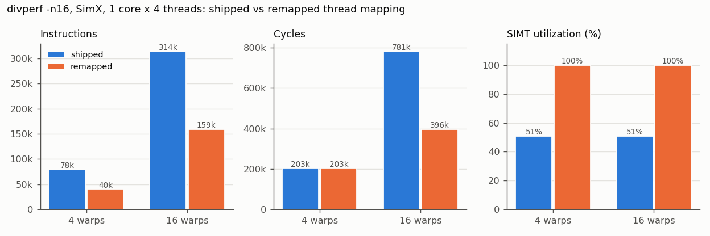
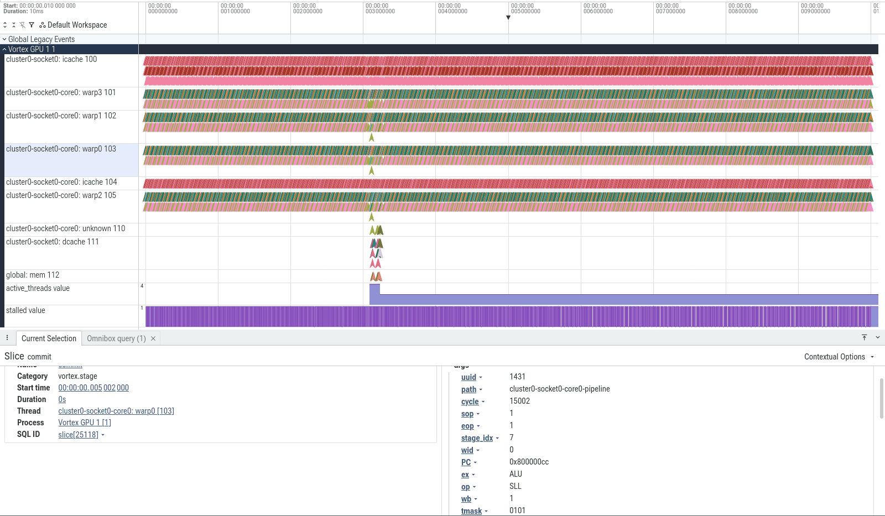
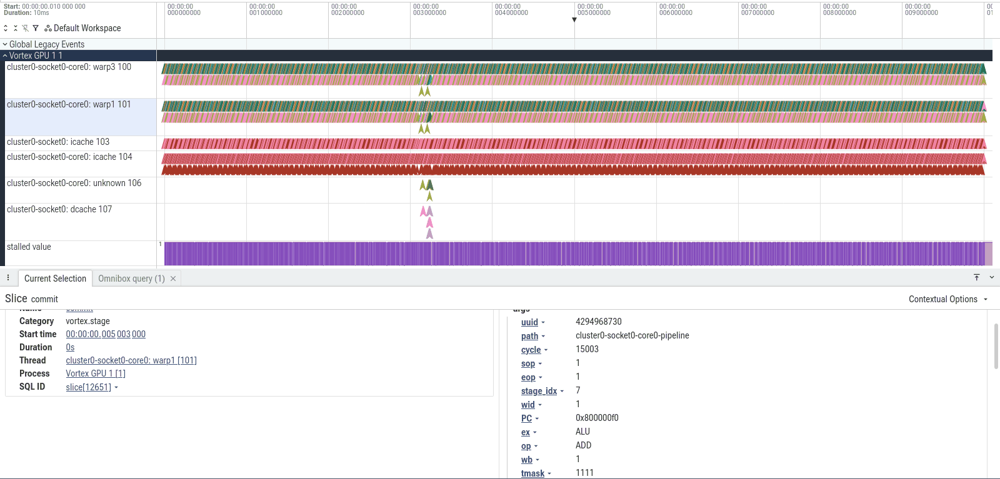

# Assignment 7: Performance Analysis with Perfetto

> Targets Vortex release [v3.0](https://github.com/vortexgpgpu/vortex/releases/tag/v3.0).

## Background

Performance counters tell you *how much*; a timeline tells you *where* and
*when*. Vortex v3.0 ships
[`ci/perfetto.py`](https://github.com/vortexgpgpu/vortex/blob/v3.0/ci/perfetto.py),
a converter from a SimX or rtlsim debug trace to the Chrome trace JSON format
that the [Perfetto UI](https://ui.perfetto.dev) displays. You get one timeline
row per warp with one slice per instruction (from its first pipeline stage to
commit), stage markers, per-warp state counters and cache/memory events.
The guide is
[`docs/perfetto_analysis.md`](https://github.com/vortexgpgpu/vortex/blob/50cb17454/docs/perfetto_analysis.md)
(the copy on `master`; the v3.0 copy names the script `vortex_perfetto.py`, which
is `ci/perfetto.py` in the tree).

In this assignment you profile a kernel with a performance problem, find the
cause in the timeline, fix it, and measure the fix with counters.

**The kernel.** `tests/regression/divperf` (handout patch) computes
`dst[e] = elem_fn(e, src0[e], src1[e])` over `16 × num_threads_total` elements.
Odd elements are expensive (`heavy_fn`, a 200-iteration dependent chain of ALU
operations); even elements are one add (`light_fn`). Each hardware thread
processes the elements `slot, slot + num_tasks, slot + 2·num_tasks, …`, where
`slot` is the thread-to-element mapping you will change. The host checks every
element, so any mapping that covers each element exactly once passes.

**What the trace contains.** `perfetto.py` keys on events that SimX prints at
debug level 3 (`--debug=3`): `pipeline schedule`/`commit` lines, scheduler
`warp-state` lines
([`scheduler.cpp`](https://github.com/vortexgpgpu/vortex/blob/v3.0/sim/simx/scheduler.cpp#L292)),
LSU `mem-req` lines and cache events. In the export:

| Perfetto element | What it is |
|---|---|
| process `Vortex GPU 1` | the whole device; expand it |
| track `cluster0-socket0-core0: warpN` | one async slice per instruction of warp N; instant markers `schedule`, `decode`, `issue`, `dispatch`, `execute`, `commit`; click a marker for `uuid`, `PC`, `op`, `ex`, `tmask` (and the destination value at `commit`) |
| counter tracks `active_threads value` and `stalled value` | `active_threads` is the number of set bits of a warp's thread mask, `stalled` whether a warp is stalled. The converter emits them per warp, but Perfetto keeps one track per counter name for the whole process, so all warps' samples share one track |
| tracks `...: icache`, `cluster0-socket0: dcache`, `global: mem` | instant markers `dcache:core-req`, `dcache:miss`, `dcache:fill`, `mem:mem-req`, … |

Two caveats: the guide also mentions an `active` counter, but a SimX run of this
kernel logs no `active` warp-state events, so that track does not appear; and
`active_threads` is only sampled when a thread mask changes, so read its *value*,
not the density of samples (a window in which no mask changes has no
`active_threads` track at all).

**The counter you will move.** `--perf=1` prints, among others,

```
PERF: scheduler: idle=61%, occupancy=4.0 (100%), simt_util=2.0 (51%)
```

`simt_util` is the average number of active threads per issued instruction
(issued threads / issued warps, in
[`perf.cpp`](https://github.com/vortexgpgpu/vortex/blob/v3.0/sw/runtime/common/perf.cpp#L350)),
and the percentage is of the warp width. `occupancy` is the average number of
active warps per cycle.

## Setup

Clone the v3.0 release and build it out of tree. If you fetched the `v3.0`
tag before 2026-10-07, refresh it first with `git fetch --tags --force`.

```bash
git clone --branch v3.0 --recursive https://github.com/vortexgpgpu/vortex.git
cd vortex
mkdir build32 && cd build32
../configure --xlen=32 --tooldir=$HOME/tools
./ci/toolchain_install.sh --all     # prebuilt toolchain, first time only
make -s
```

Apply the handout patch from the Vortex root and re-run `configure`, which
copies the new test's Makefile into the build tree. `$TUTORIAL` is your
checkout of this tutorial repository (e.g. `~/vortex_tutorials`).

```bash
cd ..                                    # Vortex root
git apply $TUTORIAL/Exercises/patches/a7_divperf_test.patch
cd build32
../configure --xlen=32 --tooldir=$HOME/tools
```

The patch adds `tests/regression/divperf/{kernel.cpp,main.cpp,common.h,Makefile}`.
You need a browser with https://ui.perfetto.dev (the trace is loaded locally;
nothing is uploaded) and Python 3.8+.

No Verilator build is needed. Switching between `--perf=1`, `--debug=3` and a
different `--warps` rebuilds the SimX runtime (about a minute each time);
SimX cycle counts are identical in debug and non-debug builds.

## Part A: SimX

### Step 1: Counters first

```bash
./ci/blackbox.sh --driver=simx --app=divperf --perf=1
```

Write down `instrs`, `cycles`, `IPC`, `simt_util`, `occupancy`, `idle` and the
`branches:` line. Note that `simt_util` is about half of the warp width while
`occupancy` is full. Form a hypothesis before you look at the timeline.

### Step 2: Trace and export a window

```bash
./ci/blackbox.sh --driver=simx --app=divperf --debug=3 --log=run_before.log
python3 ci/perfetto.py run_before.log -t simx --cycle-min 10000 --cycle-max 20000 -c -o before.json.gz
```

The log is large (about 168 MB, 1.44 M lines, for the 78 k instructions of the
203 k-cycle run: roughly 18 lines, 2.1 KB, per executed instruction).
Converting it whole takes minutes and produces a trace the browser struggles with, so always export a window: cycles 10,000–20,000 convert in about
12 s to a 0.7 MB file. Without `--cycle-ns`, one cycle is shown as 1 µs: the
window starts at 10 ms (cycle 10,000) and the axis runs 0–10 ms across it.

### Step 3: Read the timeline

1. Open https://ui.perfetto.dev, *Open trace file*, load `before.json.gz`.
2. Expand `Vortex GPU 1`. Each `warpN` track has two rows: instruction slices
   on top, stage markers below.
3. Look at the `active_threads value` track across the window.
4. Zoom into a few hundred cycles of one warp track (`W`/`S` keys or Ctrl+scroll):
   the dense comb of short slices is the heavy loop. Click several `commit`
   markers inside it and read `tmask` and `PC` in the *Current Selection* panel.
   SimX prints thread masks **lane 0 first**, so `tmask=0101` means lanes 1 and
   3 are active.
5. To jump to a specific marker, type `:` in the search box and run SQL, then
   click the `id` of a result row:
   ```sql
   select s.id, s.ts, s.dur, s.track_id from slice s
   join args a on a.arg_set_id = s.arg_set_id
   join args w on w.arg_set_id = s.arg_set_id
   where s.name = 'commit' and a.key = 'args.tmask' and a.string_value = '0101'
     and w.key = 'args.wid' and w.int_value = 0 and s.ts > 15000000
   order by s.ts limit 1
   ```

Count the commit masks of the whole window from the log (same window as the
export):

```bash
awk '/pipeline commit:/ { c = $2 + 0; if (c >= 10000 && c <= 20000) {
       match($0, /tmask=[01]+/); m[substr($0, RSTART + 6, RLENGTH - 6)]++; n++ } }
     END { for (k in m) printf "%s %6d %5.1f%%\n", k, m[k], 100 * m[k] / n }' run_before.log
```

**Deliverable 1:** a screenshot of the four `warpN` tracks and the
`active_threads`/`stalled` counter tracks, the commit-mask histogram, and a two-sentence diagnosis: which lanes run the heavy
loop, why every warp executes it, and what that costs.

### Step 4: Remap threads to elements

Edit the line `uint32_t slot = gid;` in `tests/regression/divperf/kernel.cpp`
(the source tree; the build picks it up). Keep the shipped line so you can
measure both versions, and select yours with a macro:

```c++
#ifdef REMAPPED
	uint32_t slot = /* your mapping of gid */;
#else
	uint32_t slot = gid;
#endif
```

Requirements:

- every element is still processed exactly once (the host check enforces it);
- within one warp, all threads get elements of the **same parity** in every
  iteration of the `i` loop, so the heavy branch runs with a full thread mask on
  some warps and not at all on the others;
- it works for 4 and 16 warps per core. You may assume 4 threads per warp, the
  default; `lane = gid & 3` and `warp = gid >> 2` are a good start.

Hint: `e` has the parity of `slot` when `num_tasks` is even. Pair up warps.

### Step 5: Measure the fix

`CONFIGS` reaches both the runtime and the kernel build, and a new `CONFIGS`
value rebuilds the app:

```bash
CONFIGS="-DREMAPPED" ./ci/blackbox.sh --driver=simx --app=divperf --perf=1
CONFIGS="-DREMAPPED" ./ci/blackbox.sh --driver=simx --app=divperf --debug=3 --log=run_after.log
python3 ci/perfetto.py run_after.log -t simx --cycle-min 10000 --cycle-max 20000 -c -o after.json.gz
```

Repeat the histogram on `run_after.log` and load `after.json.gz`.
**Deliverable 2:** the after screenshot and histogram, and the before/after
counters.

The instruction count halves. Now look at `cycles`. If the speedup is not what
you expected, do not go back to the kernel: go back to the counters (`idle` and
`IPC`; at 4 warps the `stalls:` line is 0% in both versions) and explain.

### Step 6: Give the core more warps

Run both versions with 16 warps per core (counters only; do not trace this
configuration, the log would be several hundred MB):

```bash
./ci/blackbox.sh --driver=simx --app=divperf --warps=16 --perf=1                      # shipped
CONFIGS="-DREMAPPED" ./ci/blackbox.sh --driver=simx --app=divperf --warps=16 --perf=1 # remapped
```

(`--warps=16` adds `-DVX_CFG_NUM_WARPS=16` to `CONFIGS`: `blackbox.sh` rebuilds
the runtime and the app. If you build the kernel by hand, `make clean` it first.)

**Deliverable 3:** the four-row table of Expected results with your numbers,
and an explanation of why the remap halves the cycles at 16 warps but not at 4.

## Expected results

`divperf -n16`, SimX, 1 core, 4 threads per warp, `--perf=1`. All runs pass. A
different correct remapping can differ by a few instructions per thread from the
reference row; cycles should match within about 1%. The table is also in
[`expected/a7/divperf_results.csv`](expected/a7/divperf_results.csv).

| warps | kernel | instrs | cycles | IPC | simt_util | occupancy | idle | divergent branches | commits with `tmask=1111` (cycles 10k–20k) |
|---|---|---:|---:|---:|---|---|---:|---:|---|
| 4 (default) | shipped | 78,408 | 203,187 | 0.386 | 2.0 (51%) | 4.0 (100%) | 61% | 64 | 2% (98% are `0101`) |
| 4 | remapped | 39,748 | 202,555 | 0.196 | 4.0 (100%) | 2.0 (51%) | 80% | 0 | 100% |
| 8 | shipped | 156,816 | 352,127 | 0.445 | 2.0 (51%) | 8.0 (100%) | 55% | 128 | — |
| 8 | remapped | 79,496 | 210,927 | 0.377 | 4.0 (100%) | 4.1 (51%) | 62% | 0 | — |
| 16 | shipped | 313,632 | 781,186 | 0.401 | 2.0 (51%) | 15.8 (99%) | 60% | 256 | — |
| 16 | remapped | 158,992 | 396,236 | 0.401 | 4.0 (100%) | 8.1 (51%) | 60% | 0 | — |

The remap gives no speedup at 4 warps, 1.67× at 8 warps and 1.97× at 16 warps.
The 8-warp rows are the answer to Question 3; do not read them before you
predict them.

**What caps the IPC near 0.4.** `heavy_fn` is a chain of dependent integer
ops, so all of the work goes through the ALU's dispatch queue. In v3.0 that queue holds
`VX_CFG_DISPATCH_QUEUE_SIZE = 4` entries, and a warp stops requesting issue
once 3 ALU ops are in flight. Because the warp simply drops out of the
arbitration, no `stalls:` class counts it. Doubling the queue confirms the
ceiling (shipped kernel, `CONFIGS="-DVX_CFG_DISPATCH_QUEUE_SIZE=8"`):

| warps | queue size | cycles | IPC |
|---|---:|---:|---:|
| 4  | 4 (default) | 203,187 | 0.386 |
| 4  | 8           | 203,186 | 0.386 |
| 16 | 4 (default) | 781,186 | 0.401 |
| 16 | 8           | 393,878 | 0.796 |



Commit-mask histogram, window 10,000–20,000:

```
# shipped                      # remapped
0101   3794  98.0%             1111   1945 100.0%
1111     64   1.7%
1010     12   0.3%
```

**The two timelines.**



The shipped kernel, window 10,000–20,000, with a `commit` marker of warp 0
selected at cycle 15,002 (`tmask=0101`, `PC=0x800000cc`, inside the heavy loop).
All four warps carry the dense comb of short ALU slices: the six-instruction
heavy loop at `0x800000cc`–`0x800000e0`. `active_threads` is 4 from cycle 13,087
to 13,230, while each warp stores its result, computes its next element and loads
it with all four lanes, and 2 again once the parity branch splits the warp; the
two light lanes then commit their three instructions as `1010` and the heavy loop
resumes as `0101`. The `dcache` and `mem` markers fall in the same short span.
`stalled value` toggles at nearly every instruction, since each one waits for the
previous result of the dependent chain; the track mixes all four warps.



The remapped kernel, same window, with a `commit` marker of warp 1 selected at
cycle 15,003 (`tmask=1111`). Warps 0 and 2 have no track: they finished their
light elements by cycle 3,605. Warps 1 and 3 carry the dense comb of the heavy
loop (`0x800000e8`–`0x800000fc` in this build) with every lane active. No
thread mask changes inside the window, so there is no `active_threads` track.

Reproduce (from `build32/`, after Setup):

```bash
for w in 4 8 16; do
  ./ci/blackbox.sh --driver=simx --app=divperf --warps=$w --perf=1 | tee divperf_shipped_w$w.log
  CONFIGS="-DREMAPPED" ./ci/blackbox.sh --driver=simx --app=divperf --warps=$w --perf=1 | tee divperf_remapped_w$w.log
done
grep -H "scheduler:\|branches:\|PERF: instrs" divperf_*_w*.log
python3 $TUTORIAL/Exercises/tools/plot_perf.py shipped=divperf_shipped_w16.log \
    remapped=divperf_remapped_w16.log --metric instrs --metric cycles -o divperf_w16.png
./ci/blackbox.sh --driver=simx --app=divperf --debug=3 --log=run.log
python3 ci/perfetto.py run.log -t simx --cycle-min 10000 --cycle-max 20000 -c -o win.json.gz
```

## Questions

1. Before the fix, `occupancy` was 100% and `simt_util` 51%; after it, the
   reverse. Which of the two counters measures wasted issue slots, and which
   measures latency hiding? Why can one not substitute for the other?
2. With 4 warps the instruction count halves but the cycle count does not move
   (203,187 → 202,555), and `idle` rises from 61% to 80%. Explain with the
   structure of `heavy_fn` (a dependent chain) and the number of warps that
   still run it. What is the cycle count bounded by in each case?
3. With 16 warps both versions run at the same IPC, 0.40, and the remap gives
   1.97×. That 0.40 is a core-wide ceiling: once 3 ALU ops are in flight, the
   ALU dispatch queue stops further issue (Expected results shows the ceiling
   doubling when the queue doubles). One warp alone running `heavy_fn` reaches
   only about 0.1 IPC, because each op waits for the previous one. Using these
   two limits (a per-warp rate and a core-wide ceiling), explain why the remap
   gives nothing at 4 warps and 1.97× at 16. Then predict the cycles and the
   speedup at 8 warps (`--warps=8`) before you run it, and compare with your
   prediction.
4. `branches: divergent=` counts 64 (4 warps) and 256 (16 warps) before the fix.
   Relate these numbers to the kernel's loop structure. Why is the divergent
   *rate* still printed as 0%?
5. Your remap hard-codes 4 threads per warp. Write it for any power-of-two warp
   width `T`. Which condition on `num_tasks` and the number of warps does it
   need?
6. A GPU compiler cannot do this remap automatically in general. Why not? What
   would it have to prove about the kernel?
7. The trace is about 2.1 KB per executed instruction (18 lines of ~117
   bytes). Estimate the log size for the 16-warp shipped run and explain why
   the assignment windows every export.
   How would you find the interesting window of a long run without tracing all
   of it?

## Going further

- Export an rtlsim trace of the same kernel (`--driver=rtlsim --debug=3`, one
  Verilator build): pass `-t rtlsim`, start the window at 2 or later to skip the
  pre-reset noise, and remember that rtlsim time stamps are ticks, 2 per cycle
  (`--cycle-ns 1.667` maps them to ns at 300 MHz).
- Use `--values all` to see source operands on the `dispatch` markers (much
  larger export).
