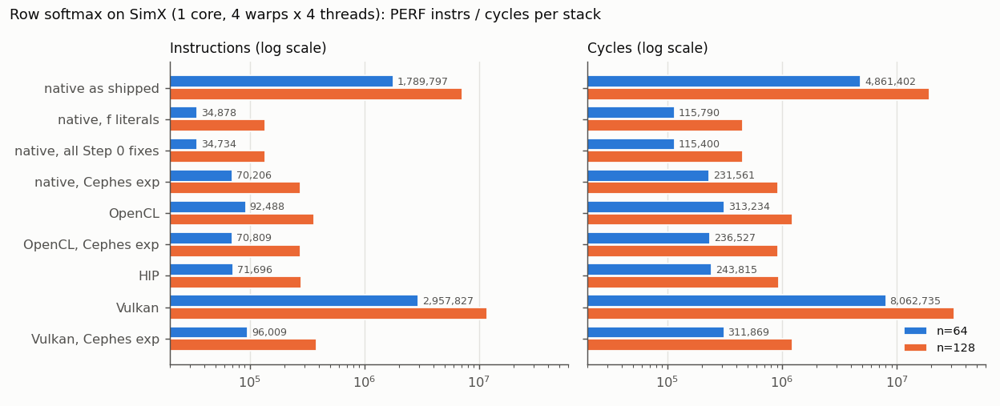

# Assignment 8: One Kernel, Four Stacks — Row Softmax

> Targets Vortex release [v3.0](https://github.com/vortexgpgpu/vortex/releases/tag/v3.0).

## Background

Vortex runs kernels written against several programming models. Each one
reaches the same RISC-V cores through a different compiler and runtime:

| Stack | Kernel language | Compiled by | Runs through | Test directory |
|---|---|---|---|---|
| Native | C++ with [`vx_spawn2.h`](https://github.com/vortexgpgpu/vortex/blob/v3.0/sw/kernel/include/vx_spawn2.h) (`__kernel`, `blockIdx`, `threadIdx`) | Vortex LLVM, ahead of time | `vortex2.h` runtime | `tests/regression/` |
| OpenCL | OpenCL C (`kernel.cl`) | PoCL, at `clBuildProgram` time | PoCL Vortex device | `tests/opencl/` |
| HIP | HIP C++ (`__global__`) | `hipcc` (chipStar) → SPIR-V; PoCL JIT at first launch | chipStar → PoCL | `tests/hip/` |
| Vulkan | GLSL compute shader (`.comp`) | `glslc` → SPIR-V; Mesa's vortexpipe at pipeline creation | Mesa lavapipe + vortexpipe | `tests/vulkan/` |

In this assignment you write the **same kernel** for all of them and compare
what each stack turns it into. You write device code only: host programs,
build files and result checks are provided.

**The problem.** Row-wise softmax of an `n × n` row-major float matrix:

```
y[r][c] = exp(x[r][c] − m_r) / Σ_c' exp(x[r][c'] − m_r),     m_r = max_c x[r][c]
```

Softmax is the normalization at the core of attention. Subtracting the row
maximum does not change the result mathematically, but it keeps every `exp`
argument ≤ 0: without it, `exp` overflows to `inf` for inputs above ~88 and the
row becomes `NaN`.

**The mapping (L1).** One work-item (thread, invocation) per row, global memory
only, three passes over the row:

1. `m = max(x[r][0..n-1])`, starting from `x[r][0]`;
2. `e = exp(x[r][c] − m)`; write `e` to the output and add it to `sum`;
3. divide every output element by `sum`.

The launch uses the device's maximum work-group size (16 = 4 warps × 4 threads
on the default configuration) and `ceil(n / 16)` work-groups, so threads whose
row index is ≥ `n` must return. Consecutive threads read addresses `4n` bytes
apart: this mapping is deliberately simple; L2 coalesces the loads.

**The provided hosts** (handout patch) generate `x` with `srand(50)`,
`U[0, 1) × scale`, run the kernel, and compare with a double-precision reference
(relative error ≤ 1e-4, absolute floor 1e-12). Options: `-n size` (default 64),
`-s scale` (default 1; `-s 100` is the stability check). Output:

```
Workload size=64x64, input range=[0, 1)
...
Max relative error: 4.99e-07
PERF: instrs=92488, cycles=313234, IPC=0.295
PASSED!
```

**Tests can exit 0 while failing.** Always look for `PASSED!` / `FAILED!`, never
only at the exit status.

## Setup

Clone the v3.0 release and build it out of tree. If you fetched the `v3.0`
tag before 2026-10-07, refresh it first with `git fetch --tags --force`.

```bash
git clone --branch v3.0 --recursive https://github.com/vortexgpgpu/vortex.git
cd vortex
sudo ./ci/install_dependencies.sh --vulkan   # baseline + OpenCL headers, Vulkan loader, glslc
mkdir build32 && cd build32
../configure --xlen=32 --tooldir=$HOME/tools
./ci/toolchain_install.sh --all              # LLVM, PoCL, chipStar, Mesa Vortex (prebuilt)
make -s
```

`--vulkan` adds the Vulkan loader and `glslc` (it adds the LunarG apt
repository; allow about 15 minutes). HIP additionally needs the gcc-11
`libstdc++` headers (`/usr/lib/gcc/x86_64-linux-gnu/11`), which
`tests/hip/common.mk` picks up when present. The prebuilt PoCL, chipStar and
Mesa are only published for Ubuntu (focal builds, also used on jammy/noble).

**Record your Mesa build.** `TOOLCHAIN_REV=v3.0.1` (in `VERSION`) is a rolling
tag of the prebuilt repository: its Mesa has been replaced several times. This
assignment was validated with prebuilt commit `a57278b0a2`, Mesa
`25.1.0 (git-fc5b07ad81)`. Check yours:

```bash
strings $HOME/tools/mesa-vortex/lib/libgallium-*.so | grep -m1 'git-'
```

If you have several Mesa builds, pass the right one to every Vulkan run with
`MESA_PATH=<dir>/mesa-vortex` (the default is `$(TOOLDIR)/mesa-vortex`).

Apply the handout patch from the Vortex root and re-run `configure`, which
copies the new Makefiles into the build tree. `$TUTORIAL` is your checkout of
this tutorial repository (e.g. `~/vortex_tutorials`).

```bash
cd ..                                    # Vortex root
git apply $TUTORIAL/Exercises/patches/a8_softmax_tests.patch
cd build32
../configure --xlen=32 --tooldir=$HOME/tools
```

The patch adds, per stack, the host program, a Makefile and a **stub kernel**
under the kernel's default file name. You edit only these files, in the source
tree (the build copies them on every run):

| Stack | You edit | Provided |
|---|---|---|
| OpenCL | `tests/opencl/softmax/kernel.cl` | `main.cc`, `Makefile` |
| HIP | `tests/hip/softmax/kernel.h` | `main.cpp`, `common.h` (tolerance, `softmax_expf()`), `Makefile` |
| Vulkan | `tests/vulkan/softmax/softmax.comp` | `main.c`, `Makefile` |

Each stub compiles and runs; at `-n16` it prints `FAILED! - 256 errors`
(the Vulkan stub also prints `PERF: instrs=0`: an empty dispatch is skipped).

Run any stack with `make -C tests/<stack>/softmax run-simx OPTS="-n64"`. Use
`make`, not `blackbox.sh --app=softmax`: `blackbox.sh` resolves
`tests/regression/softmax` first. `KERNEL=<file>` selects another kernel file of
the same source directory (useful to keep L1 and L2 side by side).

## Part A: SimX

### Step 0: Read the kernel before you trust the baseline

The native version is already in v3.0:
[`tests/regression/softmax/kernel.cpp`](https://github.com/vortexgpgpu/vortex/blob/v3.0/tests/regression/softmax/kernel.cpp).
It is your reference for the mapping and the baseline for the comparison. Run it:

```bash
make -C tests/regression/softmax run-simx OPTS="-n64"
```

It passes. Note `instrs` and `cycles`: 1.8 M instructions for a 64 × 64 matrix,
about 440 per element for three passes of a few arithmetic operations each.
Something is wrong. Before you write a single port,
find out what.

1. Look at the compiled kernel for calls into the compiler runtime:

   ```bash
   make -C tests/regression/softmax        # the default target also writes kernel.dump
   grep -E "jal.*<__" tests/regression/softmax/kernel.dump
   ```

   Which functions are called, from which source line? The default 32-bit
   Vortex core has single-precision floating point (the F extension) but no D
   extension. Read the
   `exp()` in
   [`common.h`](https://github.com/vortexgpgpu/vortex/blob/v3.0/tests/regression/softmax/common.h#L17)
   and find what forces those calls.
2. Fix it in `tests/regression/softmax/common.h`, re-run, and record the new
   numbers (Expected results). Your ports must not repeat this mistake.
3. Two more defects in `kernel.cpp`. `max` starts at `0.0`
   ([L16](https://github.com/vortexgpgpu/vortex/blob/v3.0/tests/regression/softmax/kernel.cpp#L16)):
   for which inputs is that wrong? And the `exp` values are written back into
   the **input** buffer
   ([L26](https://github.com/vortexgpgpu/vortex/blob/v3.0/tests/regression/softmax/kernel.cpp#L26)):
   what does that break? Fix both (start from `x[0]`; write to `dst`), re-run.
4. Why did the test pass with all three defects? Look at which `exp()` the host
   reference in
   [`main.cpp`](https://github.com/vortexgpgpu/vortex/blob/v3.0/tests/regression/softmax/main.cpp#L233)
   calls (`main.cpp` does not include `<cmath>`), and evaluate that 4-term
   polynomial at `x = −1` and `x = −4`. With inputs in `[0, 1)` the argument
   never leaves `(−1, 0]`.

Keep the native kernel as you fixed it: it is the "native" row of your table.
Note that its `exp` is a cheap approximation, so the stacks differ in *which*
`exp` they run, not only in overhead. The Expected results include a row for
each stack with the same `exp` (Cephes `expf`, the `softmax_expf()` of the HIP
scaffold) to separate the two effects.

### Step 1: OpenCL

Write the kernel in `tests/opencl/softmax/kernel.cl`. Its signature is fixed by
the host:

```c
__kernel void softmax(__global const float* in, __global float* out,
                      const uint rows, const uint cols);
```

- Row index: `get_global_id(0)`.
- Use the OpenCL built-in `exp()`.

```bash
make -C tests/opencl/softmax run-simx OPTS="-n16"     # quick check
make -C tests/opencl/softmax run-simx OPTS="-n64"
make -C tests/opencl/softmax run-simx OPTS="-n16 -s100"
```

Stack notes:

- The host reads `./kernel.cl` from the build directory and compiles it at run
  time in `clBuildProgram` (1.3–2.3 s on every run; no kernel cache unless
  `POCL_KERNEL_CACHE=1`). A syntax error shows up as
  `CL_BUILD_PROGRAM_FAILURE (-11)` followed by the build log.
- The `PERF:` line is printed after `Verify result`.
- A warning about the target triple is benign.

### Step 2: HIP

Write the kernel in `tests/hip/softmax/kernel.h`:

```c++
__global__ void softmax(const float* in, float* out, unsigned rows, unsigned cols);
```

- Row index: `blockIdx.x * blockDim.x + threadIdx.x`.
- **Known limitation of v3.0: no HIP math function links on Vortex.** chipStar
  lowers `expf`, `__expf`, `fmaxf`, `sqrtf`, `exp2f`, … to OpenCL built-in names
  in SPIR-V (`_Z3expf`, …), and the PoCL-Vortex kernel library of this release
  exports only its internal `_cl_` names. A kernel that calls one fails when PoCL
  JIT-compiles it at the first launch:
  `Cannot find symbol _Z3expf in kernel library`, then `hipErrorNotInitialized`,
  and the run reports `PERF: instrs=0` and `FAILED!`. Use `softmax_expf()` from
  the provided `common.h` (Cephes `expf` built from arithmetic and bit
  operations) and a comparison instead of `fmaxf`.
- No `__shared__`, `__syncthreads()` or atomics: on the 32-bit device they do
  not build in this release (the kernel never launches and every output keeps
  its poison value). Global memory only.
- Write every literal as `float` (`0.0f`, `1.0f`). A double literal compiles and
  passes, and silently costs 4× (Questions).

```bash
make -C tests/hip/softmax run-simx OPTS="-n16"
make -C tests/hip/softmax run-simx OPTS="-n64"
```

The first launch JIT-compiles the module (`Elapsed time (JIT + kernel)`, about
2.3 s cold, 1.5 s once `~/.cache/chipStar` is warm). The
`CHIP warning ... subgroup size 32` and `opt: WARNING: failed to create target
machine for 'spirv32'` messages are noise.

### Step 3: Vulkan

Write the shader in `tests/vulkan/softmax/softmax.comp`. The stub already
declares the interface the host binds:

```glsl
layout(local_size_x_id = 0) in;                                      // set by the host
layout(std430, binding = 0) readonly buffer In  { float x[]; };
layout(std430, binding = 1)          buffer Out { float y[]; };
layout(std140, binding = 2) uniform Params { uint rows; uint cols; };
```

- Row index: `gl_GlobalInvocationID.x`.
- Use GLSL `exp()`.
- **Keep `rows`/`cols` in the uniform buffer.** Push constants hang the
  vortexpipe compute path in this release (the command processor never
  retires the dispatch: `[VXDRV] Warning: CP has not retired a command in 10s`,
  even at `-n4`).

```bash
make -C tests/vulkan/softmax run-simx OPTS="-n16"
make -C tests/vulkan/softmax run-simx OPTS="-n64"       # ~20 s; add MESA_PATH=... if needed
```

Stack notes:

- `make run-simx` captures the program output and prints it at the end, so a
  long run is silent until it finishes. The `CP has not retired a command in
  10s` warning also appears on legitimately long runs.
- `tests/vulkan/common.mk` adds the raster/texture/output-merger and atomic
  extensions to `CONFIGS`. Switching between Vulkan and another stack therefore
  rebuilds the shared SimX runtime (a minute). These extensions do not change
  compute timing.
- The runs are strict: if vortexpipe falls back to the CPU (llvmpipe), the run
  fails instead of silently passing.
- Compiled pipelines are cached in `~/.cache/vortexpipe`
  (`VORTEXPIPE_NO_CACHE=1` disables the cache).

**Why does Vulkan execute 32× the instructions of OpenCL?** Your Vulkan kernel is algorithmically identical
to the OpenCL one. Find out where the instructions go. Keep the compiler's
temporary files and look at the LLVM IR and the binary vortexpipe produced:

```bash
VORTEXPIPE_KEEP_TMP=1 VORTEXPIPE_NO_CACHE=1 make -C tests/vulkan/softmax run-simx OPTS="-n4"
# the output names each kept directory: "vortexpipe: VORTEXPIPE_KEEP_TMP set; kept <dir>"
grep -n "exp" <dir>/kernel.ll
$HOME/tools/llvm-vortex/bin/llvm-objdump -d <dir>/kernel.elf | grep -E "^[0-9a-f]+ <" | head -40
```

(A run keeps more than one directory; use the one whose `kernel.ll` contains
your kernel.) Explain the chain from GLSL `exp` to the functions you find in
`kernel.elf`, and relate it to what you fixed in Step 0.

### Step 4: The table

Fill the table of Expected results with your numbers at `-n64` and `-n128`
(native, OpenCL, HIP, Vulkan). The provided script runs all four stacks at one
size, prints the table and plots it with `tools/plot_perf.py`:

```bash
$TUTORIAL/Exercises/tools/run_softmax_table.sh -n 64
$TUTORIAL/Exercises/tools/run_softmax_table.sh -n 128
```

It writes the logs and `softmax_n<size>.png` to `softmax_n<size>/`. It honors
`MESA_PATH` and `KERNEL_OPENCL`/`KERNEL_HIP`/`KERNEL_VULKAN` (see its header).
Run time once everything is built: about 30 s at `-n64` and 85 s at `-n128`,
dominated by Vulkan, plus one SimX runtime rebuild when the script switches to
Vulkan. Do not go to `-n256`: the native shipped kernel and Vulkan
exceed two minutes there.

### Step 5 (stretch, L2): One work-group per row

The L1 mapping gives one row to each thread, so the 4 lanes of a warp read
addresses `4n` bytes apart and every load is 4 cache requests. Write a second
kernel in which **one work-group processes one row**:

- launch `n` work-groups of `W` threads (`W` = the device maximum, 16);
- thread `t` handles columns `t, t + W, t + 2W, …`: adjacent threads read
  adjacent words (coalesced);
- reduce the per-thread maxima and sums across the work-group in shared memory,
  with a barrier between the steps (tree reduction or one thread summing `W`
  partials);
- every thread then writes its own columns.

Do it for native, OpenCL and Vulkan; **not for HIP** (no `__shared__` on the
32-bit device in this release). Each needs a host change for the launch
geometry and the shared allocation:

| Stack | Shared memory and barrier | Launch change |
|---|---|---|
| Native | `__local_mem()` and `__syncthreads()` ([`vx_spawn2.h`](https://github.com/vortexgpgpu/vortex/blob/v3.0/sw/kernel/include/vx_spawn2.h#L147)); size via `li.lmem_size` (see [`sgemm2/main.cpp`](https://github.com/vortexgpgpu/vortex/blob/v3.0/tests/regression/sgemm2/main.cpp#L247)) | `main.cpp`: `grid = n`, `block = W` instead of `vx_device_max_occupancy_grid` |
| OpenCL | a `__local float*` kernel argument and `barrier(CLK_LOCAL_MEM_FENCE)` (see [`psum/kernel.cl`](https://github.com/vortexgpgpu/vortex/blob/v3.0/tests/opencl/psum/kernel.cl#L1)) | `main.cc`: `global = n × local`; `clSetKernelArg(kernel, 4, W * sizeof(float), NULL)` |
| Vulkan | `shared float red[...]` and `barrier()` (see [`shmem.comp`](https://github.com/vortexgpgpu/vortex/blob/v3.0/tests/vulkan/shmem/shmem.comp#L15)) | `main.c`: `vkCmdDispatch(cb, rows, 1, 1)` |

Keep the L1 files. For OpenCL and Vulkan, put the L2 kernels in new files
(e.g. `kernel_l2.cl`, `softmax_l2.comp`) and select them with `KERNEL=`, or with
the script. Native has no `KERNEL=` switch and its host changes too: copy
`tests/regression/softmax` to `tests/regression/softmax_l2`, set
`PROJECT := softmax_l2` in its `Makefile`, make the L2 changes there and re-run
`../configure` from `build32/`. The script's `native` entry always runs
`tests/regression/softmax` (L1), so run native L2 by hand:

```bash
KERNEL_OPENCL=kernel_l2.cl KERNEL_VULKAN=softmax_l2.comp \
  $TUTORIAL/Exercises/tools/run_softmax_table.sh -n 64 -t l2 opencl vulkan
make -C tests/regression/softmax_l2 run-simx OPTS="-n64"
```

This part is open-ended; reference numbers are in Expected results (L2), but
predict before you look (Question 7). Measure L1 vs L2 at
`-n64` and `-n128` and explain what changed: instructions (reduction and barrier
overhead), cycles, IPC, and the D-cache traffic (counter class 4: for native,
`./ci/blackbox.sh --driver=simx --app=softmax --args=-n64 --perf=4`, and
`--app=softmax_l2` for L2; for the
`make`-driven stacks, add `PERF=1` to the `make` line and set
`VORTEX_PROFILING=4` in the environment).

## Part C (optional): The same kernel in CUDA through CuPBoP

[Assignment 9](assignment9.md) sets up CuPBoP (CUDA source on Vortex) with its
own 64-bit SimX build `build64_cupbop` (4 cores × 16 warps × 32 threads, L2, A + Zacas).
Do its Setup first; it is not repeated here. Then add the CUDA softmax example and run it:

```bash
cd $CuPBoP_PATH
git apply $TUTORIAL/Exercises/patches/a8_cupbop_softmax.patch
cd examples/softmax
make ci CUDA_GPU_ARCH=sm_80                                # 64 x 64, 64-thread blocks
make clean && make ci CUDA_GPU_ARCH=sm_80 CI_RUN_ARGS="-n 128 -b 128"
```

The counters are in the `Perf_counter_*.txt` file of the example directory.
Run the native kernel on the same build for comparison:

```bash
cd $VORTEX_PATH                                            # build64_cupbop
CONFIGS="$VORTEX_CONFIGS" make -C tests/regression/softmax run-simx OPTS="-n64"
CONFIGS="$VORTEX_CONFIGS" make -C tests/regression/softmax run-simx OPTS="-n128"
```

The CUDA example reproduces the **shipped** native kernel on purpose (same
4-term polynomial with double literals, `max` from 0, `exp` written back into
the input), so the comparison is like for like. Its numbers are not comparable
with Part A: this is a 64-bit core with hardware double precision (the D
extension), so the double literals of Step 0 cost almost nothing here.

## Expected results

SimX, default configuration (1 core, 4 warps × 4 threads, work-group 16). All
runs `PASSED!`; the OpenCL, HIP and Vulkan hosts report a max relative error of
4.8e-7 to 6.0e-7 (1.4e-6 for Vulkan at `-n16 -s100`). Rows in *italics* are the same algorithm with Cephes `expf` swapped
in, measured to separate the cost of each stack's `exp` from its overhead.
Native rows are self-checked by the native host (Step 0.4), the others against
the double-precision reference. The table is also in
[`expected/a8/softmax_stacks.csv`](expected/a8/softmax_stacks.csv).

| Kernel | `exp` | n=64 instrs | n=64 cycles | n=128 instrs | n=128 cycles |
|---|---|---:|---:|---:|---:|
| native as shipped | 4-term polynomial, double literals → soft-double | 1,789,797 | 4,861,402 | 7,105,135 | 19,274,899 |
| native, `f` literals (Step 0.2) | 4-term polynomial, float | 34,878 | 115,790 | 137,464 | 454,657 |
| native, all three Step 0 fixes | same | 34,734 | 115,400 | 137,176 | 451,919 |
| *native, Cephes* | Cephes `expf` | *70,206* | *231,561* | *277,749* | *915,843* |
| OpenCL | PoCL `exp` → `vx_expf` | 92,488 | 313,234 | 364,932 | 1,226,426 |
| *OpenCL, Cephes* | Cephes `expf` | *70,809* | *236,527* | *278,567* | *926,439* |
| HIP | Cephes `softmax_expf` (scaffold) | 71,696 | 243,815 | 279,902 | 935,840 |
| Vulkan | GLSL `exp` → `exp2` → libm `exp2f`, soft-double | 2,957,827 | 8,062,735 | 11,766,930 | 32,003,976 |
| *Vulkan, Cephes* | Cephes `expf` | *96,009* | *311,869* | *379,971* | *1,233,984* |

IPC is 0.29–0.37 everywhere, and n=128 costs 3.9–4.0× the instructions and
3.8–4.0× the cycles of n=64 (four times the elements). Wall time per run at n=64 / n=128: native shipped 11 / 38 s, native
fixed 1 / 2 s, OpenCL 3 / 6 s, HIP 4 / 6 s, Vulkan 21 / 69 s.

What the rows say:

- With the same `exp`, native, OpenCL and HIP are within 2.1% of each other
  (70.2 k / 70.8 k / 71.7 k at n=64).
- vortexpipe costs +36% instructions for the same algorithm (96.0 k vs 70.8 k
  for OpenCL).
- The built-in `exp` dominates everything else: PoCL's `vx_expf` is +31% over
  Cephes; Vulkan's `exp2f` is 31× its Cephes row (32× the OpenCL row) because it runs in double precision in
  software on a core without the D extension.
- The shipped native kernel is not a fair baseline: its double literals cost
  51× over the `f`-literal version.



Stability check, `-n16 -s100`: OpenCL, HIP and Vulkan pass. An OpenCL kernel
without the max subtraction fails with `FAILED! - 77 errors` and
`Max relative error: 1`.

L2 (Step 5), same configuration: `W` = 16, one work-group per row, tree
reduction of max and sum in shared memory; each stack keeps its L1 `exp`.
All runs `PASSED!` at n=64 and n=128 (OpenCL and Vulkan also with `-s 100`)
([`expected/a8/softmax_l2.csv`](expected/a8/softmax_l2.csv)):

| Kernel | n=64 instrs | n=64 cycles | n=128 instrs | n=128 cycles | L2/L1 cycles n=64 / n=128 |
|---|---:|---:|---:|---:|---|
| native L1 (Step 0 fixes) | 34,734 | 115,400 | 137,176 | 451,919 | |
| native L2 | 79,812 | 312,426 | 241,394 | 895,852 | 2.71× / 1.98× |
| OpenCL L1 | 92,488 | 313,234 | 364,932 | 1,226,426 | |
| OpenCL L2 | 201,350 | 692,772 | 596,774 | 2,057,562 | 2.21× / 1.68× |
| Vulkan L1 | 2,957,827 | 8,062,735 | 11,766,930 | 32,003,976 | |
| Vulkan L2 | 3,002,223 | 8,509,247 | 11,847,497 | 32,796,115 | 1.06× / 1.02× |

On one 16-thread core L2 is slower at both sizes. A work-group fills the
whole core, so the `n` groups run one after another, each thread handles only
`n/16` columns, and the per-group cost (launch, two tree reductions,
11 barriers) is not amortized; the gap shrinks as `n` grows. The loads do
coalesce (native n=64: 13,312 D-cache requests vs 20,640 for L1), but the
4 warps of a group miss on the same lines at the same time (write misses 2,077
vs 256). In Vulkan the soft-double `exp` hides everything else.

Part C (CuPBoP), SimX XLEN 64, 4 cores × 16 warps × 32 threads, shipped native
kernel semantics in both ([`expected/a8/softmax_cupbop.csv`](expected/a8/softmax_cupbop.csv)):

| Size | native instrs / cycles | CuPBoP instrs / cycles | CuPBoP / native |
|---|---|---|---|
| 64 × 64 | 6,814 / 55,677 | 18,272 / 85,803 | 2.68× / 1.54× |
| 128 × 128 | 25,610 / 169,734 | 39,614 / 202,630 | 1.55× / 1.19× |

Reproduce (from `build32/`, with your kernels in place):

```bash
$TUTORIAL/Exercises/tools/run_softmax_table.sh -n 64
$TUTORIAL/Exercises/tools/run_softmax_table.sh -n 128
# or one stack at a time:
make -C tests/regression/softmax run-simx OPTS="-n64"
make -C tests/opencl/softmax     run-simx OPTS="-n64"
make -C tests/hip/softmax        run-simx OPTS="-n64"
make -C tests/vulkan/softmax     run-simx OPTS="-n64"
```

## Questions

1. Step 0: which runtime functions did `kernel.dump` show, what does each one
   do, and why does a `float` function containing `x * 0.25` call them on a
   core without the D extension? Estimate the cost of one such call from the instruction counts
   before and after your fix.
2. Same `exp`, same algorithm: native, OpenCL and HIP land within 2.1%. Where
   does each stack still spend extra instructions? Consider kernel entry and
   argument loading, the mapping from work-item ids to hardware threads, and
   the bounds check. Use `kernel.dump` (native), `POCL_DEBUG` / the PoCL cache
   (OpenCL), and the kept `kernel.ll` (Vulkan).
3. Why does Vulkan execute 32× the instructions of OpenCL with the built-in
   `exp`, and 36% more with Cephes? For the second part, look at how the kept `kernel.ll` loads the
   storage-buffer base addresses (64-bit values on a 32-bit core) inside the
   loops.
4. In HIP, normalizing with `y[i] = y[i] * (1.0 / sum)` costs 291,798
   instructions at n=64; the reference `y[i] = y[i] / sum` costs 71,696. The
   same two lines in OpenCL cost 92,536 and 92,488. Why does OpenCL not pay for
   the double literal?
5. PoCL's `exp` (`vx_expf`) is 31% more instructions than Cephes, yet the
   test's tolerance is met by both. What would you check before replacing a
   library `exp` with a faster one in a real attention kernel?
6. The OpenCL host compiles the kernel on every run and the HIP host JIT-compiles
   it at the first launch. Which of those costs appear in `PERF:` and which in
   wall time? Why does SimX not care?
7. (L2) Predict, before measuring, whether L2 reduces instructions, cycles, or
   both. On the default core (one 16-thread work-group fills it) L2 is slower than
   L1 at both n=64 and n=128, though the gap narrows at n=128. Explain why, and
   what core configuration or matrix shape would let L2 win.
8. CuPBoP runs 2.7× the native instructions at 64 × 64 but only 1.55× at
   128 × 128. What does CuPBoP add around the kernel (look at the generated
   wrapper and `kernel.dump`), and why is that cost amortized at the larger size?
